# Laboratorio 160 — Cree su servidor de BD e interactúe usando una aplicación

**ReCoders® 2026 · Autor: Felipe Kessi Bustos**

## Ficha

| Campo | Detalle |
|---|---|
| Fecha | 2026-11-05 |
| Módulo | Bases de Datos |
| Región | us-west-2 (Oregón) |
| Duración estimada de la guía | 45 minutos |
| Estado | Incompleto: creación de la instancia RDS rechazada |
| Material disponible | Tres fragmentos de instrucciones, dos diagramas y 23 capturas únicas |

## Alcance de la evidencia recibida

Documentación basada exclusivamente en las instrucciones y capturas proporcionadas. Los diagramas muestran la arquitectura de referencia; no acreditan recursos desplegados. La captura del error fue enviada dos veces y se incluye una sola vez.

## Objetivos

- Lanzar una instancia de Amazon RDS con alta disponibilidad.
- Configurar la instancia para permitir conexiones desde el servidor web.
- Abrir una aplicación web e interactuar con su base de datos.

## Arquitectura de referencia

Situación inicial indicada en la guía:

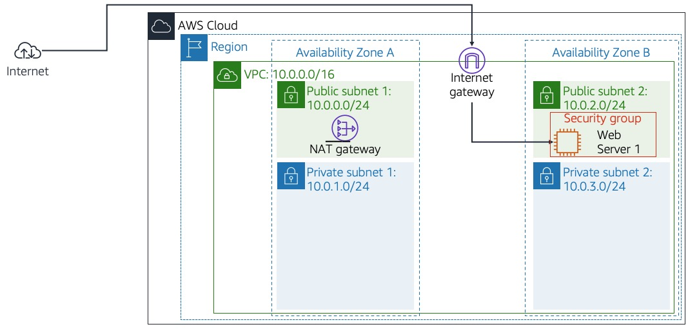

Arquitectura prevista al completar el laboratorio:

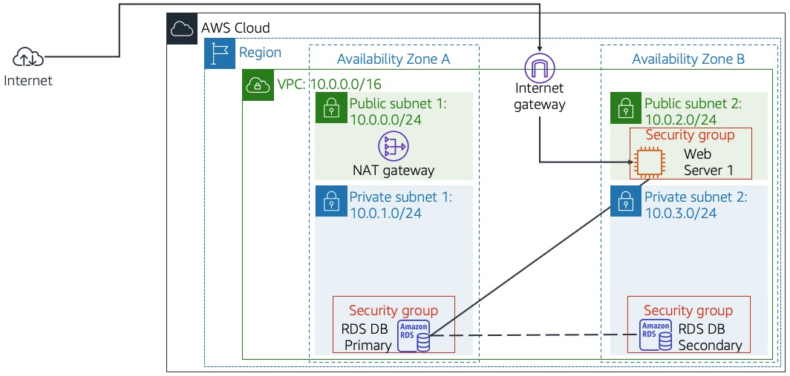

## Procedimiento y evidencias

### Fragmento 1 — Acceso a la Consola de AWS (pasos 1–4)

La guía indica seleccionar **Iniciar laboratorio**, esperar el indicador verde de AWS, abrir la consola y ubicarla junto a las instrucciones. Se debe mantener la región del laboratorio. No se recibieron capturas específicas de este acceso.

### Fragmento 2 — Grupo de seguridad (pasos 5–9)

En **Servicios > VPC > Grupos de seguridad**, se accedió a la lista de grupos y se creó el grupo para la base de datos.

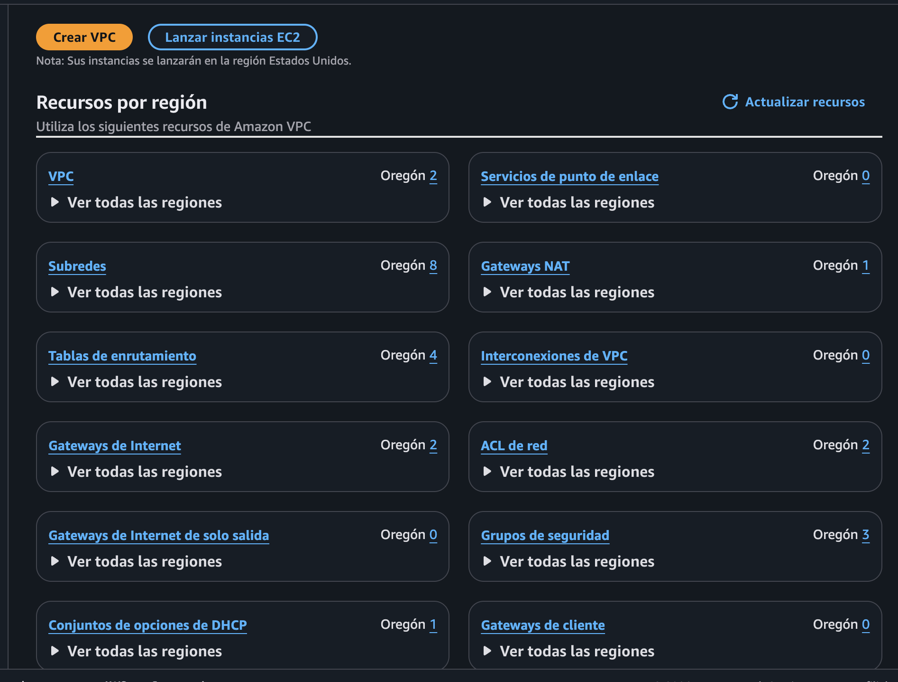

*Evidencia 1: Panel de recursos de Amazon VPC en Oregón.*

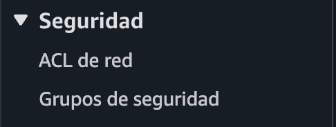

*Evidencia 2: Acceso a Grupos de seguridad desde el menú Seguridad.*

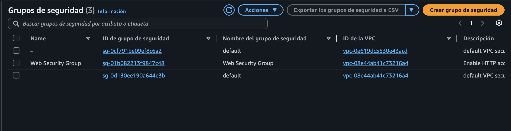

*Evidencia 3: Web Security Group disponible en Lab VPC.*

Se configuraron los siguientes valores:

| Parámetro | Valor |
|---|---|
| Nombre | DB Security Group |
| Descripción | Permit access from Web Security Group |
| VPC | Lab VPC — vpc-08e44ab41c73216a4 |
| Regla entrante | MySQL/Aurora, TCP 3306 |
| Origen | Web Security Group — sg-01b082213f9847c48 |

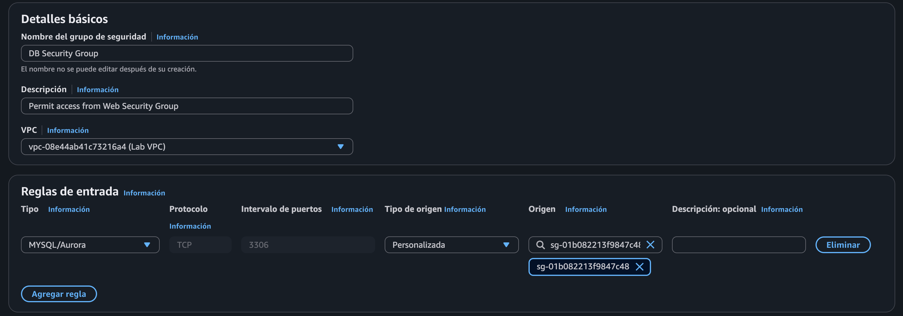

*Evidencia 4: Configuración del grupo y regla TCP 3306 desde el grupo web.*

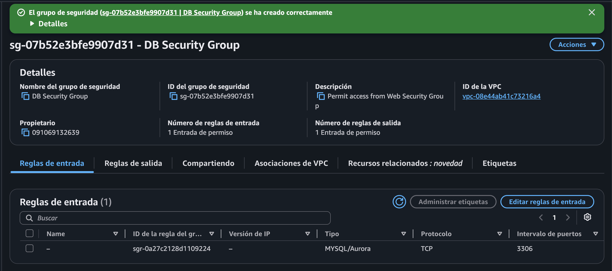

*Evidencia 5: Confirmación de creación de DB Security Group — sg-07b52e3bfe9907d31.*

### Fragmento 2 — Grupo de subredes (pasos 10–15)

En **Servicios > RDS > Grupos de subredes**, se abrió la creación de un grupo de subredes de base de datos.

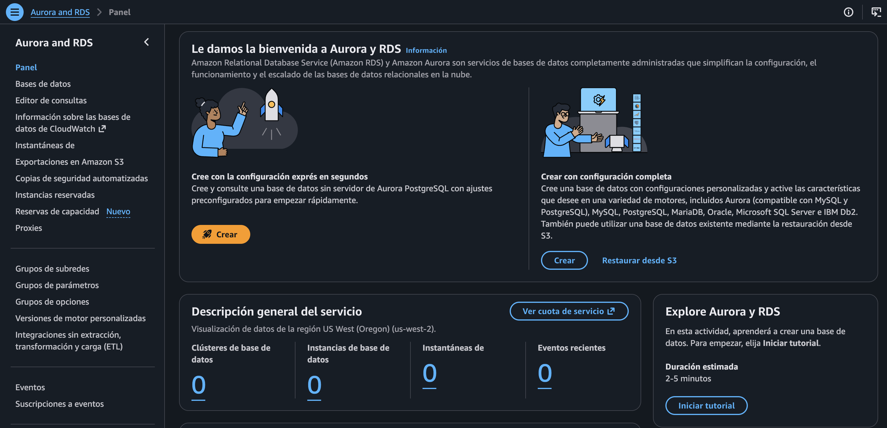

*Evidencia 6: Panel de Aurora y RDS en us-west-2.*

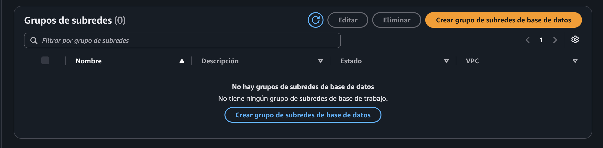

*Evidencia 7: Lista inicial sin grupos de subredes.*

Se ingresó **DB Subnet Group** como nombre y descripción, y se seleccionó **Lab VPC**.

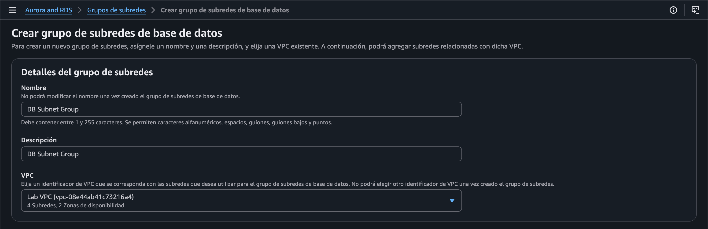

*Evidencia 8: Nombre, descripción y VPC del grupo de subredes.*

Se seleccionaron las zonas **us-west-2a** y **us-west-2b**, con **Private Subnet 1 (10.0.1.0/24)** y **Private Subnet 2 (10.0.3.0/24)**, respectivamente.

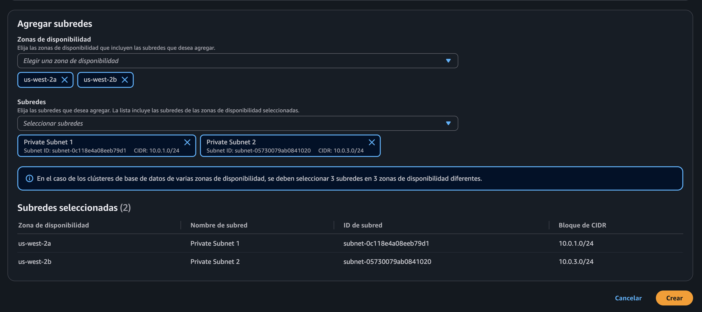

*Evidencia 9: Dos subredes privadas seleccionadas en dos zonas de disponibilidad.*

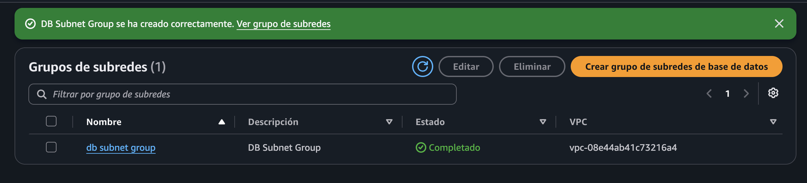

*Evidencia 10: Grupo db subnet group creado con estado Completado.*

### Fragmento 2 — Configuración de Amazon RDS (pasos 16–30)

En **RDS > Bases de datos > Crear base de datos**, se seleccionó **MySQL** y el método **Configuración completa**, correspondiente a la creación estándar indicada en la guía.

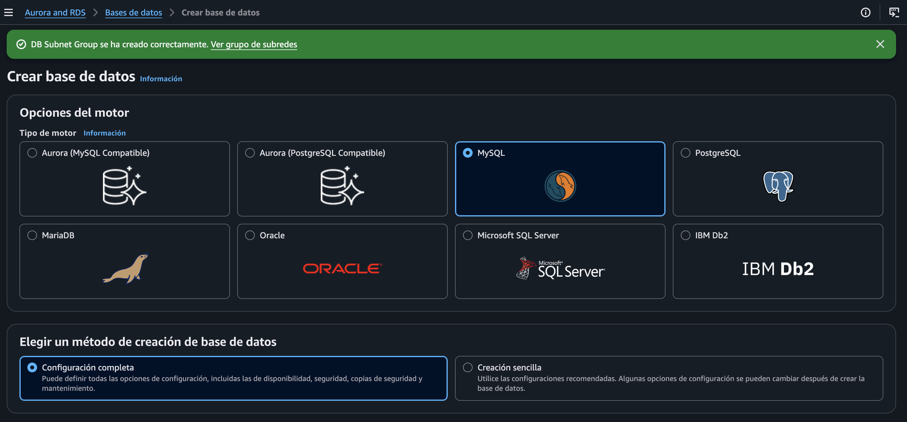

*Evidencia 11: Selección de MySQL y configuración completa.*

Se eligió **Desarrollo y pruebas** y la implementación **Multi-AZ de dos instancias**.

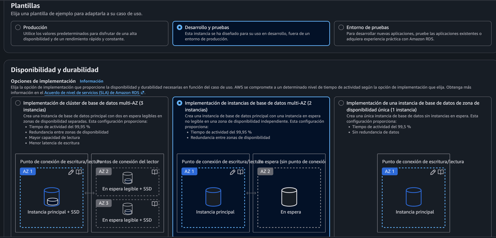

*Evidencia 12: Plantilla de desarrollo y pruebas e implementación Multi-AZ de dos instancias.*

Se configuró la versión **MySQL 8.4.11** y el identificador **lab-db**.

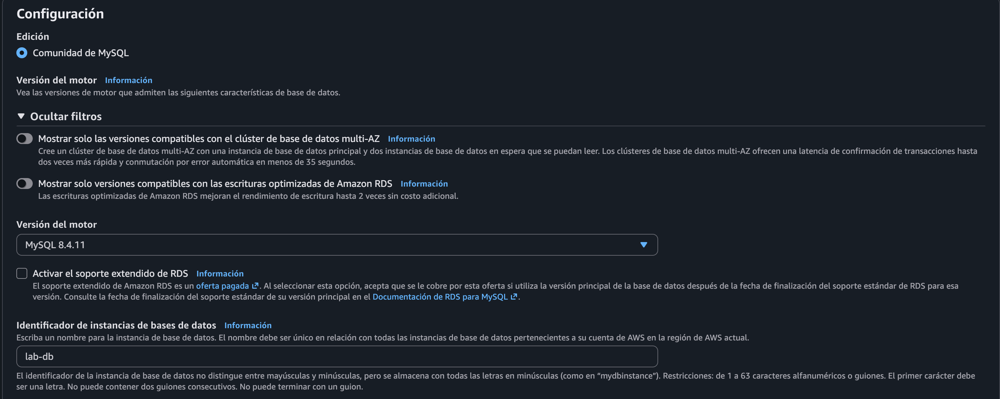

*Evidencia 13: Versión del motor e identificador lab-db.*

Se ingresó el usuario maestro **main**. La secuencia muestra inicialmente la administración mediante Secrets Manager y después el cambio a **Autoadministrado**, con contraseña ingresada y autenticación con contraseña. Los campos de contraseña están ocultos en la evidencia.

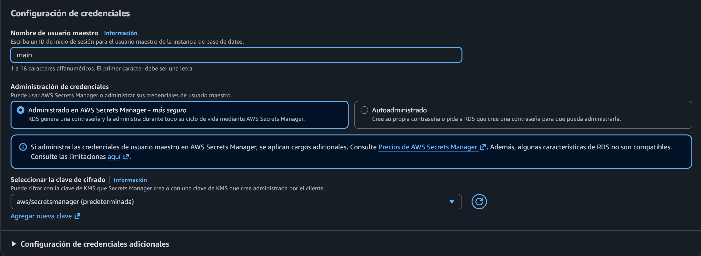

*Evidencia 14: Estado inicial de las credenciales con Secrets Manager seleccionado.*

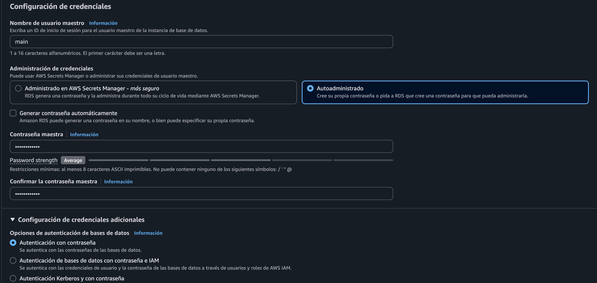

*Evidencia 15: Credenciales autoadministradas y autenticación con contraseña.*

Se seleccionó la clase ampliable **db.t3.medium**.

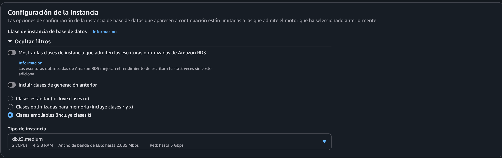

*Evidencia 16: Clase db.t3.medium seleccionada.*

El almacenamiento visible quedó como **SSD de uso general (gp3)**, con **200 GiB**, **3000 IOPS** y **125 MiBps**.

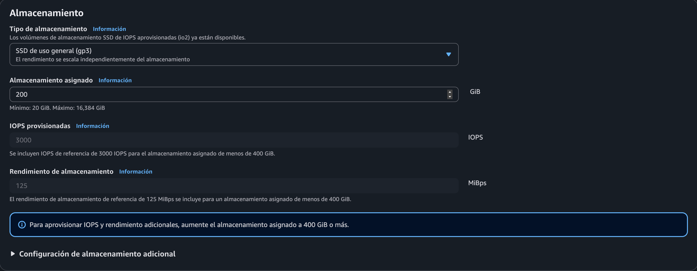

*Evidencia 17: Configuración de almacenamiento gp3.*

En Conectividad se seleccionó **No conectarse a un recurso informático EC2**, **Lab VPC**, **db subnet group** y **Acceso público: No**.

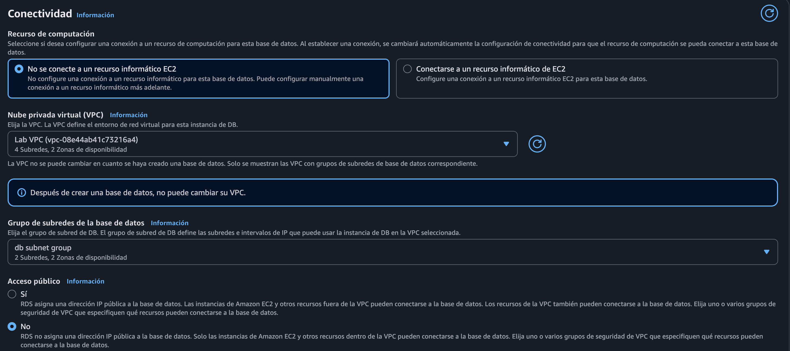

*Evidencia 18: VPC, grupo de subredes y acceso público desactivado.*

Se seleccionó el grupo existente **DB Security Group**. La creación de un proxy de RDS quedó desactivada.

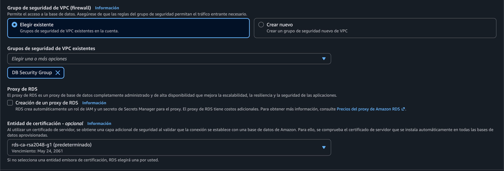

*Evidencia 19: DB Security Group asociado a la configuración de RDS.*

La monitorización mejorada quedó desactivada, sin exportaciones de registros seleccionadas.

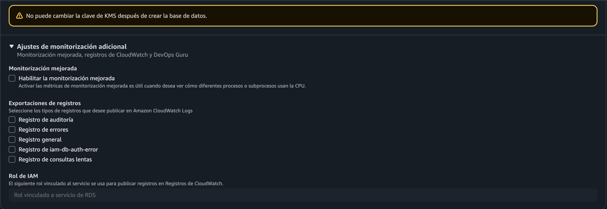

*Evidencia 20: Monitorización mejorada y exportaciones de registros desactivadas.*

Se ingresó **lab** como nombre de base de datos inicial. El cifrado quedó habilitado con la clave **aws/rds**, y los respaldos automáticos quedaron desactivados.

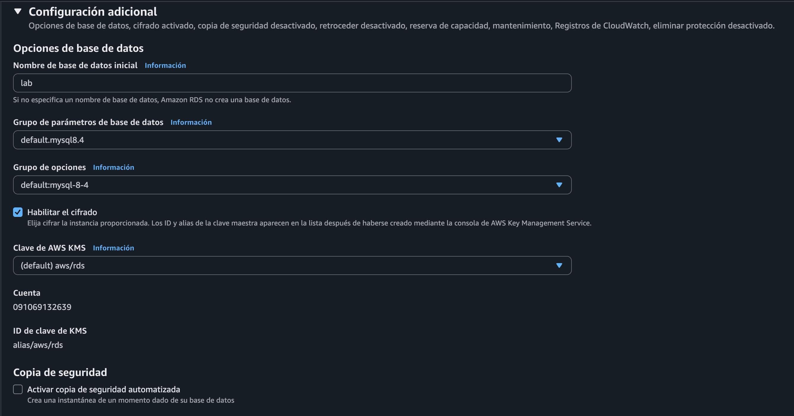

*Evidencia 21: Base de datos inicial lab, cifrado habilitado y respaldos desactivados.*

La actualización automática de versiones secundarias quedó habilitada, el mantenimiento sin preferencia y la protección contra eliminación desactivada.

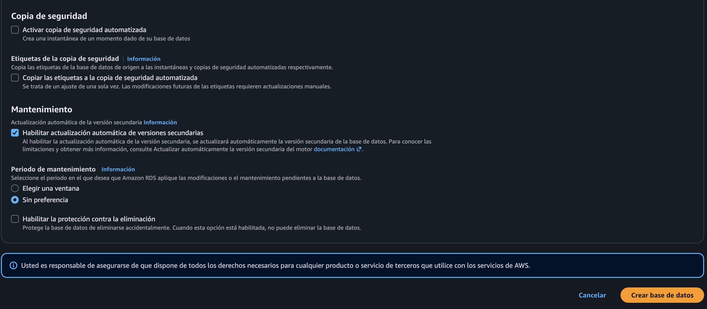

*Evidencia 22: Configuración final de respaldos y mantenimiento antes de crear la base.*

### Fragmento 2 — Intento de creación y bloqueo (pasos 31–35)

Al intentar crear **lab-db**, la consola rechazó la solicitud. La evidencia muestra que el rol del laboratorio no está autorizado para ejecutar `rds:CreateDBInstance`, debido a una **denegación explícita en una política de control de servicios (SCP)**.

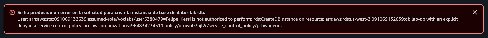

*Evidencia 23: Error de creación de lab-db por denegación explícita en una SCP.*

No se obtuvo evidencia de una instancia creada, del estado Modificando o Disponible ni de un punto de enlace. Los pasos 32–35 no se documentan como realizados.

### Fragmento 3 — Interacción mediante la aplicación (pasos 36–40)

**No realizado**, según lo informado por el estudiante, debido al error de creación de RDS.

La guía indicaba copiar la IP del servidor web desde los detalles de AWS, abrirla en el navegador, seleccionar **RDS** y configurar el punto de enlace, la base **lab** y el usuario **main**, con la contraseña indicada en la guía. Después se debía enviar la configuración y agregar, editar y eliminar contactos en la libreta de direcciones.

No se recibieron evidencias de conexión ni de operaciones con contactos. La imagen de la aplicación enlazada en la guía es una referencia, no una captura de ejecución recibida.

## Validación final

| Validación | Resultado |
|---|---|
| Crear DB Security Group con regla desde el grupo web | Confirmado por capturas |
| Crear grupo con dos subredes privadas en dos zonas | Confirmado por capturas |
| Configurar RDS con Multi-AZ | Configuración visible; creación rechazada |
| Lanzar la instancia con alta disponibilidad | No logrado |
| Verificar conexión del servidor web a RDS | No realizado |
| Agregar, editar y eliminar contactos | No realizado |

## Problema encontrado

- **Síntoma:** error al crear la instancia `lab-db`.
- **Acción rechazada:** `rds:CreateDBInstance`.
- **Causa indicada por AWS:** denegación explícita en una SCP del entorno.
- **Límite del diagnóstico:** la captura no permite determinar qué condición concreta de la configuración activó la restricción.
- **Solución aplicada:** no se informó una solución ni se recibió evidencia de recuperación.
- **Consecuencia:** no se pudo continuar con la interacción de la aplicación con RDS.

## 🧹 Cleanup (Limpieza)

Los pasos 41–42 de la guía indican seleccionar **Finalizar laboratorio**, confirmar con **Sí** y esperar el mensaje de finalización correcta. No se recibió evidencia de que se ejecutara este cierre ni de la eliminación de recursos.

## Fuentes

- Fragmento 1: introducción, objetivos, arquitectura y acceso a la consola (pasos 1–4).
- Fragmento 2: instrucciones pegadas para grupos de seguridad, subredes y creación de RDS (pasos 5–35).
- Fragmento 3: instrucciones de interacción con la aplicación y cierre (pasos 36–42).
- Diagramas de arquitectura y capturas aportados por Felipe Kessi Bustos.

## Pendientes del estudiante

- Resolver el bloqueo de creación de RDS y aportar evidencia si se retoma el laboratorio.
- Completar la interacción con la aplicación si se habilita la creación de la base de datos.
- Confirmar el cierre del laboratorio.

---

**ReCoders® 2026 · Felipe Kessi Bustos**
