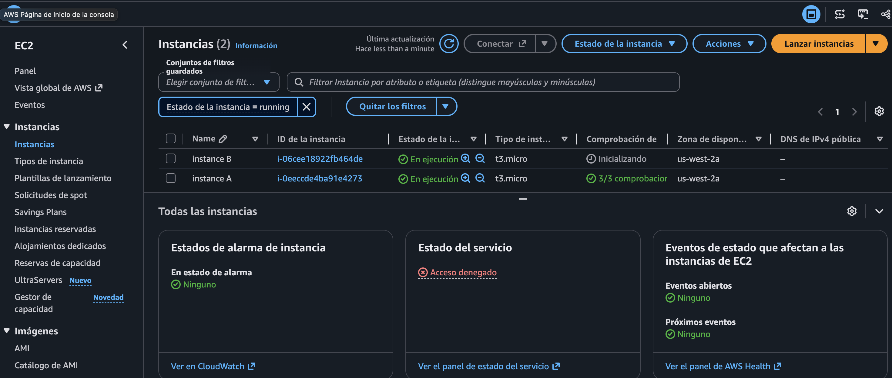
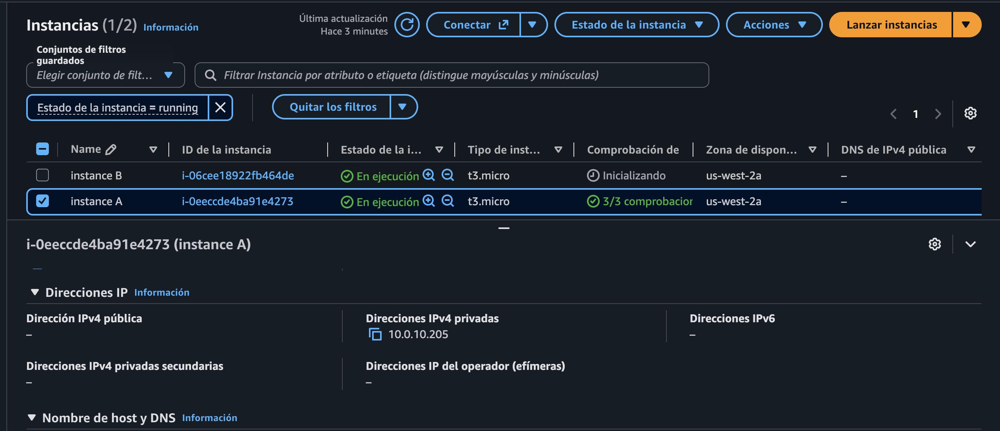
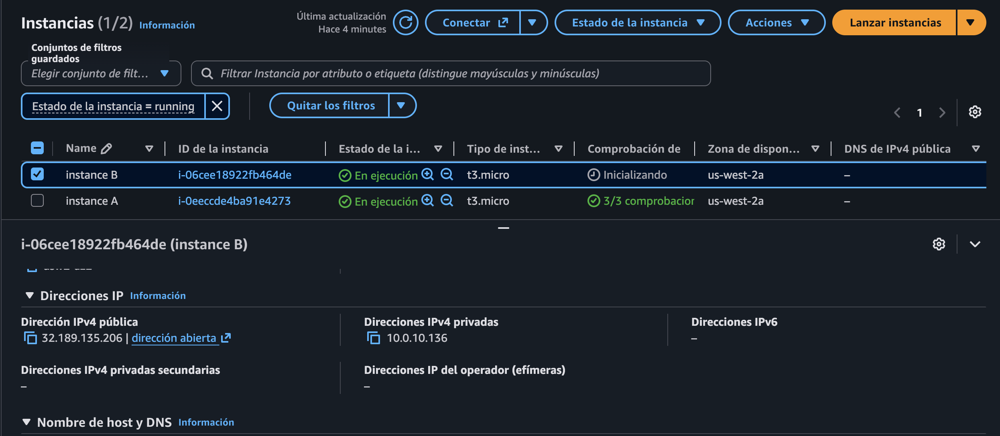
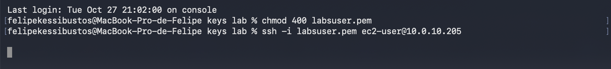
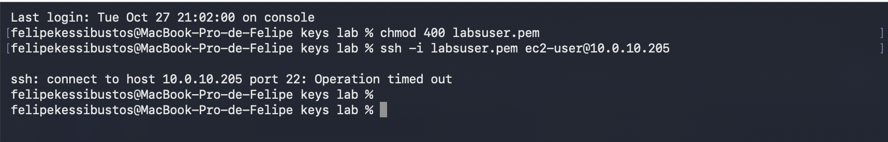
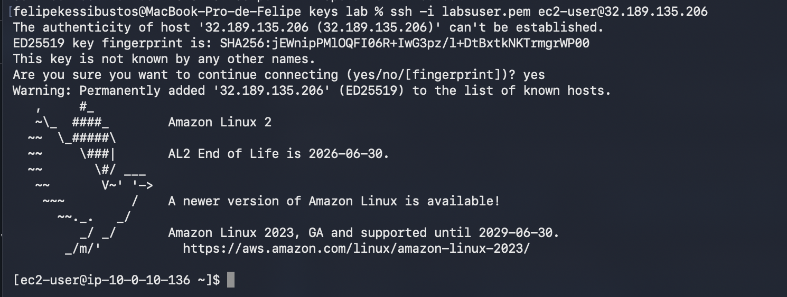

<div align="center">


# 261 — Protocolos de Internet: Direcciones IP públicas y privadas

**ReCoders® 2026**  
**Autor: Felipe Kessi Bustos**
</div>

---

## Ficha del laboratorio

| Campo | Detalle |
|---|---|
| Módulo | Redes |
| Región | us-west-2 |
| Fecha de ejecución registrada | 3 de noviembre de 2026 |
| Duración estimada en la guía | 1 hora |
| Material recibido | Tres fragmentos de instrucciones y seis capturas |
| Alcance verificado | Comparación de IP e intentos de conexión SSH |

> Identidad visual: verde, negro y blanco del logo ReCoders. Tipografías de referencia: Calibri para títulos y Cambria para cuerpo. GitHub controla las fuentes y colores de la visualización Markdown.

## Objetivos

- Resumir e investigar la situación del cliente.
- Analizar las diferencias entre una dirección IP pública y una privada.
- Desarrollar una solución al problema del cliente planteado en este laboratorio.
- Resumir y describir los hallazgos mediante una actividad grupal.

## Situación del cliente

Jess, administradora de la nube de una empresa Fortune 500, solicita asistencia porque la instancia A no puede acceder a Internet y la instancia B sí, pese a tener configuraciones equivalentes en su VPC con CIDR `10.0.0.0/16`. También consulta si utilizar el rango público `12.0.0.0/16` en una nueva VPC podría causar problemas.

La guía indica que el enrutamiento y las conexiones de la arquitectura ya fueron verificados y que el diagnóstico debe comenzar por las instancias EC2.

## Procedimiento realizado y evidencias

### 1. Consultar las instancias de EC2

En la consola de AWS se consultó **EC2 > Instancias**. Se identificaron `instance A` e `instance B`, ambas en ejecución, de tipo `t3.micro` y ubicadas en `us-west-2a`.



*Evidencia 1. La instancia A muestra 3/3 comprobaciones; las comprobaciones de B aparecen inicializándose.*

### 2. Revisar las direcciones IP de la instancia A

Se seleccionó `instance A` y se revisó la sección de direcciones IP de su información de red.

| Dato | Valor observado |
|---|---|
| ID | `i-0eeccde4ba91e4273` |
| IPv4 privada | `10.0.10.205` |
| IPv4 pública | Sin asignar |



*Evidencia 2. El campo de IPv4 pública muestra un guion.*

### 3. Revisar las direcciones IP de la instancia B

Se seleccionó `instance B` y se consultó la misma información.

| Dato | Valor observado |
|---|---|
| ID | `i-06cee18922fb464de` |
| IPv4 privada | `10.0.10.136` |
| IPv4 pública | `32.189.135.206` |



*Evidencia 3. La instancia B tiene una IPv4 pública, a diferencia de la instancia A.*

### 4. Ajustar los permisos de la clave e intentar SSH a la instancia A

Desde la terminal de macOS, en el directorio `keys lab`, se ajustaron los permisos del archivo de clave y se intentó conectar a la IP privada de A:

```bash
chmod 400 labsuser.pem
ssh -i labsuser.pem ec2-user@10.0.10.205
```



*Evidencia 4. Se observa la ejecución de ambos comandos y la espera de respuesta.*

### 5. Registrar el fallo de conexión a la instancia A

El intento terminó con el siguiente mensaje:

```text
ssh: connect to host 10.0.10.205 port 22: Operation timed out
```



*Evidencia 5. No se estableció la sesión SSH con la instancia A.*

### 6. Conectar por SSH a la instancia B

Se utilizó la dirección IPv4 pública de B:

```bash
ssh -i labsuser.pem ec2-user@32.189.135.206
```

Ante la solicitud de confirmación de autenticidad del servidor se escribió `yes`. La conexión se estableció y se mostró la bienvenida de Amazon Linux 2 junto al indicador:

```text
[ec2-user@ip-10-0-10-136 ~]$
```



*Evidencia 6. La sesión remota corresponde a la dirección privada de la instancia B, `10.0.10.136`.*

## Resultados y hallazgos

| Verificación | Resultado |
|---|---|
| Comparar direcciones IP | A solo tiene IPv4 privada; B tiene IPv4 privada y pública |
| SSH a A mediante `10.0.10.205` | Tiempo de espera agotado en el puerto 22 |
| SSH a B mediante `32.189.135.206` | Conexión exitosa |

**¿Fue posible conectarse a ambas instancias por SSH?** No. Se pudo acceder a B utilizando su IP pública; el intento a la IP privada de A agotó el tiempo de espera. Este resultado coincide con la explicación de la guía para el acceso desde fuera de la VPC en este entorno.

La guía identifica la ausencia de una IP pública en A como el problema planteado. No se recibió evidencia de que se le asignara una dirección pública ni de una prueba posterior de conexión a A. La conexión SSH a B verifica el acceso remoto mostrado; no constituye una prueba de navegación o de tráfico saliente desde ambas instancias.

**Consulta sobre `12.0.0.0/16`:** el material recibido señala que utilizar un rango público para la VPC puede generar complicaciones con las respuestas de recursos externos no relacionados. Conforme a ese material, se recomienda utilizar un rango privado. No se recibió evidencia de la investigación adicional en el módulo 4 ni de una prueba con ese CIDR.

## Actividad grupal y cierre

La guía solicita explicar los hallazgos en parejas, con una persona como Jess y otra como ingeniero de soporte. También indica finalizar mediante **End Lab > Yes** y cerrar el panel de confirmación.

No se recibieron capturas ni confirmación de la actividad grupal o de **End Lab**; estas acciones no se documentan como ejecutadas.

## Alcance del registro

Esta documentación se basa únicamente en los fragmentos y capturas proporcionados. La numeración recibida pasa del paso 8 al 17; no se proporcionaron los pasos 9–16. La descarga de la clave PEM y el inicio del laboratorio figuran en las instrucciones, pero no cuentan con evidencia visual propia.

## Recursos incluidos en la guía

- [Direccionamiento IP de las instancias Amazon EC2](https://docs.aws.amazon.com/AWSEC2/latest/UserGuide/using-instance-addressing.html)
- [CIDR de la VPC](https://docs.aws.amazon.com/vpc/latest/userguide/VPC_Subnets.html#add-cidr-block-restrictions)
- [RFC 1918](https://datatracker.ietf.org/doc/html/rfc1918)

---

**ReCoders® 2026 · Felipe Kessi Bustos**
