# 262 Protocolos de Internet direcciones estáticas y dinámicas

**ReCoders® 2026 · Felipe Kessi Bustos**

Módulo: Redes | Región: us-west-2

Felipe Kessi Bustos | ReCoders® 2026

## Situación del cliente

Según la recapitulación del laboratorio, Bob tenía una instancia pública de Amazon EC2 cuya dirección IP pública dinámica cambiaba al detenerla e iniciarla. La solución propuesta fue asociar una dirección IP elástica o Elastic IP para disponer de una dirección pública persistente.

## Objetivos

Resumir la situación del cliente; analizar las diferencias entre direcciones IP estáticas y dinámicas mediante EC2; asignar una IP persistente a una instancia; desarrollar una solución y describir las conclusiones.

## Arquitectura del entorno

El diagrama presenta una VPC con una puerta de enlace de Internet, una subred pública y la Instancia A en la zona de disponibilidad 1.

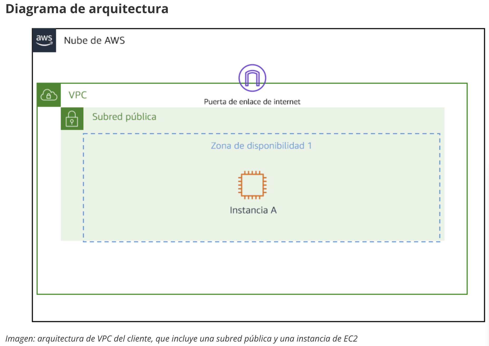

*Diagrama de arquitectura del cliente*

## Paso 1 Configurar la instancia de prueba

En el formulario de lanzamiento se ingresó el nombre test instance y se seleccionó Amazon Linux.

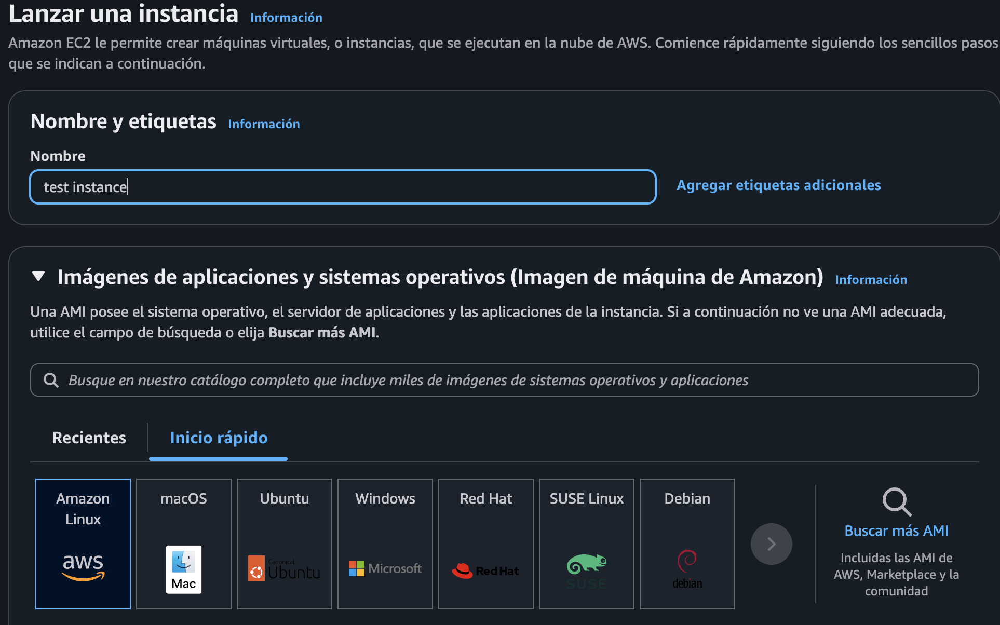

*Evidencia 1 Nombre de la instancia y selección de Amazon Linux*

Se configuró la AMI Amazon Linux 2023 kernel 6.18, arquitectura de 64 bits x86 y tipo de instancia t2.micro. El usuario indicado por la AMI es ec2-user.

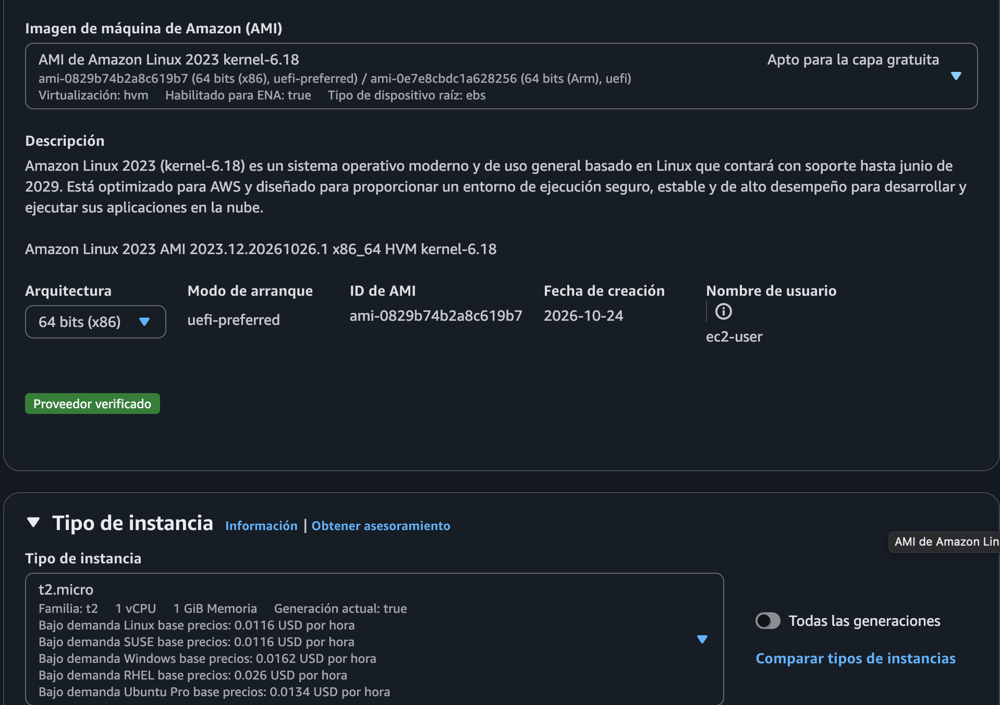

*Evidencia 2 AMI y tipo de instancia*

## Paso 2 Configurar acceso y red

Se seleccionó el par de claves vockey para el inicio de sesión.

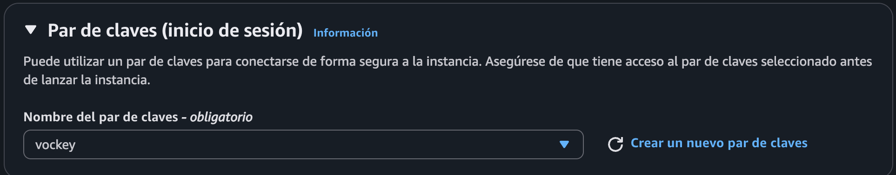

*Evidencia 3 Selección del par de claves vockey*

Se seleccionó Lab VPC con CIDR 10.0.0.0/16 y Public Subnet 1 con CIDR 10.0.10.0/24, en us-west-2a. Se habilitó la asignación automática de IP pública y se eligió el grupo de seguridad existente LinuxInstanceSG, con ID sg-04dccfcbc35649e9b.

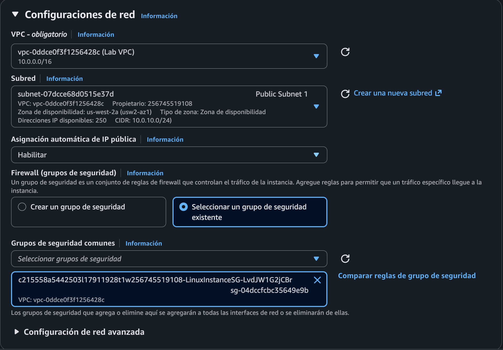

*Evidencia 4 VPC subred IP pública y grupo de seguridad*

## Paso 3 Consultar las direcciones iniciales

La instancia test instance, con ID i-0e36c7654c2f226d5, aparece en ejecución como t2.micro en us-west-2a. Las comprobaciones todavía estaban inicializando.

Se observó la dirección IPv4 pública 54.218.184.14 y la dirección IPv4 privada 10.0.10.221. El DNS público mostrado fue ec2-54-218-184-14.us-west-2.compute.amazonaws.com.

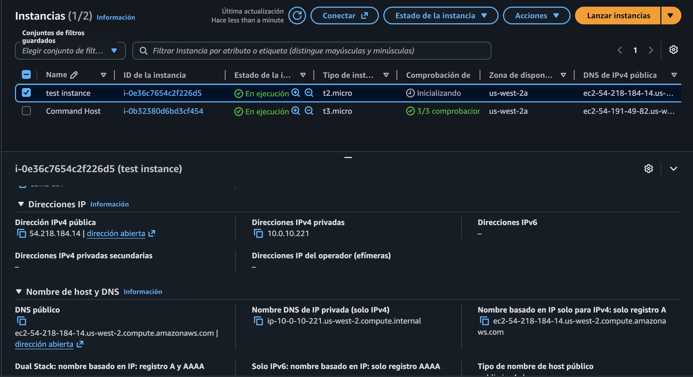

*Evidencia 5 Direcciones iniciales de la instancia*

## Paso 4 Reservar una dirección IP elástica

En Asignar dirección IP elástica se seleccionó el grupo de direcciones IPv4 de Amazon y el grupo fronterizo de red us-west-2.

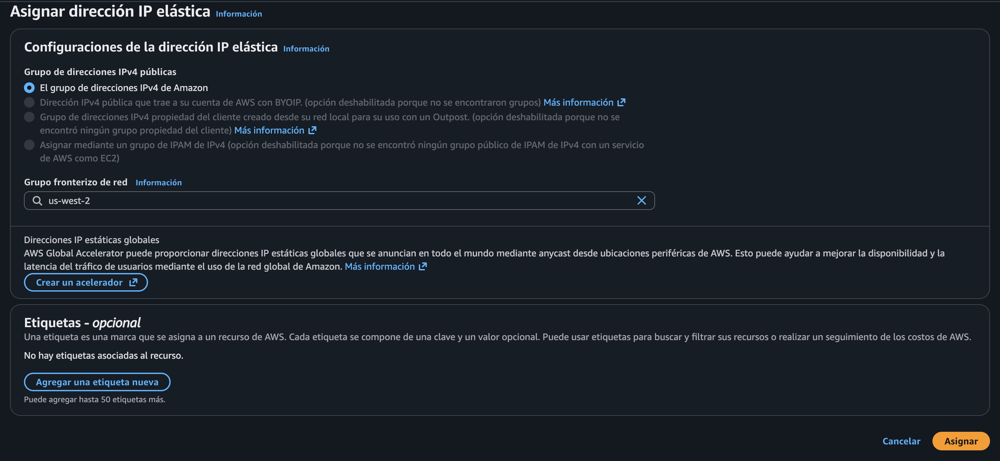

*Evidencia 6 Configuración de la reserva de Elastic IP*

## Paso 5 Consultar la Elastic IP reservada

El listado de direcciones IP elásticas mostró 32.187.207.184, con ID de asignación eipalloc-0d0ab20e58488210f.

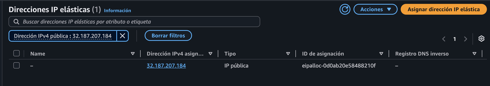

*Evidencia 7 Elastic IP reservada*

## Paso 6 Preparar la asociación con la instancia

Se abrió el formulario de asociación de la Elastic IP 32.187.207.184 y se mantuvo seleccionado el tipo de recurso Instancia.

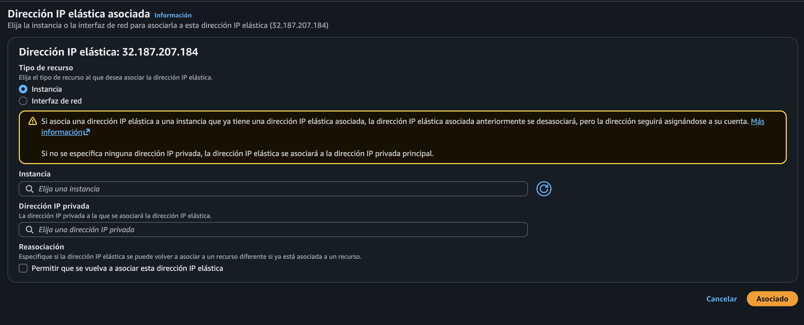

*Evidencia 8 Formulario de asociación de Elastic IP*

Luego se ingresó el ID i-0e36c7654c2f226d5 en el campo Instancia. El campo de IP privada quedó vacío y la opción de reasociación permaneció desmarcada. El formulario indica que, sin especificar una IP privada, se utiliza la dirección privada principal.

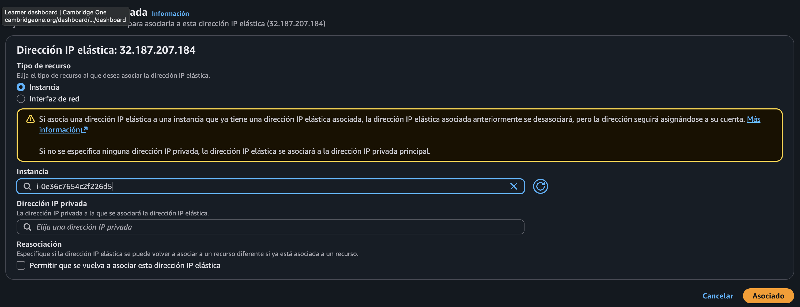

*Evidencia 9 ID de la instancia ingresado para la asociación*

## Paso 7 Comparar las direcciones observadas

La captura posterior muestra la misma instancia en ejecución con una IPv4 pública diferente, 44.243.115.33. La IPv4 privada se mantiene en 10.0.10.221. El DNS público también cambia y pasa a ec2-44-243-115-33.us-west-2.compute.amazonaws.com.

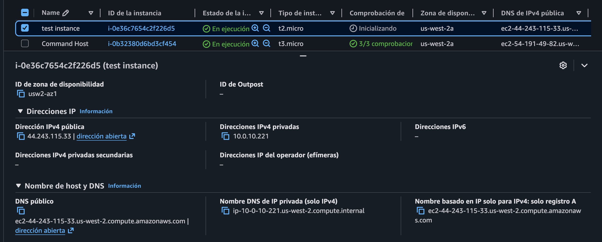

*Evidencia 10 Nueva IP pública y conservación de la IP privada*

La comparación documenta un cambio de IP pública de 54.218.184.14 a 44.243.115.33. Las capturas no muestran el ciclo de detención e inicio ni una sesión SSH. La última IP pública tampoco coincide con la Elastic IP reservada, por lo que no acredita la asociación exitosa ni su persistencia.

## Diferencia entre asignación dinámica y estática

En la situación descrita por la guía, la IP pública dinámica cambia cuando la instancia se detiene y se vuelve a iniciar. La Elastic IP es la alternativa propuesta para mantener una dirección pública persistente. En las evidencias, la IP pública cambia mientras la privada permanece igual; reservar la EIP y preparar su asociación no constituye todavía una validación de persistencia.

## Solución y conclusiones para el cliente

Bob, el problema descrito corresponde al cambio de la dirección IP pública dinámica de su instancia al detenerla e iniciarla. La solución propuesta es asociar una Elastic IP a la instancia para utilizar una dirección pública persistente.

En la ejecución documentada se creó la instancia de prueba, se observaron dos direcciones públicas distintas y se reservó la Elastic IP 32.187.207.184. También se preparó su asociación con la instancia. Para declarar la solución validada falta confirmar la asociación y comprobar que la misma EIP permanezca después de detener e iniciar la instancia.

## Tarea 2 Comunicar las conclusiones

La guía propone una actividad grupal de 5 a 10 minutos: la persona 1 representa a Bob y la persona 2 al ingeniero de soporte en la nube. El ingeniero explica sus conclusiones al cliente y posteriormente a la clase. No se aportó evidencia de la realización de esta actividad.

## Finalización del laboratorio

Los pasos 16 y 17 de la guía indican seleccionar End Lab, confirmar con Yes y cerrar el panel con X cuando aparezca el mensaje de eliminación iniciada. No se aportó una captura de este cierre.

## Recursos adicionales de la guía

Direccionamiento IP público de la instancia Amazon EC2: https://docs.aws.amazon.com/AWSEC2/latest/UserGuide/using-instance-addressing.html

Elastic IP: https://docs.aws.amazon.com/AWSEC2/latest/UserGuide/elastic-ip-addresses-eip.html