<div align="center">


# 264 Creación de recursos de redes en una Amazon Virtual Private Cloud

**ReCoders® 2026**  
**Autor: Felipe Kessi Bustos**  
Módulo: Redes · Región: `us-west-2` · Duración indicada: 60 minutos

</div>

## Objetivos del laboratorio

- Resumir la situación del cliente.
- Crear una VPC, una puerta de enlace de Internet, una tabla de enrutamiento, un grupo de seguridad, una lista de control de acceso a la red y una instancia EC2 para disponer de una red enrutable dentro de la VPC.
- Familiarizarse con la consola de AWS.
- Desarrollar una solución al problema del cliente.

El criterio de finalización es ejecutar correctamente un ping desde la instancia EC2 hacia Internet. Las capturas documentan la creación de recursos y una instancia en ejecución; la validación mediante SSH y ping no aparece en las evidencias recibidas.

## Situación del cliente

Brock, propietario de una startup, solicita asistencia porque su VPC no tiene la conectividad que necesita para hacer ping hacia Internet. El laboratorio plantea atender su solicitud desde el rol de ingeniero de soporte en la nube de AWS.

La arquitectura de referencia muestra una VPC con CIDR `192.168.0.0/18`, una puerta de enlace de Internet y una subred pública `192.168.1.0/26` en una zona de disponibilidad. Dentro de la subred se encuentra una instancia de prueba protegida por un grupo de seguridad.

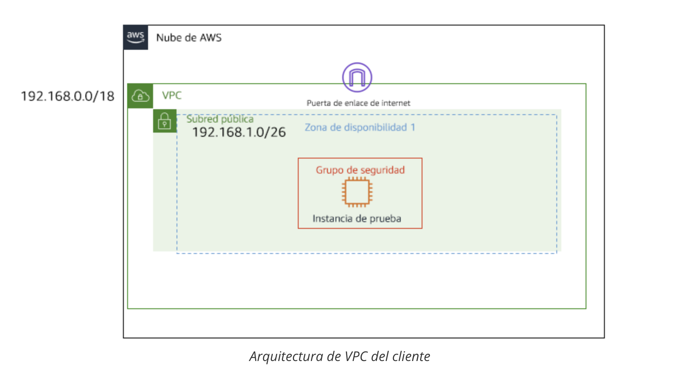

*Figura 1. Arquitectura proporcionada por la guía del laboratorio.*

## Acceso al entorno

La guía indica iniciar el entorno con **Start Lab**, esperar **Lab status: ready**, cerrar el panel y seleccionar **AWS** para abrir la consola con la sesión iniciada automáticamente. Si el navegador bloquea la nueva pestaña, se deben permitir las ventanas emergentes.

Se accedió a la página de inicio de la consola de AWS. La captura muestra que todavía no había servicios visitados recientemente.

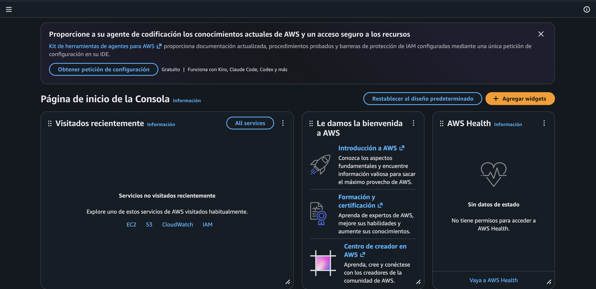

*Figura 2. Consola de administración de AWS.*

La guía permite acceder a **VPC** desde los servicios recientes, la búsqueda de servicios o **Networking and Content Delivery**. En **Sus VPC** se observó la VPC predeterminada `vpc-01130f2e6a48ff384`, con CIDR `172.31.0.0/16`, y el botón **Crear VPC**.

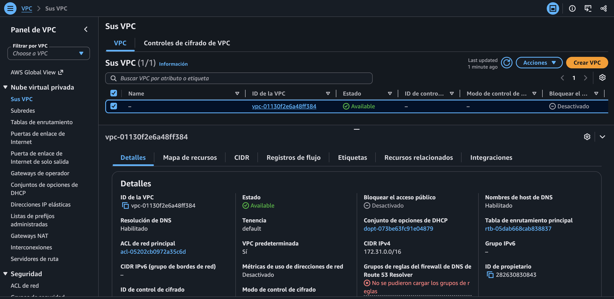

*Figura 3. Pantalla Sus VPC antes de crear Test VPC.*

El entorno del laboratorio puede restringir productos y acciones a los necesarios para su ejecución, según las instrucciones recibidas.

## Tarea 1 Investigar las necesidades del cliente y crear los recursos

La guía propone trabajar desde **Sus VPC** hacia abajo en el panel de navegación, creando los componentes de la red en orden. La solución planteada requiere una VPC, una subred, una puerta de enlace de Internet, una tabla de enrutamiento y controles de tráfico para la instancia.

### Paso 1 Crear Test VPC

En **Sus VPC > Crear VPC**, la configuración indicada fue:

| Parámetro | Valor indicado |
| --- | --- |
| Nombre | `Test VPC` |
| CIDR IPv4 | `192.168.0.0/18` |
| Otros parámetros | Valores predeterminados |

La consola confirmó la creación de **Test VPC**, ID `vpc-0b3c9533729b06171`, en estado **Available**, con CIDR `192.168.0.0/18`.

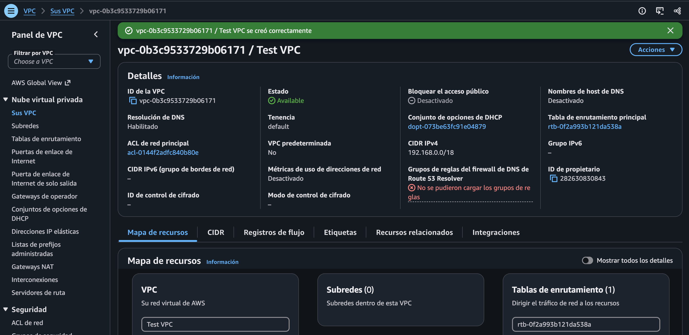

*Figura 4. Confirmación de creación y detalles de Test VPC.*

La captura también muestra resolución DNS habilitada, nombres de host DNS desactivados, tabla principal `rtb-0f2a993b121da538a` y ACL principal `acl-0144f2adfc840b80e`. Aparece un aviso de que no se pudieron cargar los grupos de reglas del firewall DNS de Route 53 Resolver.

### Paso 2 Crear la subred pública

La guía indica seleccionar **Subredes > Crear subred**, elegir **Test VPC**, asignar el nombre **Public subnet** y mantener **Sin preferencia** para la zona de disponibilidad.

**Diferencia entre las instrucciones:** la situación y el diagrama inicial solicitan `192.168.1.0/26`, mientras que el paso de creación indica `192.168.1.0/28`. La subred efectivamente creada en las capturas utiliza `/28`.

La consola confirmó la creación de **public subnet**, ID `subnet-0a9cd5139704b0cc5`, dentro de Test VPC, con estos valores:

| Parámetro | Valor observado |
| --- | --- |
| CIDR IPv4 | `192.168.1.0/28` |
| Estado | Available |
| Zona de disponibilidad | `us-west-2b` (`usw2-az2`) |
| IPv4 disponibles | 11 |
| Asignación automática de IPv4 pública | No |

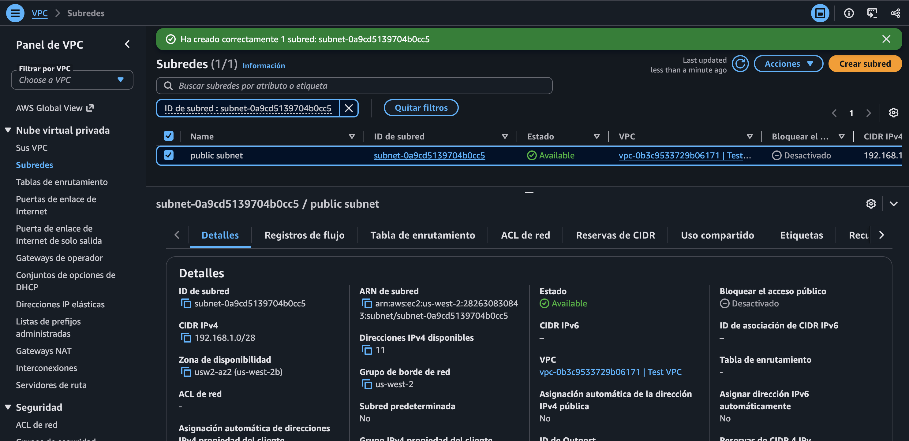

*Figura 5. Confirmación de creación de public subnet con CIDR /28.*

También se recibieron dos capturas del formulario de creación. Muestran **Test VPC** seleccionada y **Sin preferencia** para la zona. Los campos de nombre y CIDR contienen texto de ejemplo; no documentan una segunda subred creada.

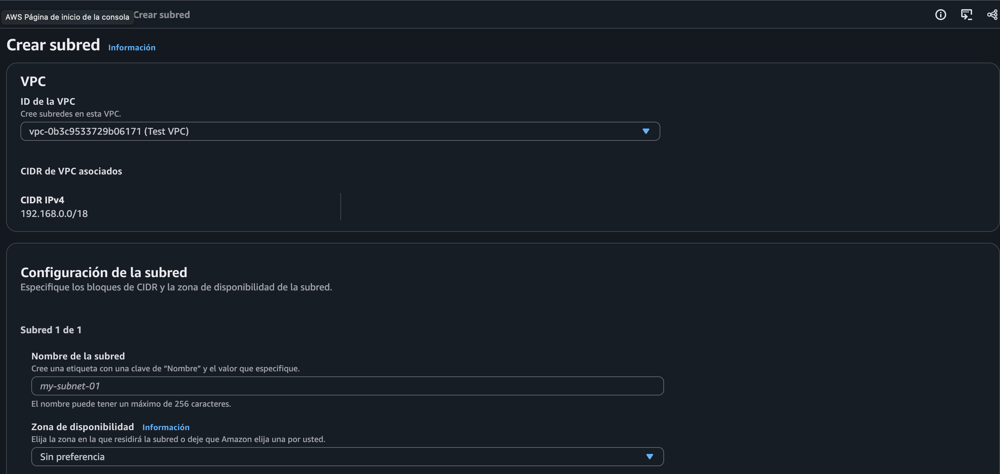

*Figura 6. Selección de VPC en el formulario de subred.*

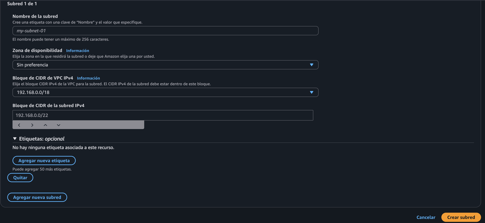

*Figura 7. Campos del formulario de subred; el texto de ejemplo no sustituye el CIDR /28 confirmado.*

### Paso 3 Crear la tabla de enrutamiento pública

En **Tablas de enrutamiento > Crear tabla de enrutamiento**, se ingresó **public route table** y se seleccionó **Test VPC**.

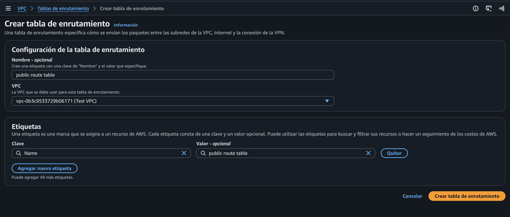

*Figura 8. Configuración de public route table.*

La consola confirmó la creación de `rtb-02ebedbe8249b45ae`. La tabla no era principal, no mostraba asociaciones explícitas de subred y contenía inicialmente la ruta activa `192.168.0.0/18 → local`.

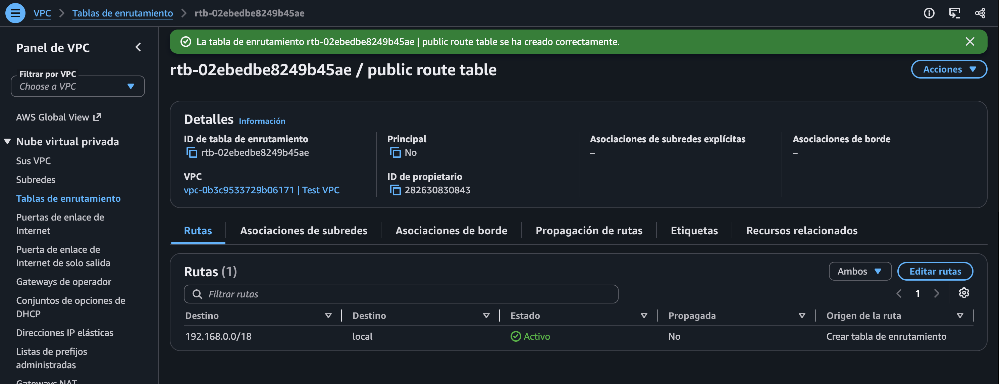

*Figura 9. Tabla pública creada con la ruta local de la VPC.*

### Paso 4 Crear y conectar la puerta de enlace de Internet

La guía indica acceder a **Gateways de Internet > Crear gateway de Internet**, asignar el nombre **IGW test VPC**, conservar el resto de los parámetros y crear el recurso. Después, se debe seleccionar **Acciones > Conectar a la VPC** y elegir Test VPC.

La siguiente captura muestra el formulario de creación con el campo de nombre todavía sin completar.

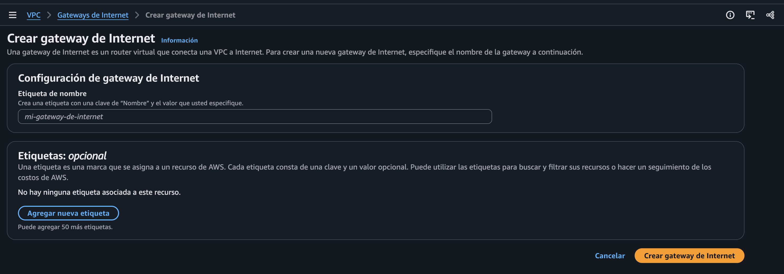

*Figura 10. Formulario de creación de una gateway de Internet.*

La confirmación de creación identifica el recurso como **IGW VPC Test**, ID `igw-015f36d01887462e7`. En esta pantalla aún no se había seleccionado una VPC para conectarla.

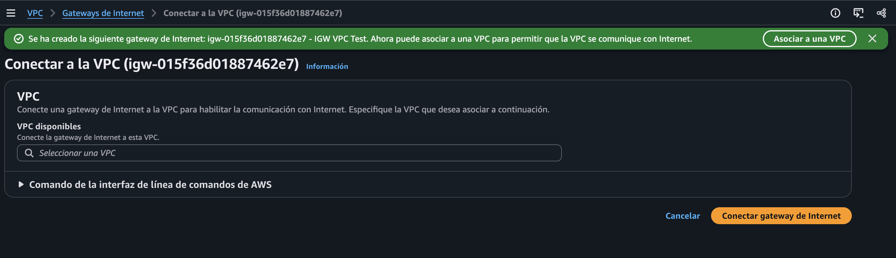

*Figura 11. IGW creada y formulario de conexión a una VPC.*

La captura posterior confirma que la IGW se conectó correctamente a **Test VPC**, ID `vpc-0b3c9533729b06171`, y quedó en estado **Attached**.

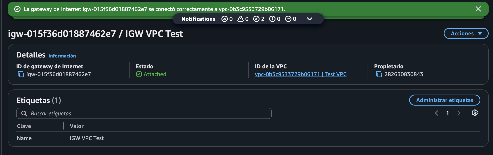

*Figura 12. Puerta de enlace de Internet conectada a Test VPC.*

### Paso 5 Agregar la ruta hacia Internet

Se seleccionó **public route table** y se consultó la pestaña **Rutas**. Antes de la modificación sólo aparecía la ruta local.

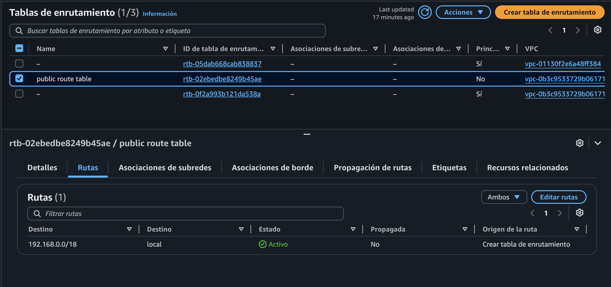

*Figura 13. Ruta local antes de agregar la salida hacia Internet.*

Se abrió **Editar rutas**. La guía indica seleccionar **Agregar ruta**, ingresar el destino `0.0.0.0/0`, elegir **Internet Gateway** como objetivo, seleccionar la IGW creada y guardar los cambios.

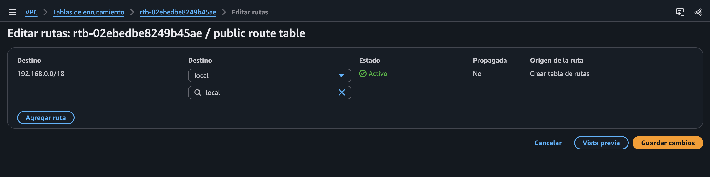

*Figura 14. Edición de las rutas de la tabla pública.*

La consola confirmó la actualización correcta. Quedaron visibles dos rutas activas:

| Destino | Objetivo | Estado |
| --- | --- | --- |
| `0.0.0.0/0` | `igw-015f36d01887462e7` | Activo |
| `192.168.0.0/18` | `local` | Activo |

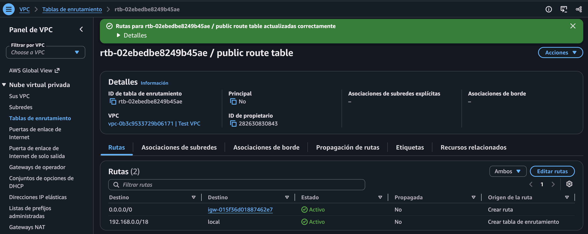

*Figura 15. Ruta hacia la IGW agregada correctamente.*

### Paso 6 Seleccionar la asociación de la subred

La guía indica abrir **Asociaciones de subredes > Editar asociaciones de subred**, seleccionar la subred pública y presionar **Guardar asociaciones**.

La captura muestra **public subnet**, ID `subnet-0a9cd5139704b0cc5`, CIDR `192.168.1.0/28`, seleccionada para la asociación. Aún aparece su tabla principal anterior y está visible el botón para guardar. No se recibió una confirmación posterior del guardado.

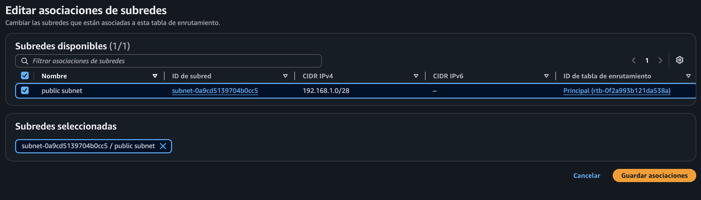

*Figura 16. Subred pública seleccionada para asociarla a la tabla pública.*

### Paso 7 Preparar la ACL de red

La guía solicita crear una ACL desde **ACL de red > Crear ACL de red**, con nombre **Public Subnet NACL** y VPC **Test VPC**. En pasos posteriores se refiere al recurso como **Public Subnet ACL**.

Las dos capturas del formulario muestran el nombre y la VPC sin completar. No permiten confirmar la creación ni identificar el ID de una nueva ACL.

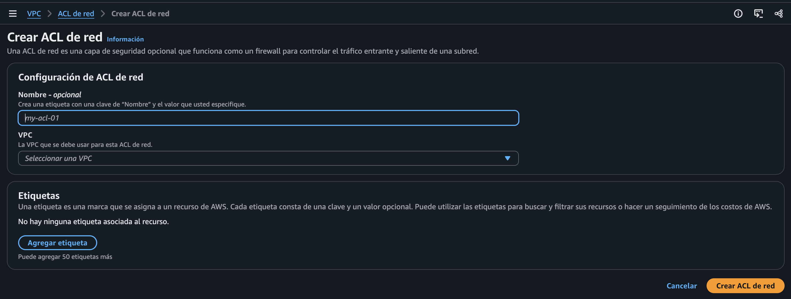

*Figura 17. Formulario de creación de ACL de red.*

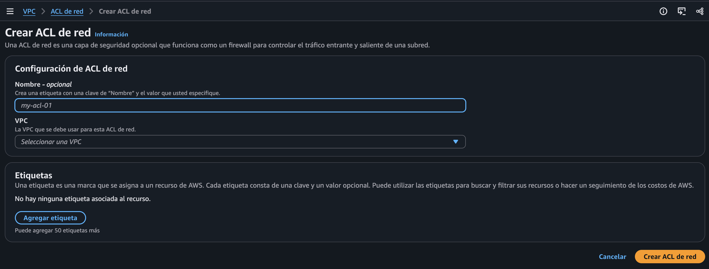

*Figura 18. Formulario de ACL todavía sin VPC seleccionada.*

Para entrada y salida, las instrucciones solicitan agregar una regla **100**, de tipo **Todo el tráfico**, permitiendo tráfico desde o hacia `0.0.0.0/0`, y guardar los cambios en cada dirección.

La captura de **Editar reglas de entrada** muestra la siguiente configuración:

| Regla | Tipo | Protocolos y puertos | Origen | Acción |
| --- | --- | --- | --- | --- |
| `100` | Todo el tráfico | Todos | `0.0.0.0/0` | Permitir |
| `*` | Todo el tráfico | Todos | `0.0.0.0/0` | Denegar |

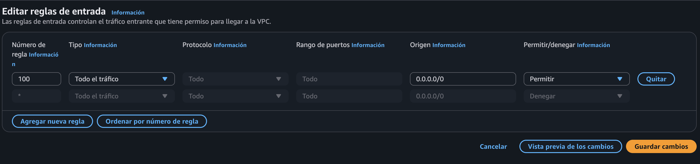

*Figura 19. Regla de entrada 100 en edición.*

La imagen no muestra el ID de la ACL ni una confirmación de guardado. No se recibieron capturas de las reglas de salida ni de la asociación de la nueva ACL a la subred.

### Paso 8 Crear el grupo de seguridad

Se accedió a **Grupos de seguridad**. El listado inicial mostraba los grupos predeterminados de las dos VPC.

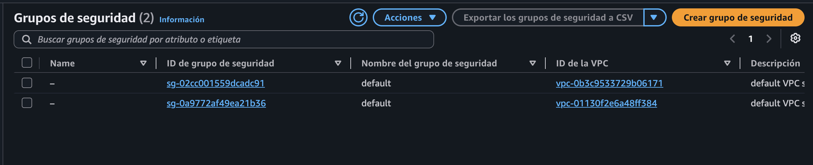

*Figura 20. Grupos predeterminados antes de crear el grupo público.*

En **Crear grupo de seguridad**, se configuraron estos valores:

| Parámetro | Valor observado |
| --- | --- |
| Nombre | `public security group` |
| Descripción | `allow public access` |
| VPC | `vpc-0b3c9533729b06171` — Test VPC |

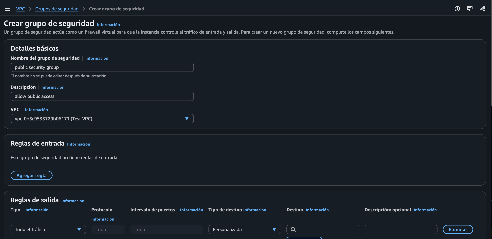

*Figura 21. Detalles básicos del grupo de seguridad.*

La configuración de salida permite **Todo el tráfico** con destino `0.0.0.0/0`.

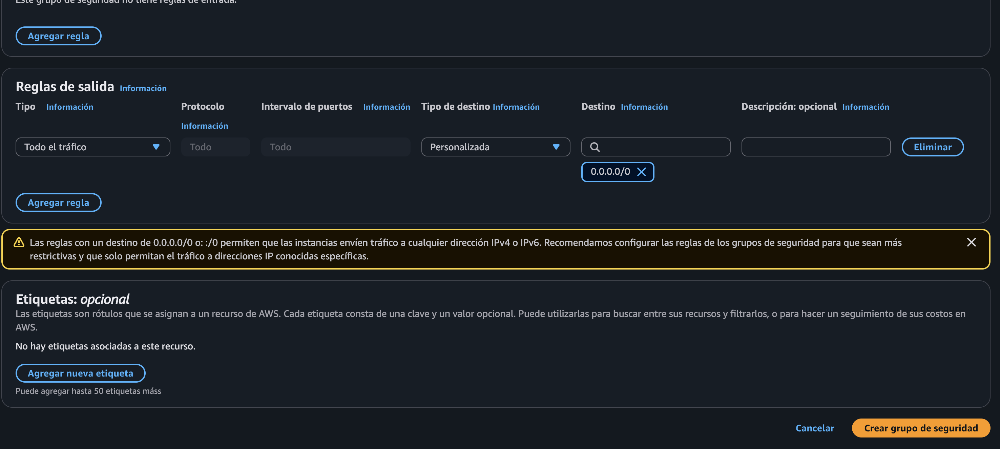

*Figura 22. Regla de salida configurada en el formulario.*

La consola confirmó la creación de **public security group**, ID `sg-00cc02a877a950f82`, con **0 reglas de entrada** y **1 regla de salida**.

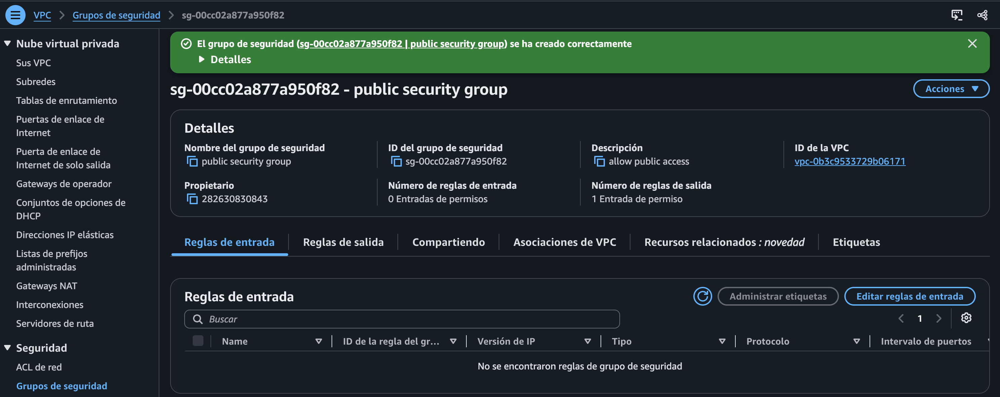

*Figura 23. Grupo creado sin reglas de entrada.*

La guía describe reglas de entrada SSH, HTTP y HTTPS desde cualquier lugar. Estas reglas no aparecen configuradas en la confirmación recibida y, por tanto, no se registran como realizadas.

## Tarea 2 Lanzar la instancia EC2

### Paso 9 Lanzar la instancia de prueba

La guía indica acceder a **EC2 > Instancias > Lanzar instancias** y configurar:

| Parámetro | Valor indicado por la guía |
| --- | --- |
| Nombre | Dejar en blanco |
| Quick Start | Amazon Linux |
| AMI | Amazon Linux 2023 AMI |
| Tipo de instancia | `t3.micro` |
| Par de claves | `vockey` |
| VPC | Test VPC |
| Subred | Public Subnet |
| Asignación automática de IP pública | Habilitar |
| Firewall | Seleccionar grupo existente |
| Grupo de seguridad | public security group |

La captura confirma que se inició correctamente el lanzamiento de la instancia `i-06dbb12232d5be963`.

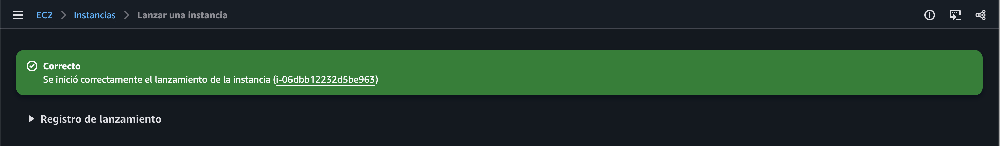

*Figura 24. Lanzamiento de la instancia iniciado correctamente.*

El listado posterior muestra la instancia **En ejecución**, de tipo `t3.micro`, en `us-west-2b`, con comprobaciones **Inicializando** y sin nombre visible. El campo de DNS de IPv4 pública aparece como `—`.

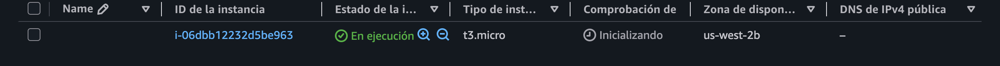

*Figura 25. Instancia EC2 en ejecución mientras se inicializan las comprobaciones.*

Estas capturas no muestran la AMI, la clave, la dirección IPv4 pública, la subred ni el grupo de seguridad asociado a la instancia.

### Paso 10 Conexión SSH indicada para macOS y Linux

Los pasos 45 a 52 de la guía indican:

1. Abrir **Details > Show** para consultar **Credentials**.
2. Seleccionar **Download PEM** y guardar `labsuser.pem`.
3. Anotar la dirección **PublicIP** y cerrar el panel.
4. Abrir Terminal y cambiar al directorio donde se descargó la clave. El ejemplo proporcionado es:

   ```bash
   cd ~/Downloads
   ```

5. Restringir los permisos de la clave:

   ```bash
   chmod 400 labsuser.pem
   ```

6. Conectarse reemplazando `<public-ip>` por la dirección anotada:

   ```bash
   ssh -i labsuser.pem ec2-user@<public-ip>
   ```

7. Escribir `yes` al aceptar la primera conexión. La guía indica que la autenticación se realiza mediante el par de claves.

No se recibió una captura de la descarga de la clave ni de una sesión SSH establecida.

## Tarea 3 Probar la conectividad a Internet

### Paso 11 Ejecutar ping

El paso 53 solicita ejecutar desde la instancia:

```bash
ping google.com
```

El resultado esperado descrito por la guía es recibir respuestas de `google.com` y obtener un **0 % de pérdida de paquetes**. No se recibió una captura de la ejecución ni de sus estadísticas, por lo que la conectividad hacia Internet queda pendiente de validación.

### Paso 12 Finalizar el laboratorio

Los pasos 54 y 55 indican seleccionar **End Lab**, confirmar con **Yes** y cerrar el panel cuando aparezca el mensaje **You may close this message box now. Lab resources are terminating...**.

No se recibió evidencia del cierre del entorno.

## Resultado documentado

| Componente o validación | Resultado observado |
| --- | --- |
| Test VPC | Creada con CIDR `192.168.0.0/18` |
| public subnet | Creada con CIDR `192.168.1.0/28` en `us-west-2b` |
| public route table | Creada con ruta local y ruta predeterminada activas |
| IGW VPC Test | Conectada a Test VPC |
| Asociación de subred con tabla pública | Selección visible; sin confirmación de guardado |
| NACL | Regla de entrada en edición; sin confirmación de creación, guardado, salida o asociación |
| public security group | Creado con 0 reglas de entrada y 1 de salida |
| Instancia EC2 | En ejecución como `t3.micro` |
| Conexión SSH | Sin evidencia recibida |
| Ping hacia Internet | Sin evidencia recibida |
| Cierre del laboratorio | Sin evidencia recibida |

La ejecución documentada avanzó en la creación de los recursos de red y el lanzamiento de EC2. El criterio de finalización del laboratorio, un ping exitoso hacia Internet, no queda acreditado por las capturas disponibles.

## Recursos adicionales proporcionados por la guía

- [¿Qué es Amazon VPC?](https://docs.aws.amazon.com/vpc/latest/userguide/what-is-amazon-vpc.html)
- [Direccionamiento IP en su VPC](https://docs.aws.amazon.com/vpc/latest/userguide/vpc-ip-addressing.html)
- [Tablas de enrutamiento para su VPC](https://docs.aws.amazon.com/vpc/latest/userguide/VPC_Route_Tables.html)
- [Puertas de enlace de Internet](https://docs.aws.amazon.com/vpc/latest/userguide/VPC_Internet_Gateway.html)
- [ACL de red](https://docs.aws.amazon.com/vpc/latest/userguide/vpc-network-acls.html#nacl-rules)
- [Grupos de seguridad](https://docs.aws.amazon.com/vpc/latest/userguide/VPC_SecurityGroups.html#VPCSecurityGroups)

**Felipe Kessi Bustos · ReCoders® 2026**
