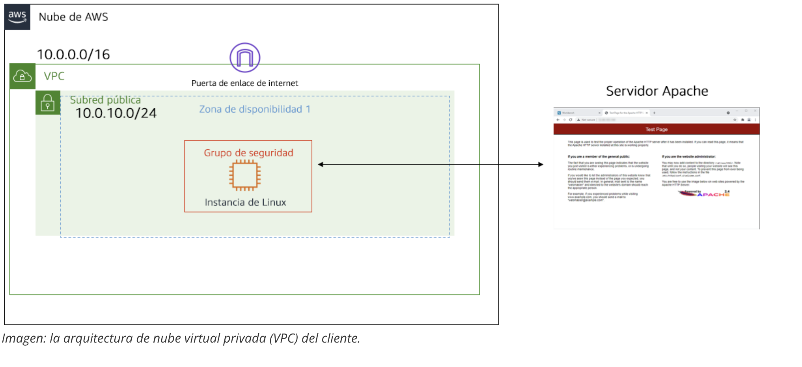
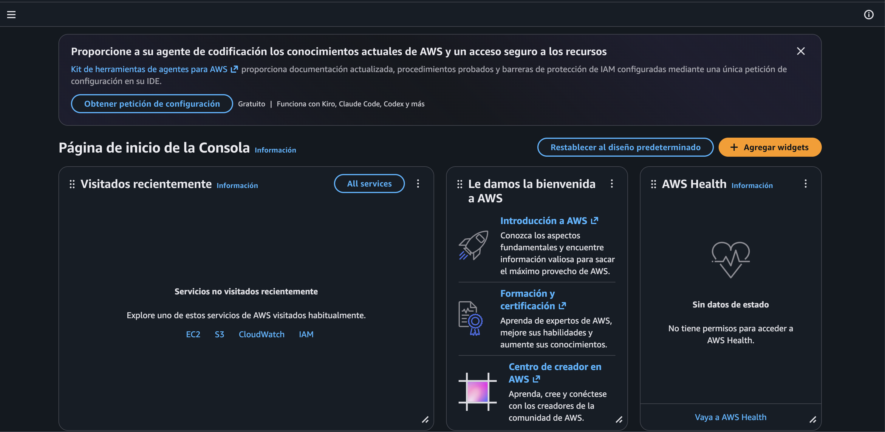
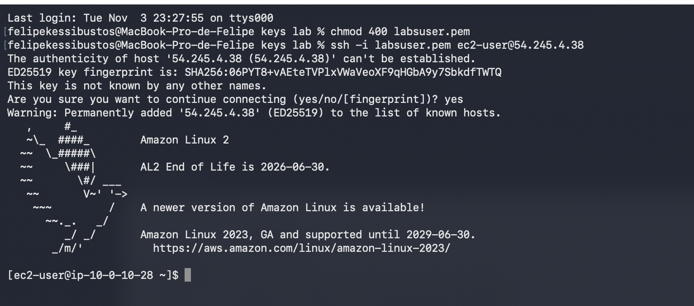
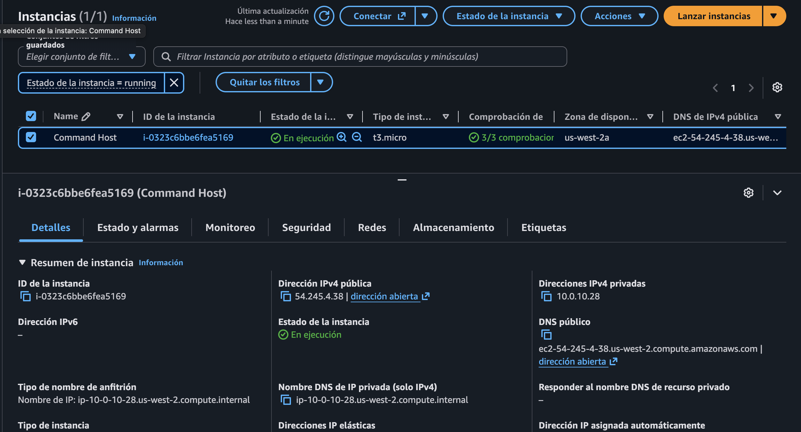
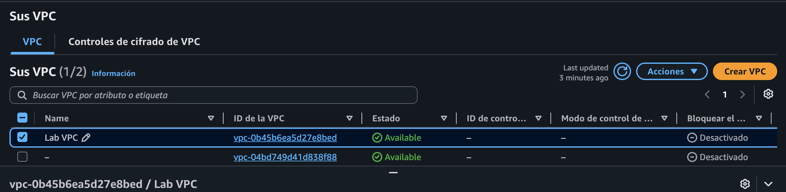
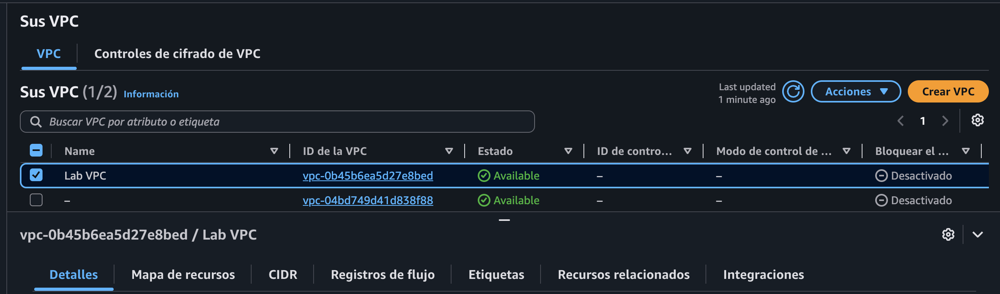
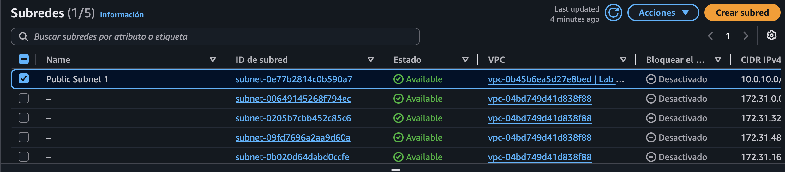
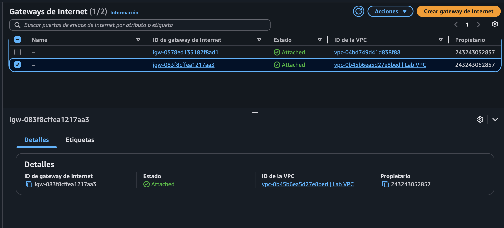
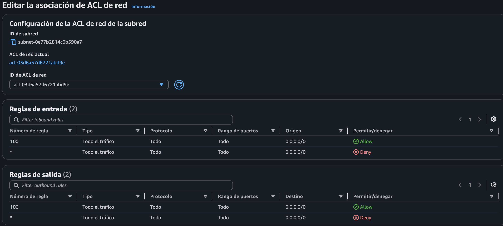

# 🚀 Laboratorio: 266 — Solución de problemas de una red

**ReCoders® 2026**  
**Autor: Felipe Kessi Bustos**

## Ficha

| Campo | Detalle |
|---|---|
| Curso | AWS re/Start — Morris & Opazo |
| Módulo | Redes |
| Fecha | 2026-11-04 |
| Estado | Pendiente de validar |
| Duración | 1 hora estimada |
| Región AWS | `us-west-2` |
| Autor | Felipe Kessi Bustos |
| Material disponible | Instrucciones pegadas y capturas de pantalla |

## Alcance de la evidencia recibida

- Fragmentos de instrucciones recibidos: 3, además de la ficha inicial.
- Capturas recibidas: 10 adjuntos correspondientes a 9 imágenes únicas; la conexión SSH se recibió dos veces.
- Contexto faltante: no se recibió evidencia del estado de Apache, tablas de rutas, grupos de seguridad ni pruebas finales.
- Esta documentación se construyó con las instrucciones y capturas proporcionadas; no se tuvo acceso a una guía descargable completa.

## Instrucciones originales recibidas

### Fragmento 1

La guía presenta el caso de Ana: no puede hacer ping al servidor Apache ni acceder mediante su IP desde el navegador. Incluye los objetivos, duración, arquitectura, restricciones y acceso mediante **Start Lab** y **AWS**.

**Interpretación complementaria:** el problema reportado requiere investigar tanto el servicio como la configuración de red. No se confirmó una causa en este fragmento.

### Fragmento 2

La guía describe la conexión SSH desde macOS/Linux: descargar `labsuser.pem`, registrar **PublicIP**, aplicar permisos `400`, conectarse como `ec2-user` y aceptar la primera conexión.

**Contexto faltante:** la numeración comienza en 13 para macOS/Linux; no se recibió el procedimiento de Windows, que no se utilizó en la evidencia.

### Fragmento 3

La guía solicita comprobar e iniciar `httpd`, probar la IP pública en el navegador y revisar subredes, tablas de rutas, Internet Gateway, Security Groups y Network ACL. Finalmente indica **End Lab > Yes**.

**Contexto faltante:** aunque el título dice «Instalar httpd», los pasos entregados describen un servicio ya instalado; no se proporcionó un comando de instalación. No se añade uno a este informe.

## Objetivo

Analizar la situación del cliente y solucionar el problema de conectividad de su servidor Apache.

## Criterios de éxito

- [x] Conectarse a la instancia mediante SSH.
- [ ] Confirmar `httpd.service` activo.
- [ ] Identificar y documentar el bloqueo de red.
- [ ] Confirmar acceso a la página de prueba de Apache por HTTP.
- [ ] Verificar la respuesta a ping reportada en el caso.

## Conceptos y servicios

| Concepto o servicio | Función en el laboratorio |
|---|---|
| Amazon VPC — Virtual Private Cloud | Red virtual del cliente. |
| Amazon EC2 — Elastic Compute Cloud | Instancia Linux que aloja el servidor. |
| Subnet | Subred donde está ubicada la instancia. |
| Internet Gateway | Puerta de enlace de internet conectada a la VPC. |
| Route Table | Tabla de rutas que la guía solicita investigar. |
| Security Group | Grupo de seguridad de la instancia, pendiente de evidencia. |
| Network ACL — Access Control List | Lista de control de acceso de la subred. |
| SSH — Secure Shell | Conexión remota utilizada desde el terminal. |
| httpd / Apache HTTP Server | Servicio web que se debe comprobar e iniciar. |

## Relación con AWS Well-Architected

| Pilar relevante | Práctica documentada | Evidencia |
|---|---|---|
| Excelencia operativa | Investigación del servicio y de la red indicada por la guía | Procedimiento; ejecución parcialmente documentada |
| Seguridad | Permisos `400` sobre la clave y revisión de ACL | Capturas 2 y 5 |
| Optimización de costos | Finalización del entorno indicada por la guía | Cleanup pendiente de verificar |

## Prerrequisitos

- Entorno de laboratorio iniciado y acceso a AWS Console.
- Terminal de macOS/Linux y archivo `labsuser.pem`.
- IP pública de la instancia.
- Acceso restringido a los servicios y acciones permitidos por el laboratorio.

## Arquitectura o flujo

```text
Navegador / terminal → Internet Gateway → subred pública → instancia Linux / Apache
VPC: 10.0.0.0/16 · Subred de referencia: 10.0.10.0/24
```



La imagen es la arquitectura de referencia de la guía; no demuestra la configuración efectiva de rutas o reglas.

## Procedimiento

### Paso 1 — Abrir AWS Console

**Objetivo del paso:** acceder al entorno del laboratorio.

**Ruta:** `Vocareum > Start Lab > AWS`.

**Acciones indicadas:** iniciar el laboratorio, esperar **Lab status: ready**, cerrar el panel y abrir **AWS**. Permitir ventanas emergentes si el navegador lo requiere.

**Resultado esperado:** consola abierta con sesión automática.

**Resultado observado:** la captura muestra la página de inicio de AWS Console.

**Por qué se hace:** permite consultar los recursos de la réplica del cliente.



**Límite de la evidencia:** no se muestra el panel con el estado ready.

### Paso 2 — Conectarse por SSH

**Objetivo del paso:** abrir una sesión remota en la instancia.

**Ruta:** `Vocareum > Details > Show > Download PEM`; después, terminal local.

**Acciones documentadas:** aplicar permisos a la clave, conectarse y aceptar la clave del servidor.

```bash
chmod 400 labsuser.pem
ssh -i labsuser.pem ec2-user@<PUBLIC_IP>
```

**Valores utilizados:** usuario `ec2-user`; clave `labsuser.pem`; IP pública `[REDACTADO]`.

**Resultado esperado:** sesión de Amazon Linux abierta sin contraseña.

**Resultado observado:** acceso exitoso y prompt `ec2-user@ip-10-0-10-28` en Amazon Linux 2.

**Por qué se hace:** permite ejecutar los comandos de comprobación de Apache.



**Límite de la evidencia:** SSH exitoso no valida HTTP ni ping. La captura contiene la IP pública y requiere difuminado antes de publicarse.

### Paso 3 — Identificar la instancia

**Objetivo del paso:** registrar el recurso utilizado.

**Ruta:** `AWS Console > EC2 > Instances > Command Host > Details`.

**Acción observada:** consulta de los detalles de la instancia.

| Parámetro | Valor observado |
|---|---|
| Nombre | Command Host |
| Instance ID | `i-0323c6bbe6fea5169` |
| Tipo | `t3.micro` |
| Zona | `us-west-2a` |
| IP privada | `10.0.10.28` |
| IP pública y DNS público | `[REDACTADO]` |

**Resultado esperado:** identificar la instancia a investigar.

**Resultado observado:** en ejecución, con 3/3 comprobaciones satisfactorias.

**Por qué se hace:** relaciona la conexión SSH con el recurso de EC2.



**Límite de la evidencia:** el estado de EC2 no confirma el estado del servicio web. La captura requiere difuminar IP y DNS públicos.

### Paso 4 — Comprobar e iniciar httpd

**Objetivo del paso:** comprobar el servidor Apache antes de investigar la red.

**Ruta:** terminal SSH de la instancia.

**Acciones indicadas por la guía:**

```bash
sudo systemctl status httpd.service
sudo systemctl start httpd.service
sudo systemctl status httpd.service
```

**Resultado esperado:** pasar de inactivo a activo. Después, probar `http://<PUBLIC_IP>` en el navegador; la guía anticipa que aún no cargará en esta etapa.

**Resultado observado:** pendiente de verificar; no se recibió la salida de los comandos ni el error del navegador.

**Por qué se hace:** distinguir el estado de Apache de los problemas de conectividad.

![Descripción de lo que se debe capturar: [terminal, httpd.service, estado active (running) y salida de systemctl status]]

**Límite de la evidencia:** no se registra como ejecutado ningún comando de este paso.

### Paso 5 — Revisar VPC y subred

**Objetivo del paso:** identificar la red y la subred del laboratorio.

**Ruta:** `AWS Console > VPC > Your VPCs`; después `Subnets`.

**Acción observada:** consulta de Lab VPC y Public Subnet 1.

| Recurso | Valor |
|---|---|
| Lab VPC | `vpc-0b45b6ea5d27e8bed` |
| Public Subnet 1 | `subnet-0e77b2814c0b590a7` |

**Resultado esperado:** recursos disponibles y pertenecientes a la VPC del laboratorio.

**Resultado observado:** ambos recursos aparecen disponibles; Public Subnet 1 pertenece a Lab VPC.

**Por qué se hace:** delimita los recursos que deben investigarse.







**Límite de la evidencia:** no se muestran la tabla de rutas efectiva ni sus asociaciones.

### Paso 6 — Revisar Internet Gateway

**Objetivo del paso:** comprobar su conexión a la VPC.

**Ruta:** `AWS Console > VPC > Internet Gateways`.

**Acción observada:** selección de `igw-083f8cffea1217aa3`.

**Resultado esperado:** puerta de enlace conectada a Lab VPC.

**Resultado observado:** estado **Attached**, asociada a `vpc-0b45b6ea5d27e8bed`.

**Por qué se hace:** es uno de los componentes de conectividad que solicita revisar la guía.



**Límite de la evidencia:** no demuestra que exista una ruta hacia ella. La captura contiene un Account ID que requiere difuminado.

### Paso 7 — Revisar Network ACL

**Objetivo del paso:** examinar el control de tráfico de la subred.

**Ruta observada:** pantalla **Editar la asociación de ACL de red** para Public Subnet 1; la secuencia previa de navegación no es visible.

**Acción observada:** consulta de la ACL actual `acl-03d6a57d6721abd9e`.

| Dirección | Regla | Tráfico | Origen/destino | Acción |
|---|---|---|---|---|
| Entrada | 100 | Todo | `0.0.0.0/0` | Allow |
| Entrada | `*` | Todo | `0.0.0.0/0` | Deny |
| Salida | 100 | Todo | `0.0.0.0/0` | Allow |
| Salida | `*` | Todo | `0.0.0.0/0` | Deny |

**Resultado esperado:** reglas compatibles con el tráfico requerido.

**Resultado observado:** la pantalla muestra reglas 100 permisivas en ambas direcciones.

**Por qué se hace:** comprobar las reglas que la guía incluye entre los posibles bloqueos.



**Límite de la evidencia:** no demuestra que se haya guardado una modificación. No se documenta una solución aplicada.

### Paso 8 — Revisar rutas, Security Group y probar HTTP

**Objetivo del paso:** completar el diagnóstico y validar el acceso.

**Ruta indicada:** `AWS Console > VPC > Route Tables / Security Groups`; después, navegador.

**Acciones indicadas:** revisar asociaciones y rutas, reglas del grupo de seguridad y acceso a `http://<PUBLIC_IP>`. La guía también propone probar conectividad hacia `www.amazon.com` mediante ping.

**Resultado esperado:** configuración correcta y página de prueba de Apache accesible.

**Resultado observado:** pendiente de verificar.

**Por qué se hace:** establecer el bloqueo concreto y demostrar su recuperación.

![Descripción de lo que se debe capturar: [VPC, tabla de rutas de Public Subnet 1, rutas activas y asociación de subred]]

![Descripción de lo que se debe capturar: [EC2, grupo de seguridad de Command Host, reglas de entrada y validación de HTTP e ICMP]]

![Descripción de lo que se debe capturar: [navegador, IP pública de Command Host, página de prueba de Apache cargada]]

## Comandos utilizados

**Ejecución demostrada:**

```bash
chmod 400 labsuser.pem
ssh -i labsuser.pem ec2-user@<PUBLIC_IP>
```

**Indicados por la guía; ejecución pendiente de evidencia:**

```bash
sudo systemctl status httpd.service
sudo systemctl start httpd.service
```

| Parte | Explicación |
|---|---|
| `chmod 400` | Permisos de lectura para el propietario de la clave. |
| `ssh -i` | Selecciona la clave de la conexión. |
| `ec2-user` | Usuario remoto indicado. |
| `sudo` | Ejecuta el comando con privilegios elevados. |
| `systemctl status / start` | Consulta o inicia el servicio. |

## Validación final

| Validación | Evidencia | Estado |
|---|---|---|
| Acceso SSH | Captura 2 | Aprobada |
| Identificación de recursos | Capturas 4, 6, 7 y 9 | Observada |
| Internet Gateway conectado | Captura 8 | Aprobada |
| Revisión de ACL | Captura 5 | Observada |
| Apache activo | Sin salida recibida | Pendiente |
| Rutas y Security Group | Sin captura recibida | Pendiente |
| Acceso HTTP y ping | Sin prueba recibida | Pendiente |
| Objetivo de solucionar el problema | Sin recuperación documentada | Pendiente |

## Problemas y solución

### Falta de respuesta a ping y acceso web

- **Momento:** situación inicial reportada por Ana.
- **Resultado esperado:** conectividad y acceso al servidor Apache.
- **Resultado observado:** el correo reporta ambos fallos; no se recibió una captura del error.
- **Causa confirmada:** no determinada con la evidencia disponible.
- **Comprobaciones:** acceso SSH, estado EC2, VPC, subred, Internet Gateway y ACL.
- **Solución aplicada:** no documentada en las capturas.
- **Validación:** pendiente del estado de Apache y las pruebas finales.
- **Evidencia de recuperación:** no recibida.

## Seguridad y privacidad

- En el texto se sustituyeron la IP pública, DNS público y Account ID por `[REDACTADO]` o parámetros genéricos.
- Las imágenes se conservan como evidencia recibida: antes de publicar se deben difuminar IP pública, DNS público, Account ID y datos de usuario local visibles en las capturas 2, 4 y 8.
- La captura no expone el contenido de la clave privada.
- Se observó `chmod 400` para proteger el archivo de clave.
- No se dispone de evidencia para evaluar mínimo privilegio del Security Group. La ACL mostrada permite todo el tráfico IPv4.

## Costos potenciales

| Recurso | Puede generar costo | Acción indicada |
|---|---|---|
| Entorno y recursos del laboratorio | No se aportaron datos de facturación | Finalizar mediante End Lab según la guía |

No se documentan precios ni cargos comprobados.

## 🧹 Cleanup (Limpieza)

La guía indica finalizar el entorno mediante su propio mecanismo:

- [ ] Seleccionar **End Lab** y confirmar **Yes**.
- [ ] Observar el mensaje **DELETE has been initiated…**.
- [ ] Cerrar el panel con **X**.

**Estado observado:** no se recibió captura de finalización. No se documenta eliminación manual de recursos.

## Evidencias

| # | Archivo | Paso | Qué demuestra | Sanitizada |
|---:|---|---|---|---|
| 1 | `assets/01-arquitectura.png` | Arquitectura | Arquitectura del cliente | Sin datos sensibles identificados en esta revisión |
| 2 | `assets/02-ssh.png` | 2 | Conexión SSH exitosa | Pendiente |
| 3 | `assets/03-consola.png` | 1 | Consola AWS | Sin datos sensibles identificados en esta revisión |
| 4 | `assets/04-instancia.png` | 3 | Detalles de la instancia EC2 | Pendiente |
| 5 | `assets/05-acl.png` | 7 | ACL de red y reglas | Sin datos sensibles identificados en esta revisión |
| 6 | `assets/06-subred.png` | 5 | Subred pública | Sin datos sensibles identificados en esta revisión |
| 7 | `assets/07-vpc.png` | 5 | Lab VPC | Sin datos sensibles identificados en esta revisión |
| 8 | `assets/08-internet-gateway.png` | 6 | Puerta de enlace de internet | Pendiente |
| 9 | `assets/09-vpc-detalles.png` | 5 | Estado de Lab VPC | Sin datos sensibles identificados en esta revisión |

## Aprendizajes

- La conexión SSH documentada permite separar ese resultado de la validación de HTTP y ping, que no se recibió.
- La consulta de recursos debe acompañarse de evidencia de rutas, reglas y pruebas finales para establecer una causa.
- Una captura de una pantalla de edición no confirma que se haya guardado un cambio.

## Fuentes

- Instrucciones del laboratorio 266 proporcionadas por el estudiante en tres fragmentos.
- Nueve capturas únicas recibidas, fechadas el 4 de noviembre de 2026.
- Plantilla e instrucciones del proyecto AWS Restart para la estructura de documentación.

## Pendientes del estudiante

- Aportar estado de Apache, tabla de rutas y reglas del Security Group.
- Documentar el cambio correctivo y las pruebas HTTP y ping.
- Confirmar End Lab.
- Difuminar los datos identificados en las capturas antes de publicar en GitHub.
