<div align="center">


# Laboratorio 268 — Operaciones de Tabla de Bases de Datos

**Felipe Kessi Bustos**  
**ReCoders® 2026**

</div>

## Datos del laboratorio

| Campo | Información |
|---|---|
| Módulo | Bases de Datos |
| Región | us-west-2 |
| Duración estimada de la guía | 45 minutos |

## Situación y objetivos

El equipo de operaciones de base de datos de una organización configuró una instancia de base de datos relacional y solicitó practicar la creación y eliminación de bases de datos y tablas.

Los objetivos del laboratorio fueron usar `CREATE` para crear bases de datos y tablas, `SHOW` para consultar los objetos disponibles, `ALTER` para modificar la estructura de una tabla y `DROP` para eliminar bases de datos y tablas.

## Arquitectura de referencia

La guía presenta una instancia con un cliente de base de datos instalado.

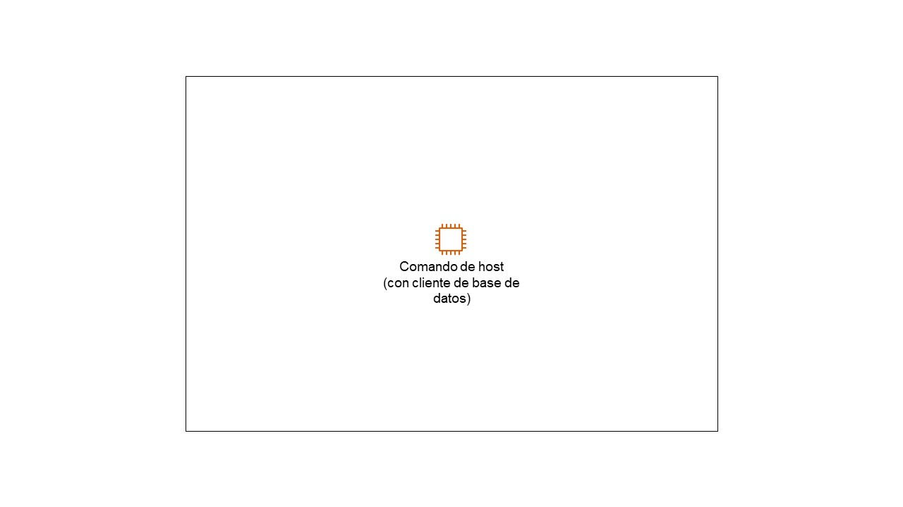

El segundo diagrama representa al usuario del laboratorio utilizando el cliente para trabajar con la base de datos `world` y las tablas `country` y `city`, mediante los enunciados `CREATE`, `SHOW`, `ALTER` y `DROP`.

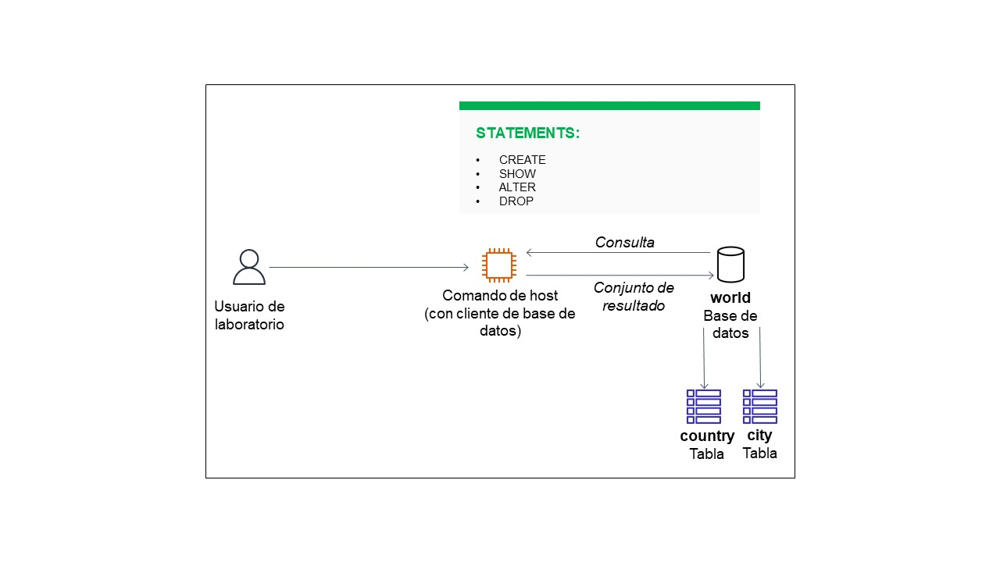

Estos diagramas corresponden al material de referencia de la guía.

## Tarea 1 — Conexión a Command Host

### 1. Selección de la instancia

En EC2 se seleccionó la instancia **Command Host**, identificada como `i-06c5352fbd0e49a76`. La captura muestra la instancia en ejecución, de tipo `t3.micro`, con tres comprobaciones correctas y ubicada en `us-west-2a`.

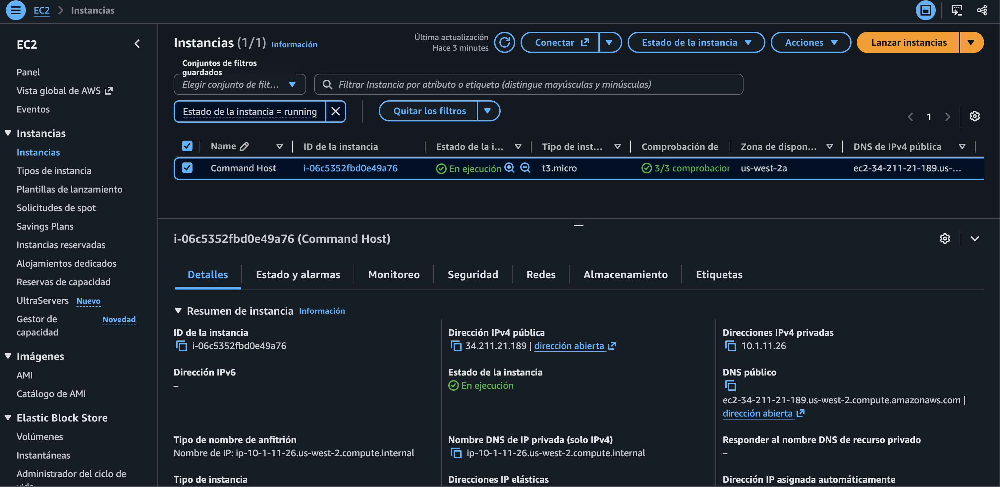

### 2. Conexión mediante Session Manager

Se abrió el menú **Conectar**, donde aparece la opción **Conectar con SSM Session Manager**. La siguiente evidencia de terminal confirma una sesión abierta en Command Host.

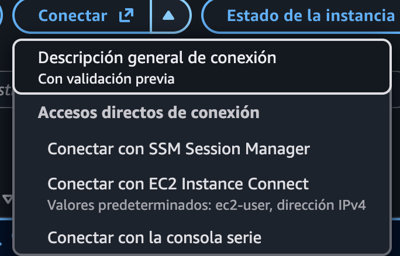

### 3. Preparación de la terminal

En la terminal se ejecutaron los siguientes comandos para cambiar al usuario root y al directorio de trabajo indicado por la guía:

```bash
sudo su
cd /home/ec2-user/
```

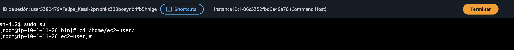

### 4. Acceso al cliente de base de datos

Se ejecutó el comando de conexión proporcionado por el laboratorio:

```bash
mysql -u root --password='re:St@rt!9'
```

La terminal mostró el monitor de **MariaDB 10.5.29** y el indicador `MariaDB [(none)]>`, con una conexión correcta.

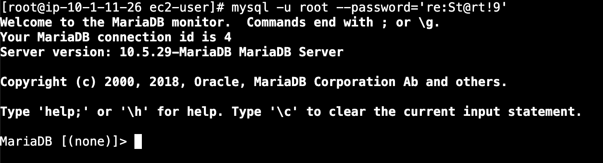

Una segunda captura muestra nuevamente los comandos de preparación y el acceso correcto a MariaDB, con identificador de conexión 5.

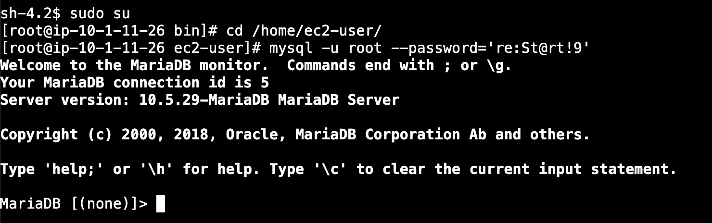

## Tarea 2 — Creación de una base de datos y tablas

### 5. Consulta de las bases de datos existentes

Se ejecutó:

```sql
SHOW DATABASES;
```

El resultado inicial mostró tres bases de datos: `information_schema`, `mysql` y `performance_schema`.

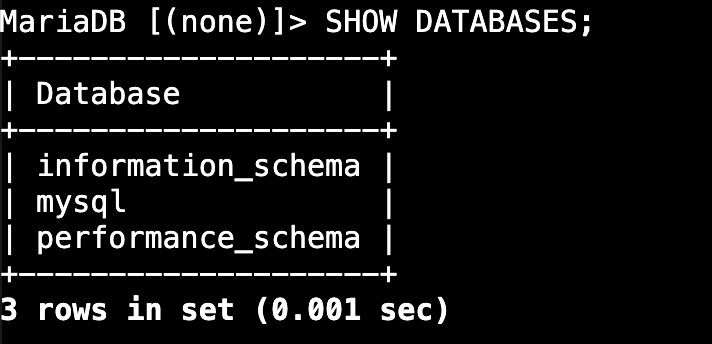

### 6. Creación y verificación de world

Se creó la base de datos `world` y se consultó nuevamente el listado:

```sql
CREATE DATABASE world;
SHOW DATABASES;
```

La creación devolvió `Query OK` y el listado mostró cuatro bases de datos, incluida `world`.

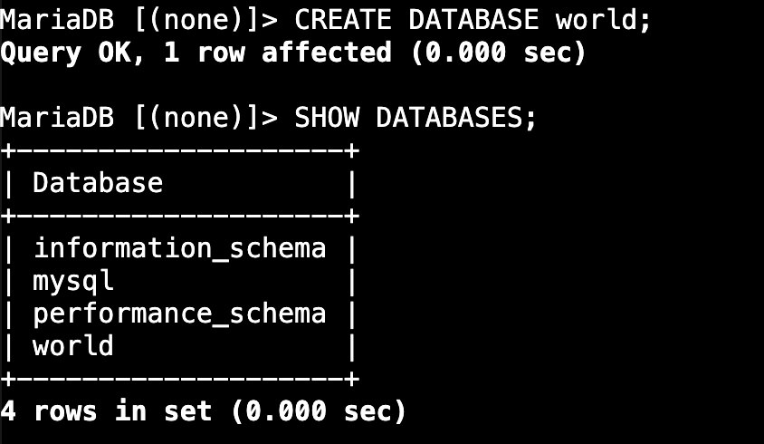

### 7. Creación de la tabla country

Se creó `world.country` con 15 columnas y la clave primaria `Code`. El nombre `Conitinent` se conservó inicialmente tal como aparece en la guía, para corregirlo en el paso de alteración.

```sql
CREATE TABLE world.country (
  `Code` CHAR(3) NOT NULL DEFAULT '',
  `Name` CHAR(52) NOT NULL DEFAULT '',
  `Conitinent` enum('Asia','Europe','North America','Africa','Oceania','Antarctica','South  America') NOT NULL DEFAULT 'Asia',
  `Region` CHAR(26) NOT NULL DEFAULT '',
  `SurfaceArea` FLOAT(10,2) NOT NULL DEFAULT '0.00',
  `IndepYear` SMALLINT(6) DEFAULT NULL,
  `Population` INT(11) NOT NULL DEFAULT '0',
  `LifeExpectancy` FLOAT(3,1) DEFAULT NULL,
  `GNP` FLOAT(10,2) DEFAULT NULL,
  `GNPOld` FLOAT(10,2) DEFAULT NULL,
  `LocalName` CHAR(45) NOT NULL DEFAULT '',
  `GovernmentForm` CHAR(45) NOT NULL DEFAULT '',
  `HeadOfState` CHAR(60) DEFAULT NULL,
  `Capital` INT(11) DEFAULT NULL,
  `Code2` CHAR(2) NOT NULL DEFAULT '',
  PRIMARY KEY (`Code`)
);
```

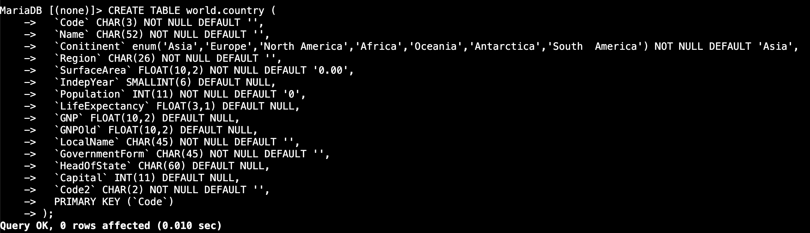

### 8. Selección de world y consulta de tablas

Se seleccionó la base de datos y se consultaron sus tablas:

```sql
USE world;
SHOW TABLES;
```

La terminal confirmó `Database changed` y mostró la tabla `country`.

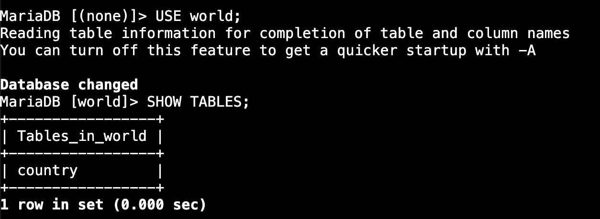

### 9. Revisión de las columnas de country

Se consultó la estructura de la tabla:

```sql
SHOW COLUMNS FROM world.country;
```

El resultado mostró 15 columnas, incluida la columna escrita como `Conitinent`.

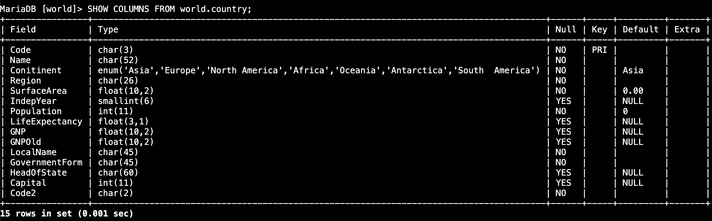

### 10. Corrección del nombre de la columna

Se modificó el esquema para renombrar `Conitinent` como `Continent`:

```sql
ALTER TABLE world.country RENAME COLUMN Conitinent TO Continent;
```

La operación devolvió `Query OK`, sin advertencias.

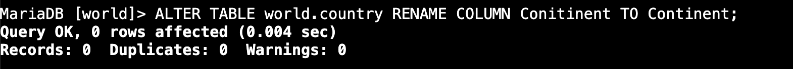

Se verificó la modificación mediante una nueva consulta:

```sql
SHOW COLUMNS FROM world.country;
```

El resultado mantuvo las 15 columnas y mostró el nombre corregido `Continent`.

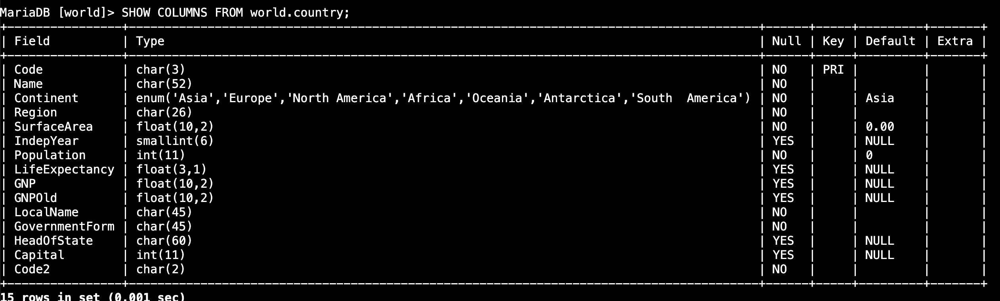

### 11. Desafío 1 — Creación de city

Se creó la tabla `city` con las columnas `Name` y `Region`, ambas de tipo `CHAR`, y se verificó el listado de tablas:

```sql
CREATE TABLE world.city (`Name` CHAR(52), `Region` CHAR(26));
SHOW TABLES;
```

La creación fue correcta y el listado mostró `city` y `country`.

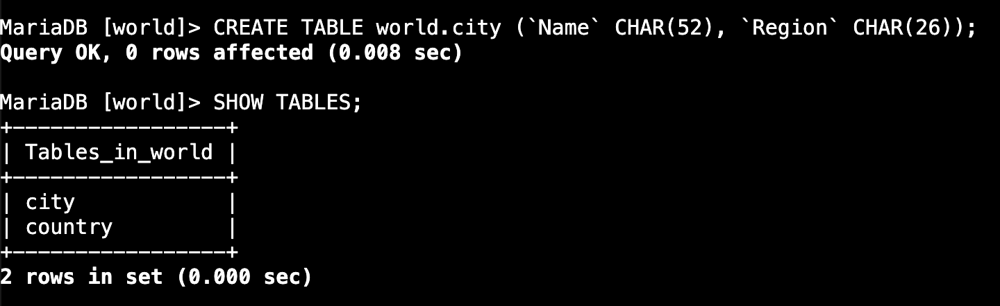

## Tarea 3 — Eliminación de tablas y base de datos

### 12. Eliminación de city

Se eliminó la tabla `city`:

```sql
DROP TABLE world.city;
```

El resultado fue `Query OK`.

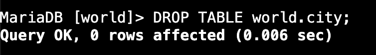

### 13. Desafío 2 — Eliminación de country y verificación

Se eliminó la tabla `country` y se consultaron las tablas restantes:

```sql
DROP TABLE world.country;
SHOW TABLES;
```

La eliminación devolvió `Query OK`. La consulta posterior mostró `Empty set`, confirmando que no quedaban tablas en `world`.

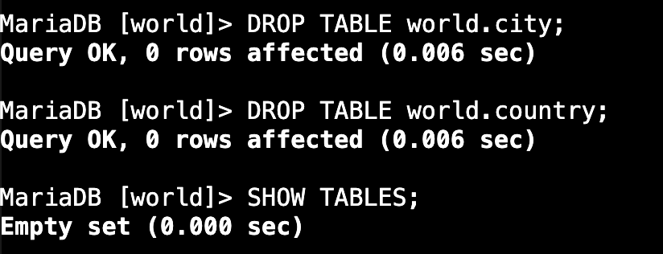

### 14. Verificación final de las bases de datos

La guía indica eliminar `world` mediante:

```sql
DROP DATABASE world;
```

La captura recibida no muestra la ejecución de ese comando. Sí muestra la consulta posterior:

```sql
SHOW DATABASES;
```

El resultado contiene únicamente `information_schema`, `mysql` y `performance_schema`; `world` ya no aparece.

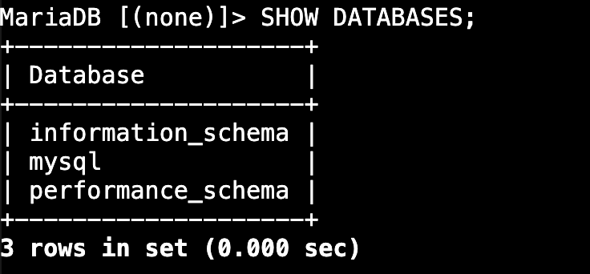

## Resultado documentado

Las evidencias muestran la conexión a Command Host y MariaDB, la creación de `world`, `country` y `city`, la consulta de bases de datos, tablas y columnas, la corrección de `Conitinent` a `Continent` y la eliminación de ambas tablas. El listado final confirma que `world` ya no figura entre las bases de datos disponibles.

La guía solicita finalizar el laboratorio desde **Finalizar laboratorio** y confirmar con **Sí**. No se recibió evidencia de ese cierre.

## Fuente del material

Instrucciones y diagramas del laboratorio de AWS proporcionados por el usuario, acompañados de 16 capturas de ejecución. La guía atribuye los datos de muestra a Statistics Finland, estadísticas regionales generales, descargados el 4 de febrero de 2022 bajo licencia CC BY 4.0.

---

**Felipe Kessi Bustos · ReCoders® 2026**
