<div align="center">


# 269 — Insertar, actualizar y eliminar datos de una base de datos

**ReCoders® 2026**  
**Autor: Felipe Kessi Bustos**

</div>

| Dato | Información |
|---|---|
| Módulo | Redes |
| Región | us-west-2 |
| Duración estimada de la guía | 45 minutos |

## Situación y objetivos

La base de datos relacional `world` contiene las tablas `city`, `country` y `countrylanguage`. El laboratorio valida operaciones SQL de inserción, actualización y eliminación sobre `country`, además de la importación de datos desde un archivo de respaldo.

Objetivos entregados:

- Insertar filas en una tabla.
- Actualizar filas de una tabla.
- Eliminar filas de una tabla.
- Importar filas de un archivo de respaldo de base de datos.

## Arquitectura de referencia

Al inicio, la guía presenta una instancia **Command Host** con un cliente de base de datos y la base de datos `world` con sus tres tablas.

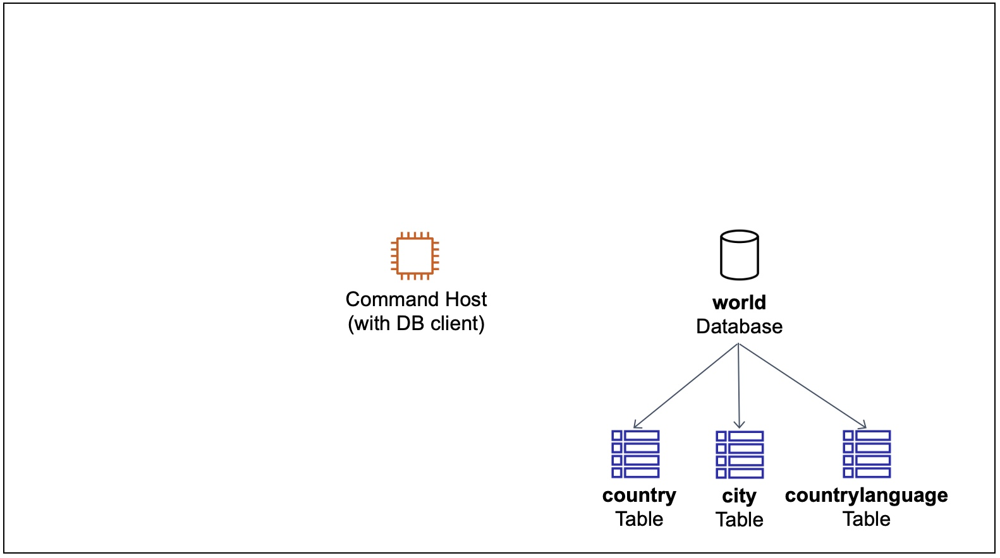

La arquitectura final de referencia muestra al usuario conectado mediante Command Host para trabajar con las instrucciones `INSERT`, `UPDATE` y `DELETE`.

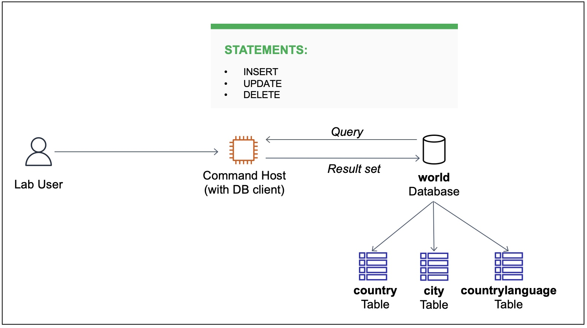

## 1. Conexión a la base de datos

La guía indica iniciar el laboratorio con **Start Lab**, esperar el indicador verde de **AWS** y abrir la consola. Luego, acceder a **EC2 → Instances**, seleccionar **Command Host** y conectarse desde la pestaña **Session Manager**, manteniendo la región del laboratorio.

La evidencia recibida muestra la terminal de Command Host. Se elevó la sesión, se cambió al directorio de trabajo y se inició el cliente MySQL:

```bash
sudo su
cd /home/ec2-user/
mysql -u root --password='re:St@rt!9'
```

La conexión se estableció con **MariaDB 10.5.29** y quedó disponible el indicador `MariaDB [(none)]>`.

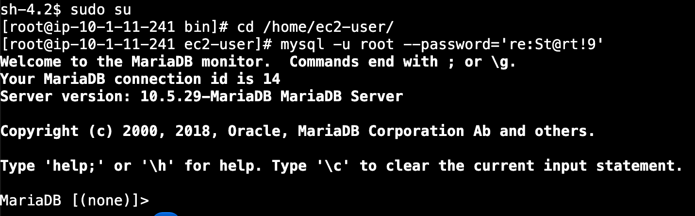

Se consultaron las bases de datos disponibles:

```sql
SHOW DATABASES;
```

El resultado mostró `information_schema`, `mysql`, `performance_schema` y `world`.

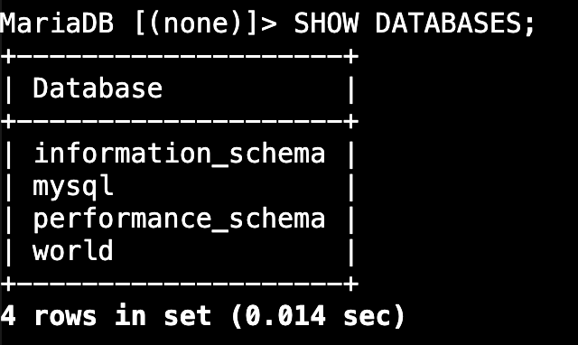

## 2. Inserción de filas en country

Primero se comprobó que la tabla estaba vacía:

```sql
SELECT * FROM world.country;
```

El resultado fue `Empty set`. A continuación, se insertaron los registros de Irlanda y Australia. Los comandos visibles en la evidencia fueron:

```sql
INSERT INTO world.country VALUES ('IRL','Ireland','Europe','British Islands',70273.00,1921,3775100,76.8,75921.00,73132.00,'Ireland/ire','Republic',1447,'IE');

INSERT INTO world.country VALUES ('AUS','Australia','Oceania','Australia and New Zealand',7741220.00,1901,18886000,79.8,351182.00,392911.00,'Australia','Constitutional Monarchy, Federation',135,'AU');
```

Cada instrucción devolvió `Query OK, 1 row affected`. En el valor `LocalName` de Irlanda, la captura muestra `Ireland/ire`; el texto de la guía proporcionado indica `Ireland/Éire`.

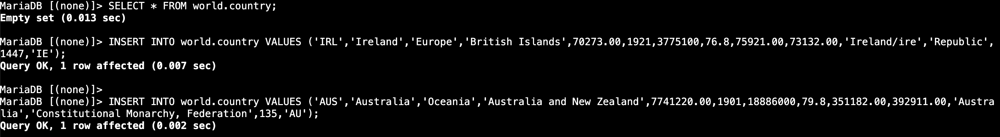

Se verificaron ambos registros mediante la consulta observada en la captura:

```sql
SELECT * FROM world.country WHERE Code IN ('IRL', 'AUS');
```

Se obtuvieron dos filas: Australia con población `18886000` e Irlanda con población `3775100`.

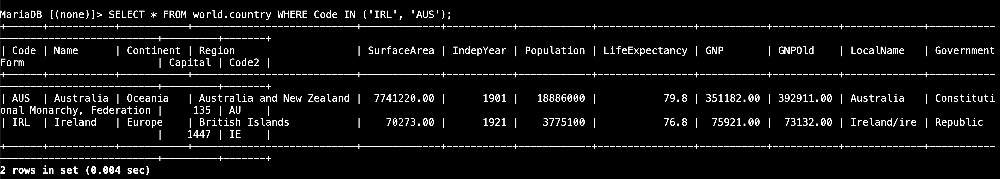

## 3. Actualización de filas

Se estableció la población en cero para todas las filas de `country`:

```sql
UPDATE world.country SET Population = 0;
```

La operación modificó **2 filas**, sin advertencias. Al no incluir una condición `WHERE`, se aplicó a todas las filas de la tabla.

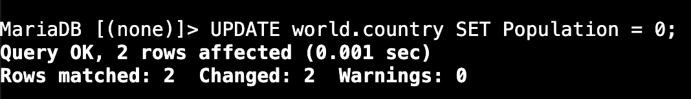

Se consultó nuevamente la tabla:

```sql
SELECT * FROM world.country;
```

Ambos registros mostraron `Population = 0`.

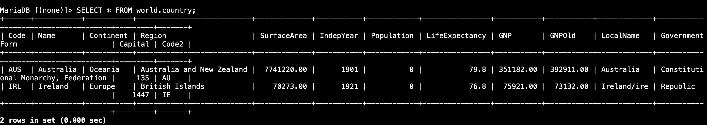

Luego se actualizaron dos columnas y se verificó el resultado:

```sql
UPDATE world.country SET Population = 100, SurfaceArea = 100;
SELECT * FROM world.country;
```

La actualización modificó **2 filas**, sin advertencias. La consulta confirmó `Population = 100` y `SurfaceArea = 100.00` en los dos registros.

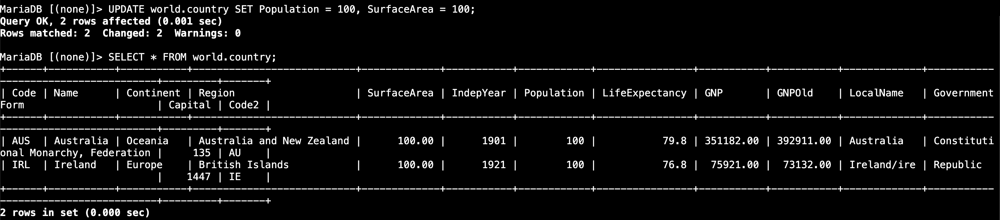

## 4. Eliminación de filas

La captura muestra la desactivación de las comprobaciones de claves foráneas antes de eliminar los registros. Este comando adicional no aparece en las instrucciones proporcionadas:

```sql
SET FOREIGN_KEY_CHECKS = 0;
DELETE FROM world.country;
SELECT * FROM world.country;
```

`DELETE` eliminó **2 filas**. La consulta posterior devolvió `Empty set`, confirmando que la tabla quedó vacía. La instrucción se aplicó a todas las filas porque no incluyó una condición `WHERE`.

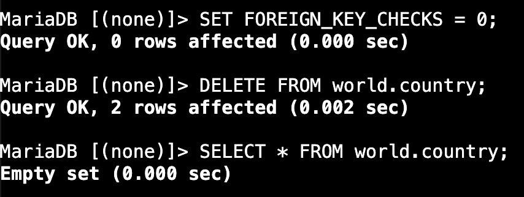

## 5. Importación desde un archivo SQL

Se salió del cliente de base de datos:

```sql
QUIT;
```

El cliente mostró `Bye` y regresó al shell.


Se importó el archivo `world.sql` y se volvió a conectar al cliente:

```bash
mysql -u root --password='re:St@rt!9' < /home/ec2-user/world.sql
mysql -u root --password='re:St@rt!9'
```

Después se seleccionó la base de datos y se consultaron sus tablas:

```sql
USE world;
SHOW TABLES;
```

El resultado mostró **3 tablas**: `city`, `country` y `countrylanguage`.

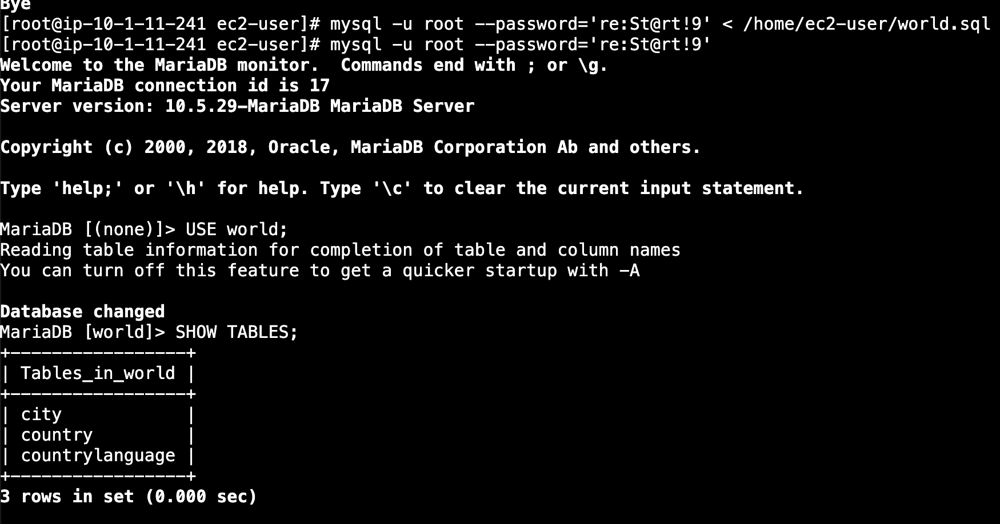

Finalmente, se consultaron los registros de `country`:

```sql
SELECT * FROM country;
```

La captura muestra múltiples países, entre ellos Aruba, Afghanistan, Angola, Anguilla, Albania y Andorra, confirmando la presencia de datos después de la importación. La evidencia no muestra el total de filas.

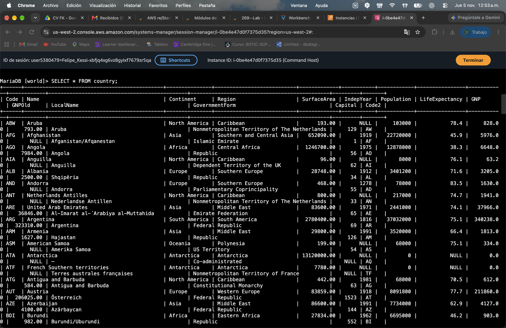

## Resultados documentados

Las capturas muestran la inserción de dos filas, la actualización de sus valores, la eliminación de ambas y la importación del archivo SQL. También muestran las tres tablas de `world` y datos cargados en `country`.

No se recibieron capturas de la comprobación del archivo mediante `ls /home/ec2-user/world.sql`, de las consultas a `city` y `countrylanguage`, ni de la finalización del laboratorio. Estos pasos aparecen en la guía, pero no se registran como ejecutados.

## Fuente de los datos de muestra

Según la guía proporcionada, los datos de país, ciudad e idioma se obtuvieron del servicio de interfaz de **Statistics Finland** el **4 de febrero de 2022**, con licencia **CC BY 4.0**.

---

**ReCoders® 2026 · Felipe Kessi Bustos**
