<p align="center"></p>

# 270 — Selección de datos en una base de datos

**ReCoders® 2026**  
**Autor:** Felipe Kessi Bustos  
**Módulo:** Bases de Datos  
**Región:** us-west-2  
**Duración estimada de la guía:** 45 minutos

## Situación y objetivos

El equipo de operaciones creó la base de datos relacional **world**, con las tablas **city**, **country** y **countrylanguage**. El laboratorio se centró en consultar sus datos mediante `SELECT`, utilizar `COUNT()` y aplicar `<`, `>`, `=`, `WHERE`, `ORDER BY` y `AND`.

## Arquitectura inicial

Los recursos proporcionados fueron una instancia **Command Host**, con cliente de base de datos, y la base de datos **world** con sus tres tablas.

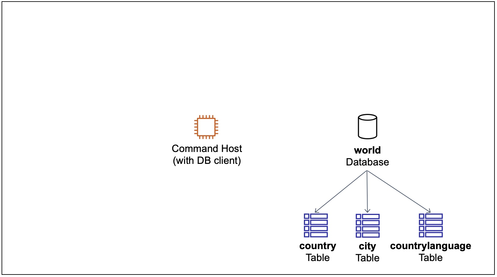

## 1. Acceso y conexión a la base de datos

La guía indicó iniciar el entorno con **Start Lab**, esperar el indicador verde junto a **AWS** y abrir la consola sin cambiar la región. Luego indicó acceder a **Services → Compute → EC2 → Instances**, seleccionar **Command Host** y conectarse mediante **Session Manager**.

La evidencia recibida muestra la preparación de la terminal y la conexión a MariaDB con los siguientes comandos:

```bash
sudo su
cd /home/ec2-user/
mysql -u root --password='re:St@rt!9'
```

Se abrió el monitor **MariaDB 10.5.29** y quedó disponible el indicador `MariaDB [(none)]>`.

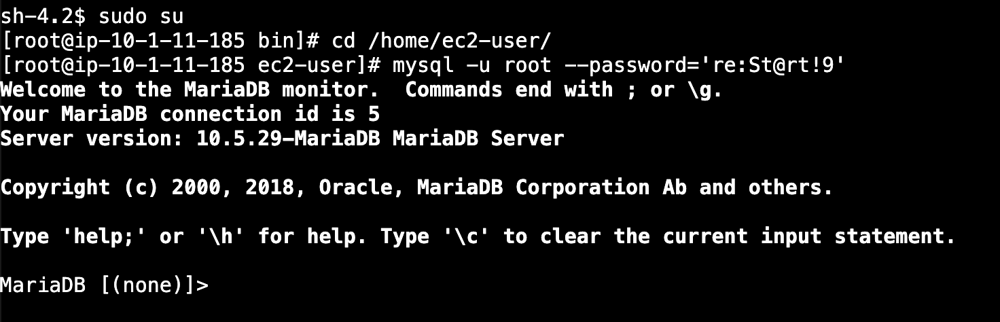

## 2. Verificación de bases de datos y consulta completa

Se ejecutó:

```sql
SHOW DATABASES;
```

El resultado mostró **information_schema**, **mysql**, **performance_schema** y **world**. A continuación, se consultaron todas las columnas de la tabla **country**:

```sql
SELECT * FROM world.country;
```

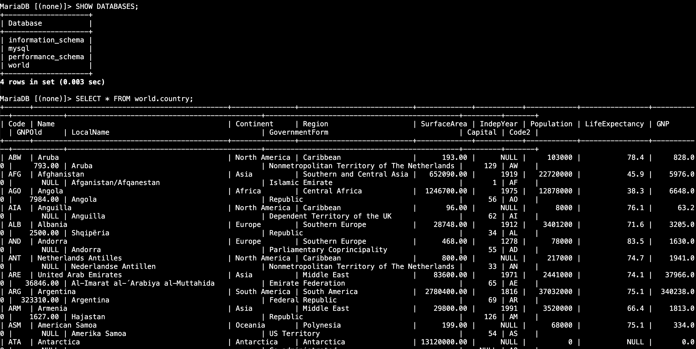

Las siguientes capturas registran el desplazamiento por el conjunto de resultados de esa misma consulta.

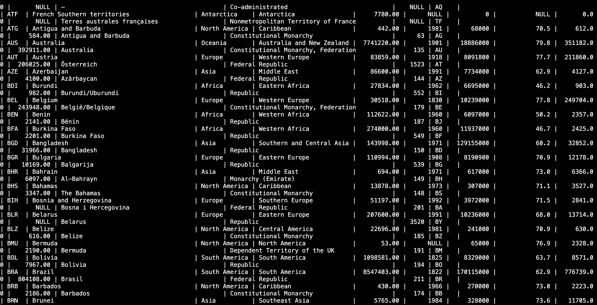

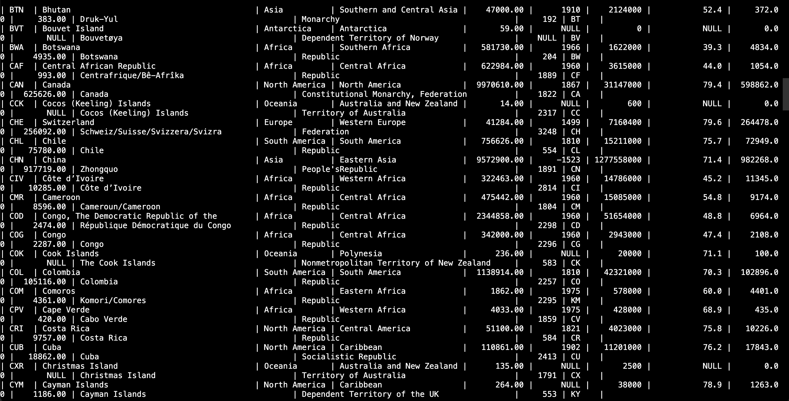

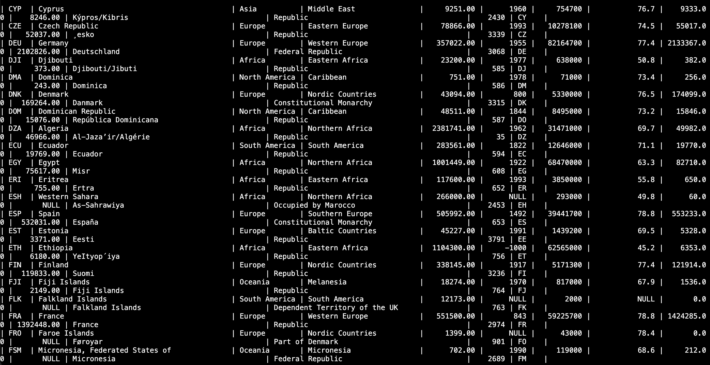

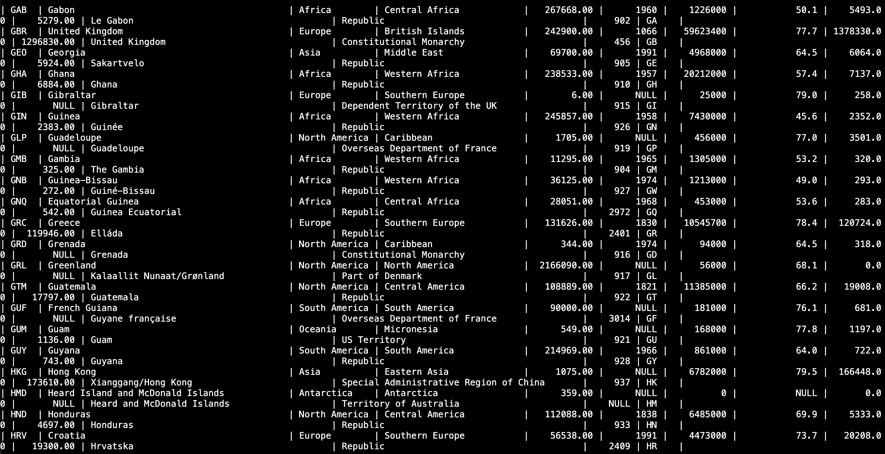

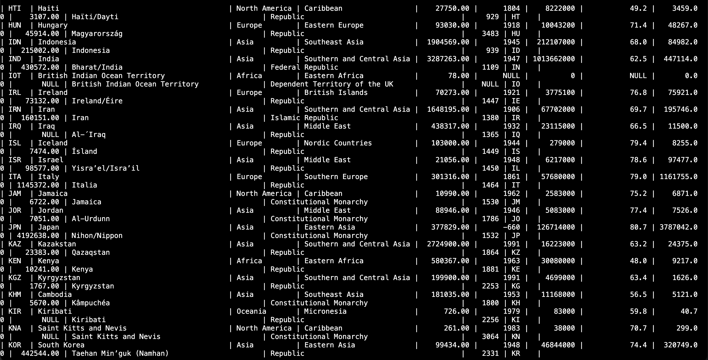

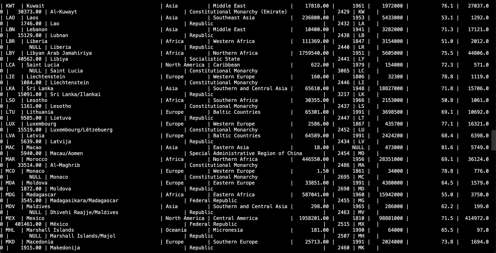

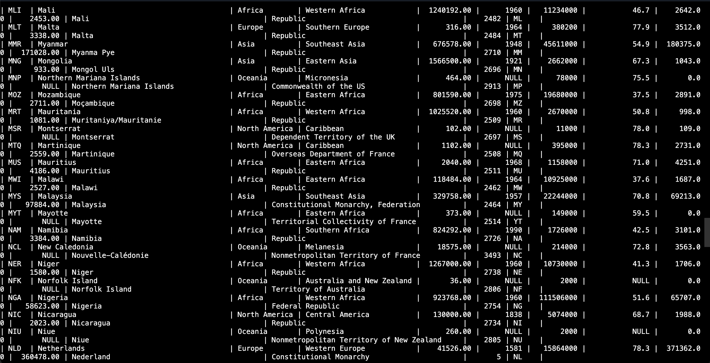

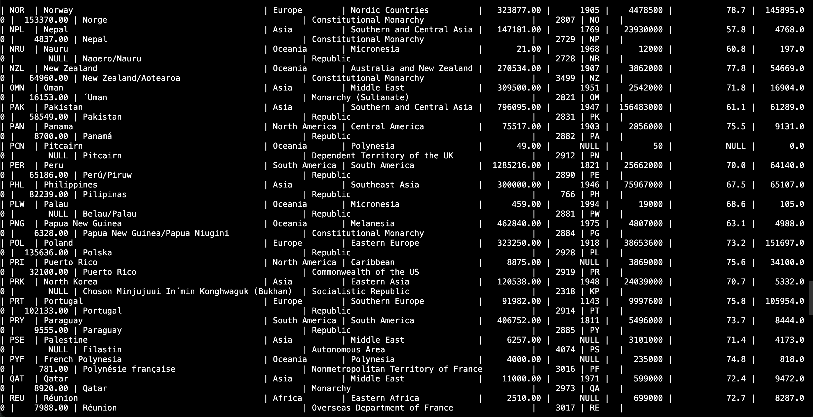

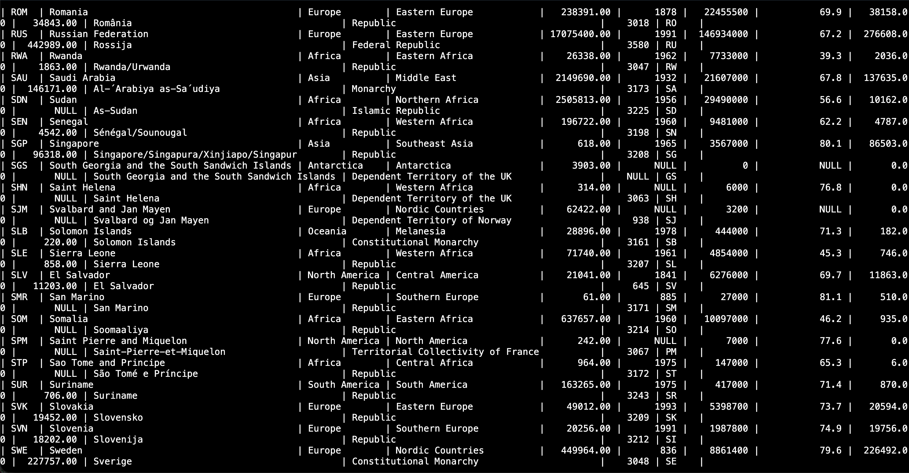

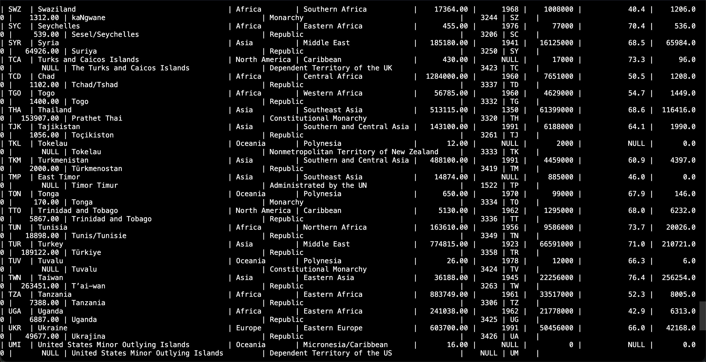

Al final del resultado, MariaDB informó **239 filas**.

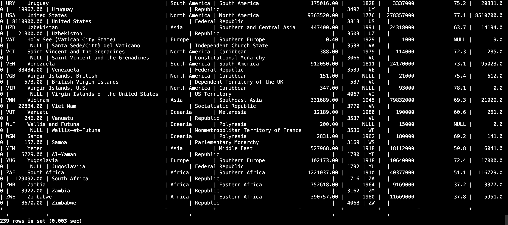

## 3. Conteo de filas y revisión del esquema

Se contó la cantidad de filas de la tabla:

```sql
SELECT COUNT(*) FROM world.country;
```

`COUNT(*)` devolvió **239**. Después, se revisó el esquema:

```sql
SHOW COLUMNS FROM world.country;
```

El resultado mostró **14 columnas**: `Code`, `Name`, `Continent`, `Region`, `SurfaceArea`, `IndepYear`, `Population`, `LifeExpectancy`, `GNP`, `GNPOld`, `LocalName`, `GovernmentForm`, `Capital` y `Code2`.

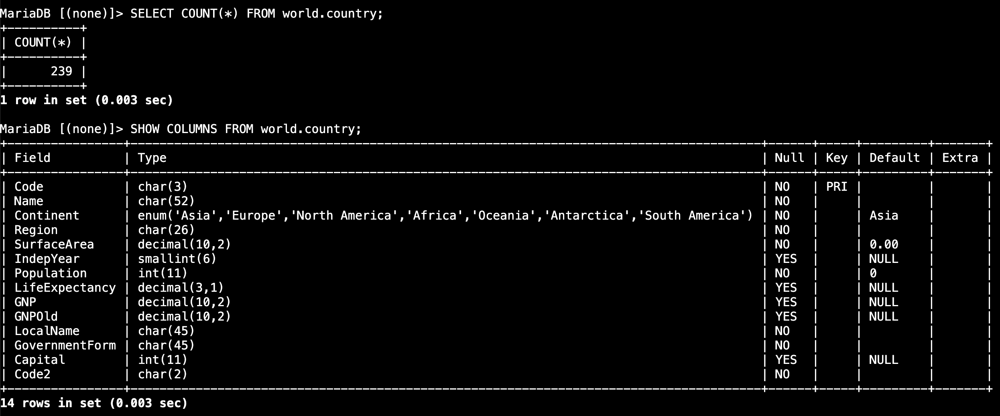

## 4. Selección de columnas específicas

Se consultaron únicamente las columnas de nombre, capital, región, superficie y población:

```sql
SELECT Name, Capital, Region, SurfaceArea, Population
FROM world.country;
```

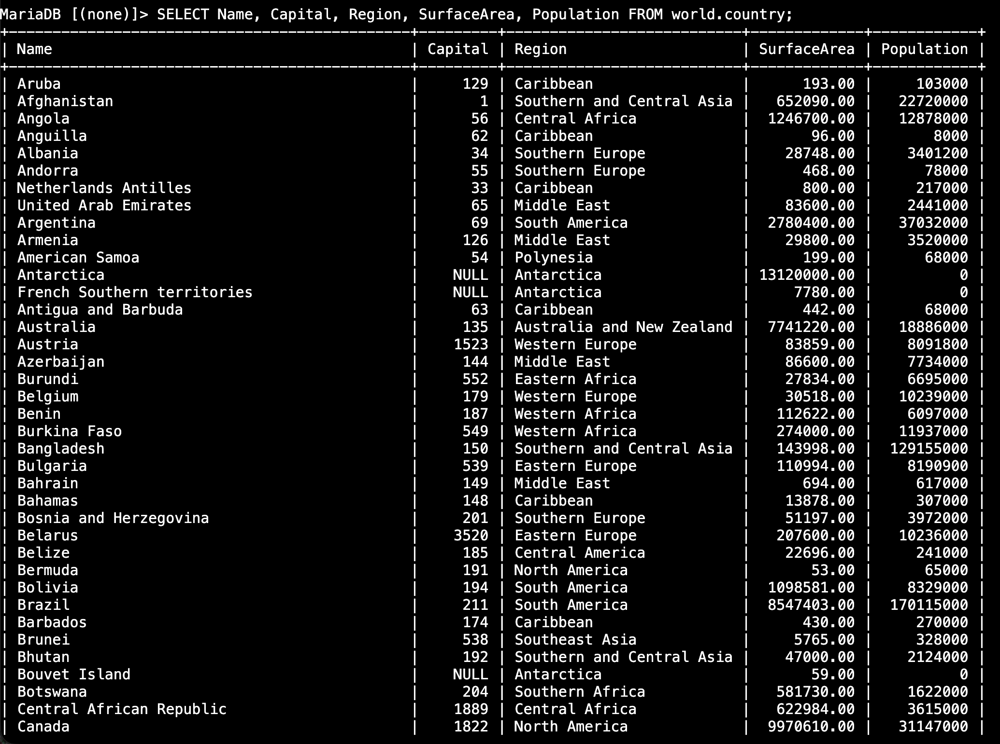

## 5. Asignación de un alias a una columna

Se utilizó `AS` para presentar `SurfaceArea` con el encabezado **Surface Area**:

```sql
SELECT Name, Capital, Region, SurfaceArea AS "Surface Area", Population
FROM world.country;
```

La captura muestra el nuevo encabezado en el resultado.

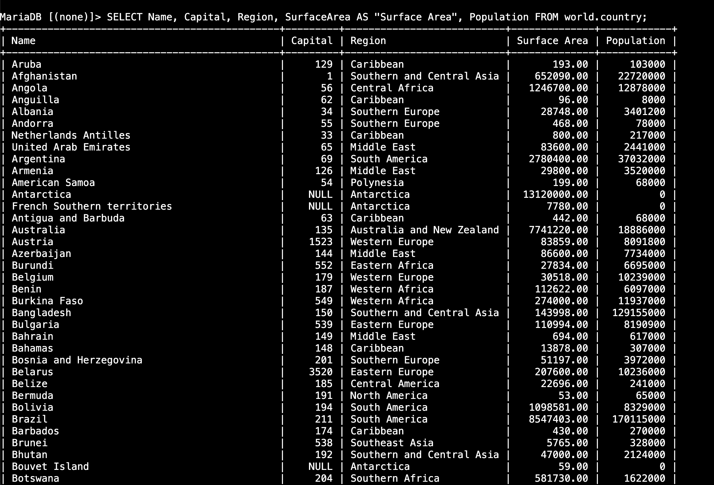

## 6. Orden ascendente por población

Se ordenó el resultado mediante `ORDER BY Population`:

```sql
SELECT Name, Capital, Region, SurfaceArea AS "Surface Area", Population
FROM world.country
ORDER BY Population;
```

La captura muestra primero registros con población **0**, seguidos de valores crecientes, como **50**, **600** y **1000**.

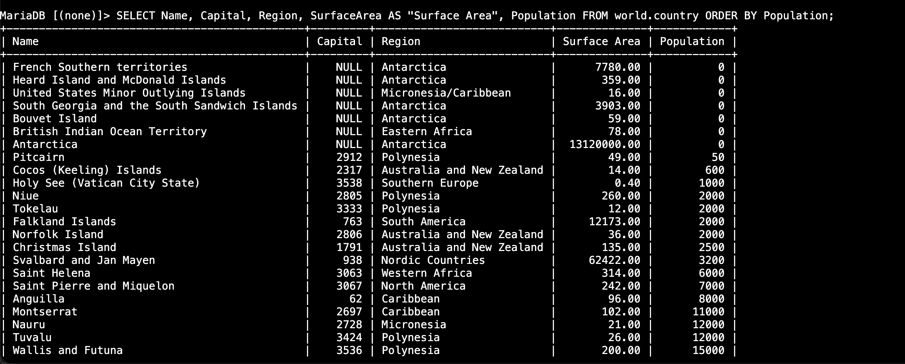

La guía también indicó ejecutar el orden descendente sin filtro mediante `ORDER BY Population DESC`. No se recibió una captura específica de esa consulta; el uso de `DESC` sí quedó registrado en los pasos siguientes.

## 7. Filtro por población y orden descendente

Se seleccionaron los registros con población superior a **50.000.000**, ordenados de mayor a menor:

```sql
SELECT Name, Capital, Region, SurfaceArea AS "Surface Area", Population
FROM world.country
WHERE Population > 50000000
ORDER BY Population DESC;
```

La consulta devolvió **24 filas**. El resultado comienza con **China**, seguida de **India** y **United States**.

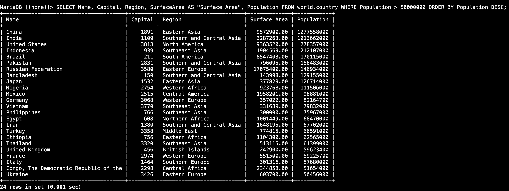

## 8. Combinación de condiciones con AND

Se consultaron los países con población superior a **50.000.000** e inferior a **100.000.000**, manteniendo el orden descendente:

```sql
SELECT Name, Capital, Region, SurfaceArea AS "Surface Area", Population
FROM world.country
WHERE Population > 50000000 AND Population < 100000000
ORDER BY Population DESC;
```

La consulta devolvió **14 filas**, desde **Mexico**, con **98.881.000** habitantes, hasta **Ukraine**, con **50.456.000**.

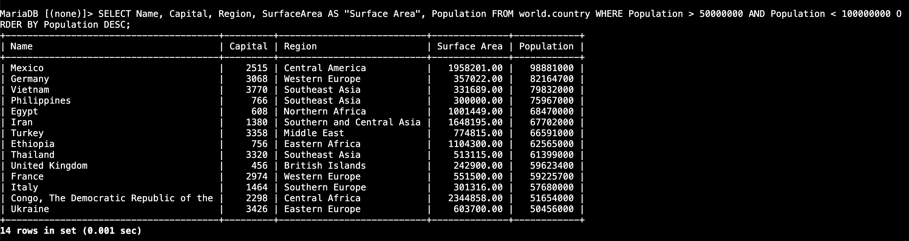

## 9. Desafío: filtro por región y población

El texto recibido de la guía pregunta: **¿Qué país en el Sur de Europa tiene una población de más de 500.000.000?**

La consulta que se ejecutó y aparece en la evidencia utiliza el umbral de **50.000.000**:

```sql
SELECT Name, Capital, Region, SurfaceArea AS "Surface Area", Population
FROM world.country
WHERE Population > 50000000 AND Region = "Southern Europe";
```

El resultado fue una fila:

| Name | Capital | Region | Surface Area | Population |
| --- | ---: | --- | ---: | ---: |
| Italy | 1464 | Southern Europe | 301316.00 | 57680000 |

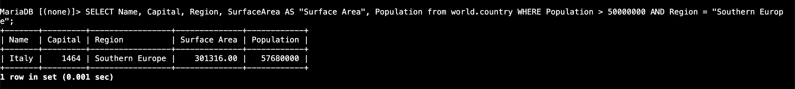

**Observación:** la evidencia responde al umbral de **50.000.000**, distinto del valor **500.000.000** escrito en el desafío. Se conserva esta diferencia para reflejar lo recibido y lo ejecutado.

## Arquitectura final de referencia

El diagrama entregado representa al usuario del laboratorio, Command Host, las consultas y los resultados asociados a la base de datos **world**.

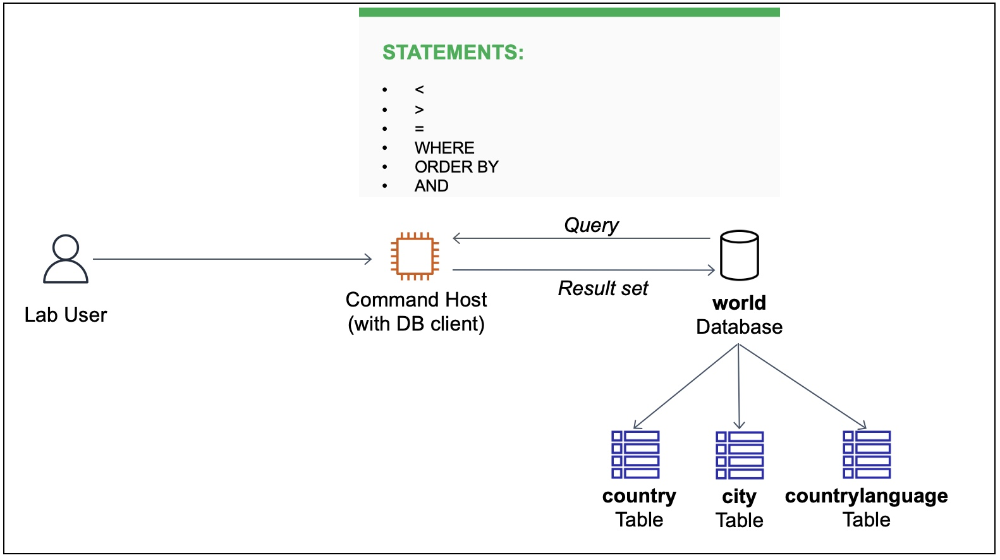

## Resultados documentados

Las evidencias muestran la conexión a MariaDB, la disponibilidad de **world**, la consulta de **239 registros** en **country**, la revisión de sus **14 columnas**, la selección de columnas, el alias de superficie y las consultas con filtros y ordenamiento. Se registraron resultados de **24**, **14** y **1** fila en las consultas filtradas.

La guía indicó finalizar con **Finalizar laboratorio → Sí**. No se recibió una captura que acredite ese cierre.

## Referencia del material

Instrucciones y capturas proporcionadas durante el laboratorio **Selección de datos de una base de datos** de AWS. Según la guía recibida, los datos de muestra se obtuvieron de **Statistics Finland**, estadísticas regionales generales, el **4 de febrero de 2022**, bajo licencia **CC BY 4.0**.

---

**Felipe Kessi Bustos · ReCoders® 2026**
