<p align="center"></p>

# 271 - Realización de una búsqueda condicional

**ReCoders® 2026**  
**Autor:** Felipe Kessi Bustos  
**Módulo:** Bases de Datos  
**Región:** us-west-2  
**Fecha:** 5 de noviembre de 2026  
**Duración estimada de la guía:** 45 minutos

## Situación

El equipo de operaciones creó la base de datos relacional `world`, que contiene las tablas `city`, `country` y `countrylanguage`. El laboratorio consiste en consultar registros de `country` con `SELECT` y condiciones de búsqueda.

## Objetivos

- Escribir una condición de búsqueda con `WHERE`.
- Usar el operador `BETWEEN`.
- Usar `LIKE` con caracteres comodín.
- Crear un alias de columna con `AS`.
- Usar funciones en un enunciado `SELECT`.
- Usar funciones en una cláusula `WHERE`.

## Arquitectura de referencia

El entorno inicial dispone de una instancia Command Host con un cliente de base de datos y la base de datos `world` con sus tres tablas.

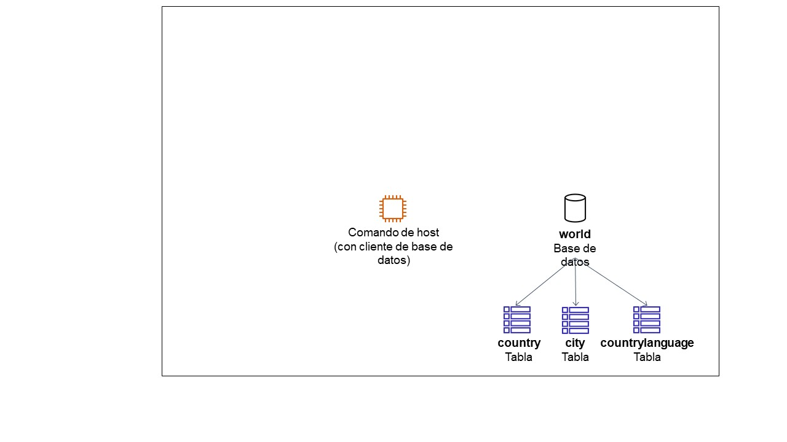

*Diagrama de referencia proporcionado en la guía.*

El diagrama final muestra al usuario conectado a Command Host para consultar `world` mediante cláusulas, operadores y funciones SQL.

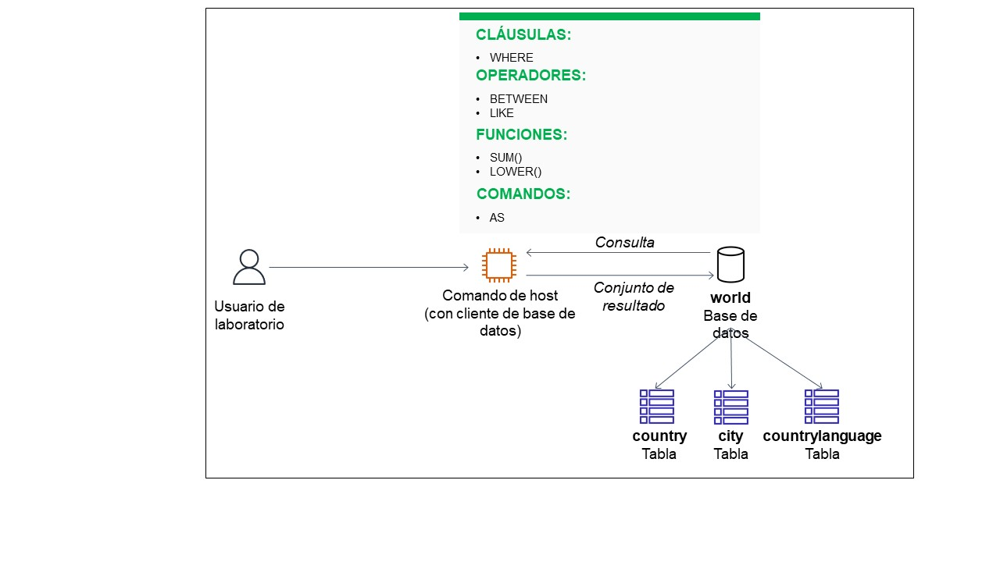

*Diagrama de referencia del resultado previsto; no corresponde a una captura de ejecución.*

## 1. Inicio y acceso al entorno

La guía indica seleccionar **Start Lab**, esperar el indicador verde de **AWS** y abrir la Consola de administración de AWS. Si el navegador bloquea la nueva pestaña, se deben permitir las ventanas emergentes. La región indicada para este laboratorio es **us-west-2**.

Para acceder a Command Host, la secuencia indicada es:

1. Abrir **Services → Compute → EC2**.
2. Seleccionar **Instances** y marcar la instancia **Command Host**.
3. Elegir **Conectar → Session Manager → Conectar**.

Estos pasos de navegación se incluyen según las instrucciones recibidas; no se adjuntaron capturas de esa navegación. El entorno puede restringir servicios y acciones a los necesarios para el laboratorio.

## 2. Preparación de la terminal y conexión a MariaDB

Se ejecutaron los comandos para cambiar al usuario root y ubicarse en el directorio de trabajo:

```bash
sudo su
cd /home/ec2-user/
```

A continuación, se realizó la conexión con el comando suministrado en la guía:

```bash
mysql -u root --password='re:St@rt!9'
```

La terminal mostró la bienvenida al monitor MariaDB, la conexión con identificador **5** y la versión **10.5.29-MariaDB**.

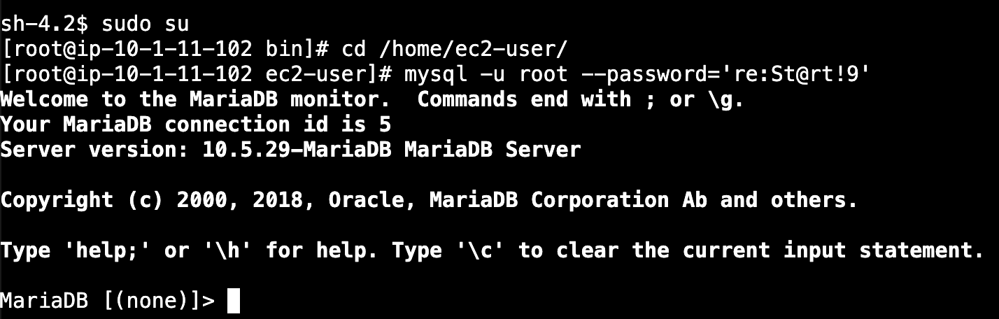

*Evidencia de preparación de la terminal y conexión al servidor de base de datos.*

## 3. Verificación de las bases de datos y consulta de country

Se listaron las bases de datos existentes:

```sql
SHOW DATABASES;
```

El resultado mostró `information_schema`, `mysql`, `performance_schema` y `world`, confirmando la disponibilidad de la base de datos del laboratorio.

Se consultaron todas las columnas y registros de `country`:

```sql
SELECT * FROM world.country;
```

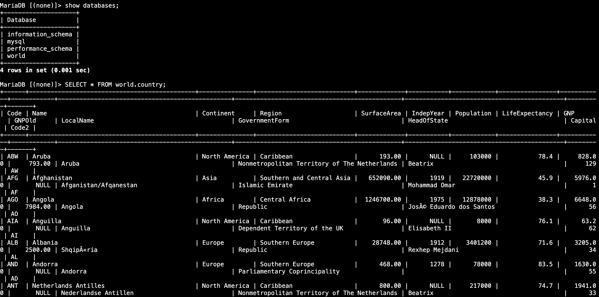

*Se observa la base de datos world y el inicio del resultado de SELECT.*

La consulta devolvió **239 filas**.

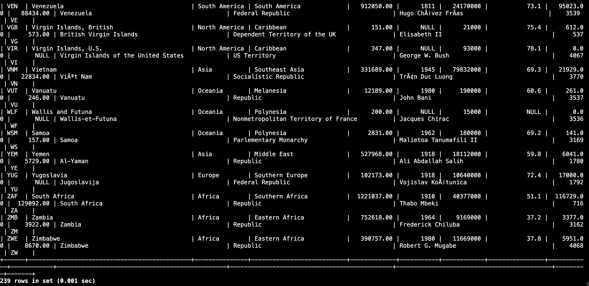

*Evidencia del total de registros devueltos.*

## 4. Búsqueda condicional con WHERE y AND

Se seleccionaron las columnas `Name`, `Capital`, `Region`, `SurfaceArea` y `Population`, filtrando países con población entre **50000000** y **100000000**, incluidos ambos límites:

```sql
SELECT Name, Capital, Region, SurfaceArea, Population
FROM world.country
WHERE Population >= 50000000 AND Population <= 100000000;
```

La consulta devolvió **14 filas**.

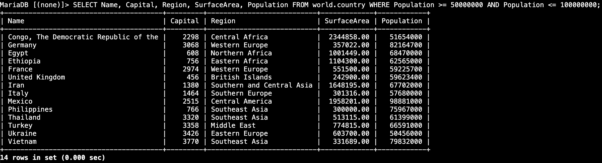

*Evidencia de la combinación de las dos condiciones de población.*

## 5. Búsqueda de rango con BETWEEN

Se ejecutó el mismo filtro mediante `BETWEEN`, que incluye los valores inicial y final del rango:

```sql
SELECT Name, Capital, Region, SurfaceArea, Population
FROM world.country
WHERE Population BETWEEN 50000000 AND 100000000;
```

Se obtuvieron nuevamente **14 filas**, correspondientes al mismo resultado de la consulta anterior.

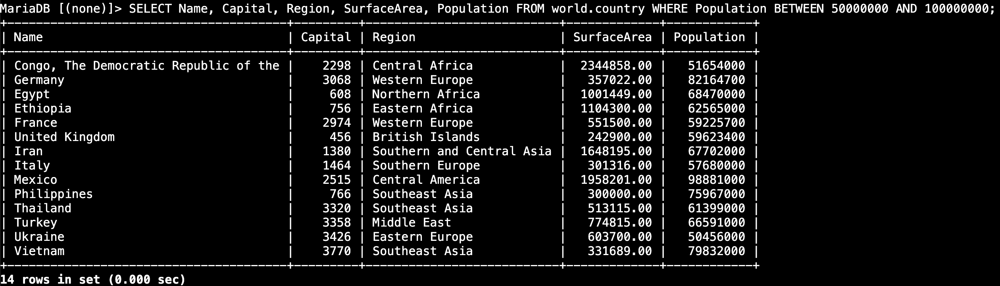

*Evidencia de la búsqueda de población mediante un rango inclusivo.*

## 6. Suma de población con SUM y LIKE

Se utilizó `LIKE` con el patrón `%Europe%` para seleccionar las regiones que contienen la cadena `Europe`, y `SUM` para sumar su población:

```sql
SELECT sum(Population)
FROM world.country
WHERE Region LIKE "%Europe%";
```

El resultado fue **634947800**.

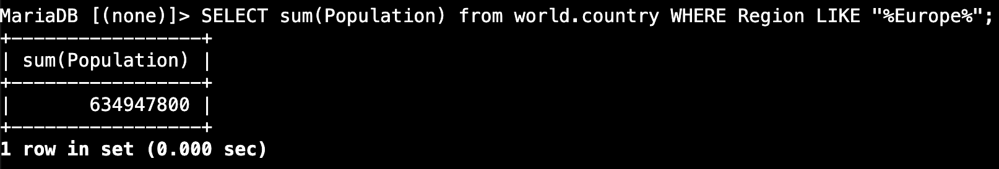

*Evidencia del resultado de SUM con el filtro LIKE.*

## 7. Alias de columna con AS

Se repitió la consulta incorporando el alias `Europe Population Total` para el encabezado de la columna:

```sql
SELECT sum(population) as "Europe Population Total"
FROM world.country
WHERE region LIKE "%Europe%";
```

Se mantuvo el resultado **634947800**, ahora con el alias solicitado.

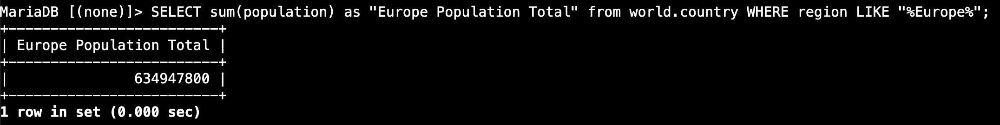

*Evidencia del uso de AS para nombrar la columna del resultado.*

## 8. Función LOWER en la cláusula WHERE

Se aplicó `LOWER` a `Region` para comparar el texto en minúsculas con el patrón `%central%`:

```sql
SELECT Name, Capital, Region, SurfaceArea, Population
FROM world.country
WHERE LOWER(Region) LIKE "%central%";
```

La consulta devolvió **31 filas**.

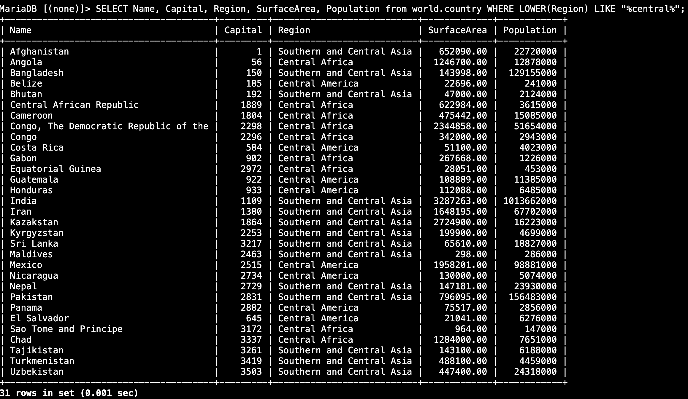

*Evidencia de una función utilizada dentro de la cláusula WHERE.*

## 9. Ejercicio: superficie y población de Norteamérica

Se ejecutó la consulta para sumar la superficie y la población de los registros cuya región es `North America`, asignando un alias a cada resultado:

```sql
SELECT SUM(SurfaceArea) as "N. America Surface Area",
       SUM(Population) as "N. America Population"
FROM world.country
WHERE Region = "North America";
```

| N. America Surface Area | N. America Population |
| ---: | ---: |
| 21500515.00 | 309632000 |

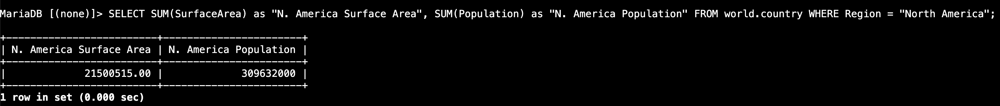

*Evidencia del resultado del ejercicio de Norteamérica.*

## 10. Cierre indicado en la guía

Los pasos 19 y 20 indican seleccionar **Finalizar laboratorio**, confirmar con **Sí** y verificar el mensaje **El laboratorio de AWS finalizó correctamente**. No se recibió una captura que confirme la ejecución de este cierre.

## Fuente de los datos

Según la guía, los datos de país, ciudad e idioma se obtuvieron del servicio de Statistics Finland el **4 de febrero de 2022**, con licencia [Creative Commons Attribution 4.0 International](https://creativecommons.org/licenses/by/4.0/deed.en). Fuente original: [Statistics Finland](https://tilastokeskus.fi/tup/kvportaali/index_en.html).

---

**ReCoders® 2026 · Felipe Kessi Bustos**
