# 272 - Trabajar con funciones

**ReCoders® 2026 · Felipe Kessi Bustos**

## Ficha del laboratorio

| Campo | Detalle |
|---|---|
| Módulo | Bases de Datos |
| Región | `us-west-2` |
| Fecha de las evidencias | 5 de noviembre de 2026 |
| Duración estimada de la guía | 45 minutos |
| Material recibido | Dos fragmentos de instrucciones, dos diagramas y once capturas de ejecución |
| Estado documentado | Consultas y desafío con evidencia; cierre del laboratorio sin evidencia |

## Situación y objetivos

El equipo de operaciones creó la base de datos relacional **world**, que contiene las tablas **city**, **country** y **countrylanguage**. El laboratorio utiliza funciones de base de datos en la instrucción `SELECT` y en la cláusula `WHERE`.

Los objetivos proporcionados fueron:

- Resumir datos con `SUM()`, `MIN()`, `MAX()` y `AVG()`.
- Dividir cadenas con `SUBSTRING_INDEX()`.
- Usar `LENGTH()` y `TRIM()` para determinar la longitud de una cadena.
- Filtrar registros duplicados con `DISTINCT`.
- Utilizar funciones en `SELECT` y `WHERE`.

## Arquitectura proporcionada por la guía

Al comenzar, estaban previstos una instancia **Command Host**, con un cliente de base de datos, y la base de datos **world** con sus tres tablas.

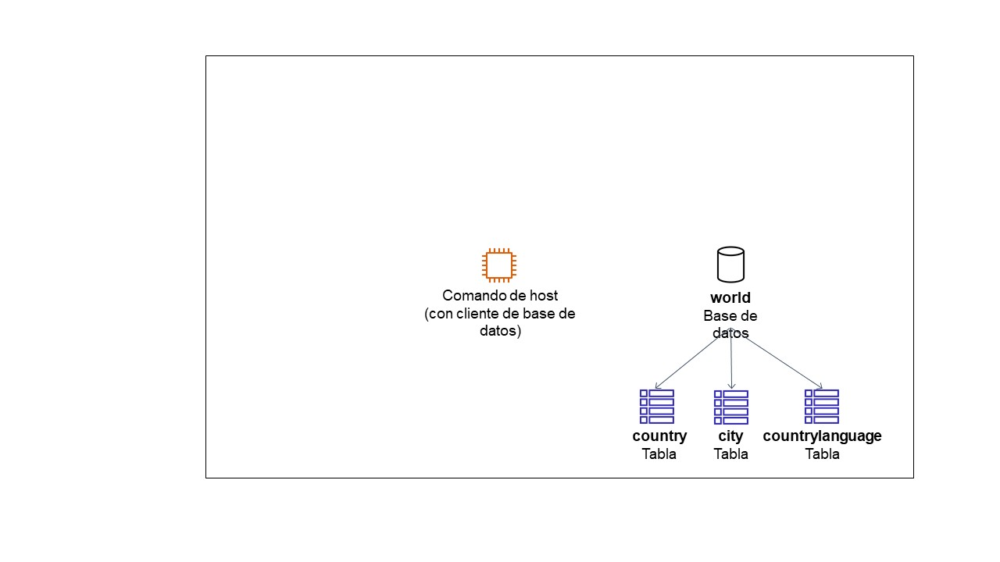

El diagrama final de la guía representa al usuario consultando la base de datos mediante Command Host y utilizando las funciones del laboratorio. Es un esquema del resultado esperado.

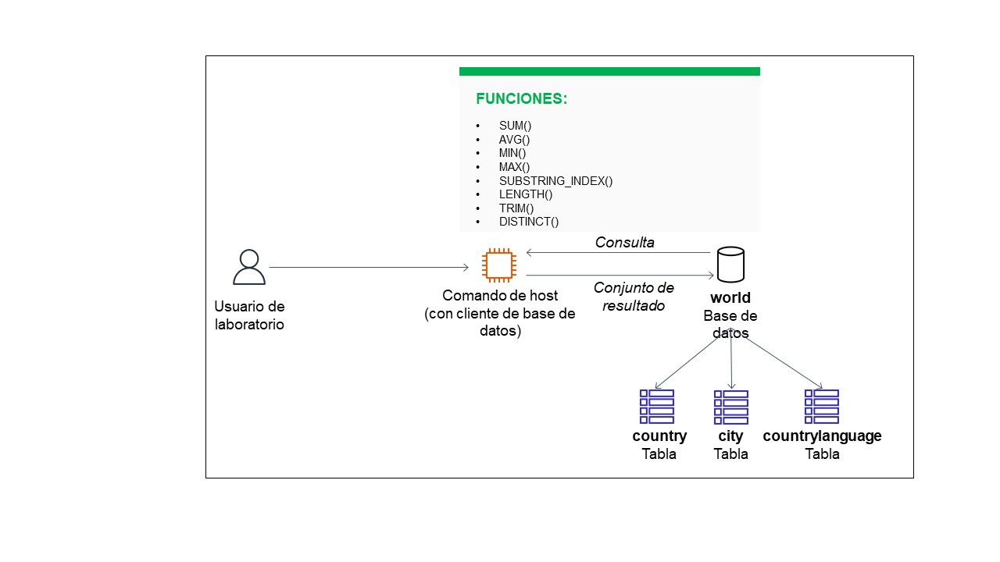

## 1. Iniciar el laboratorio y acceder a AWS

**Instrucciones recibidas:**

1. Seleccionar **Start Lab**. Si aparece **Access Denied**, cerrar el aviso y seleccionar **Start Lab** nuevamente.
2. Esperar a que el indicador junto a **AWS** cambie a verde. El rojo indica que el laboratorio no está iniciado y el amarillo que se está iniciando.
3. Seleccionar el círculo verde junto a **AWS** para abrir la consola con la sesión iniciada automáticamente.
4. Si el navegador bloquea la ventana, permitir las ventanas emergentes.
5. Colocar la consola junto a las instrucciones y mantener la región del laboratorio, `us-west-2`.

No se recibió una captura de estos pasos. La guía advierte que el entorno puede restringir servicios y acciones a los necesarios para el ejercicio.

## 2. Tarea 1: conectarse a Command Host

**Ruta indicada:** Consola de AWS → **Services** → **Compute** → **EC2** → **Instances**.

1. Seleccionar la instancia **Command Host** y elegir **Conectar**.
2. En **Conexión a instancia**, abrir **Session Manager** y seleccionar **Conectar**.
3. Si no aparece la instancia, la guía indica comprobar el aprovisionamiento y la región. Si **Conectar** no está disponible, esperar unos minutos y volver a intentarlo.
4. Preparar la terminal:

```bash
sudo su
cd /home/ec2-user/
```

5. Conectarse al servicio de base de datos con el comando entregado para este entorno:

```bash
mysql -u root --password='re:St@rt!9'
```

**Resultado observado:** se abrió el monitor de MariaDB, versión del servidor `10.5.29-MariaDB`, con el indicador `MariaDB [(none)]>`.

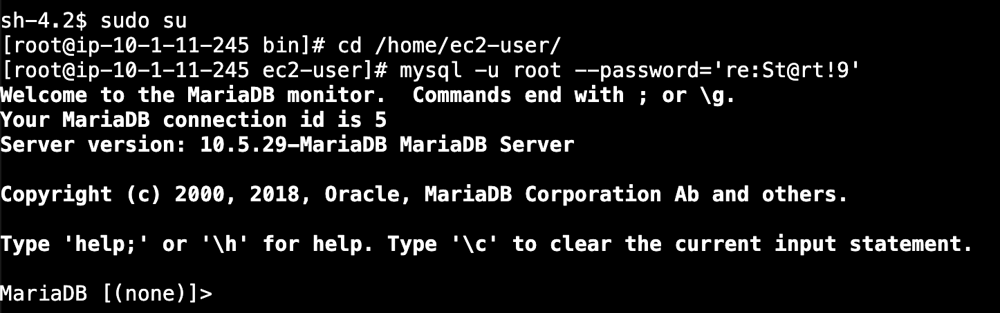

La guía indica repetir la conexión mediante Session Manager y los comandos anteriores si la ventana deja de responder. No se observó ese incidente en las capturas recibidas.

## 3. Tarea 2: consultar la base de datos world

### 3.1. Mostrar las bases de datos y consultar country

Se ejecutó:

```sql
SHOW DATABASES;
```

**Resultado observado:** se listaron `information_schema`, `mysql`, `performance_schema` y `world`.

A continuación, se consultó la tabla:

```sql
SELECT * FROM world.country;
```

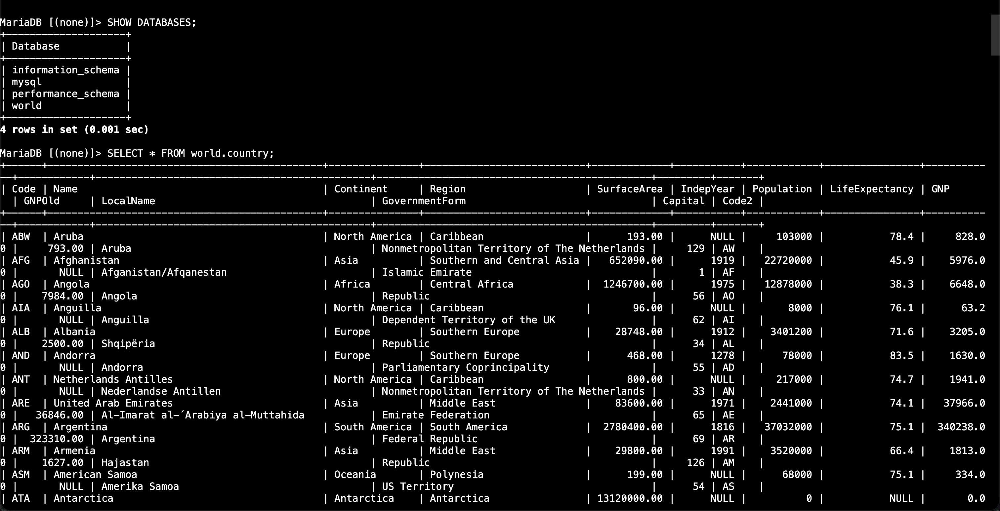

**Resultado observado:** la consulta a `world.country` devolvió **239 filas**.

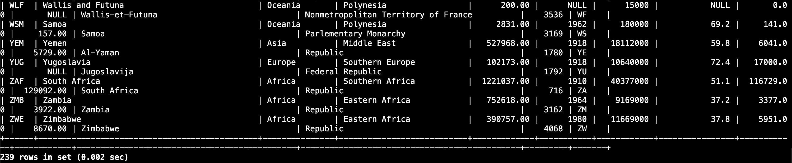

### 3.2. Resumir la población con funciones agregadas

Se ejecutó la consulta indicada, sin una condición `WHERE`, sobre todos los registros de `country`:

```sql
SELECT sum(Population), avg(Population), max(Population),
       min(Population), count(Population)
FROM world.country;
```

| Función | Operación indicada por la guía | Resultado observado |
|---|---|---:|
| `SUM(Population)` | Sumar los valores de población | 6078749450 |
| `AVG(Population)` | Calcular el promedio | 25434098.1172 |
| `MAX(Population)` | Obtener el valor máximo | 1277558000 |
| `MIN(Population)` | Obtener el valor mínimo | 0 |
| `COUNT(Population)` | Contar las filas con valor de población | 239 |

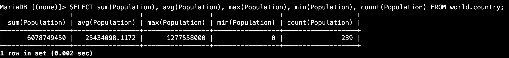

### 3.3. Dividir una cadena con SUBSTRING_INDEX()

Se obtuvo el comienzo del nombre de cada región, utilizando el espacio como separador:

```sql
SELECT Region, substring_index(Region, " ", 1)
FROM world.country;
```

**Resultado observado:** la segunda columna muestra el primer segmento de cada región. Por ejemplo, `Southern and Central Asia` aparece como `Southern` y `Central Africa` como `Central`.

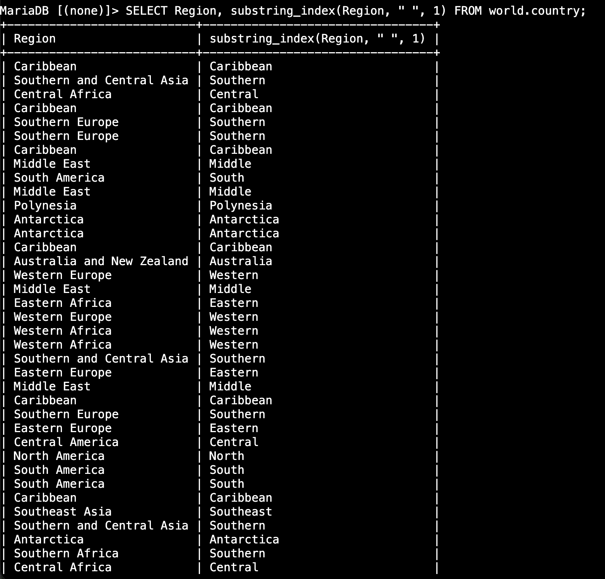

La consulta devolvió **239 filas**.

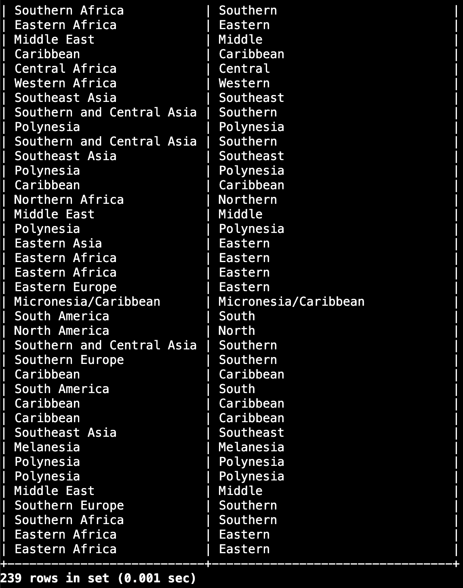

### 3.4. Utilizar SUBSTRING_INDEX() en WHERE

Se filtraron los registros cuyo primer segmento de `Region` es `Southern`:

```sql
SELECT Name, Region
FROM world.country
WHERE substring_index(Region, " ", 1) = "Southern";
```

**Resultado observado:** se devolvieron **34 filas**, con regiones como `Southern and Central Asia`, `Southern Europe` y `Southern Africa`.

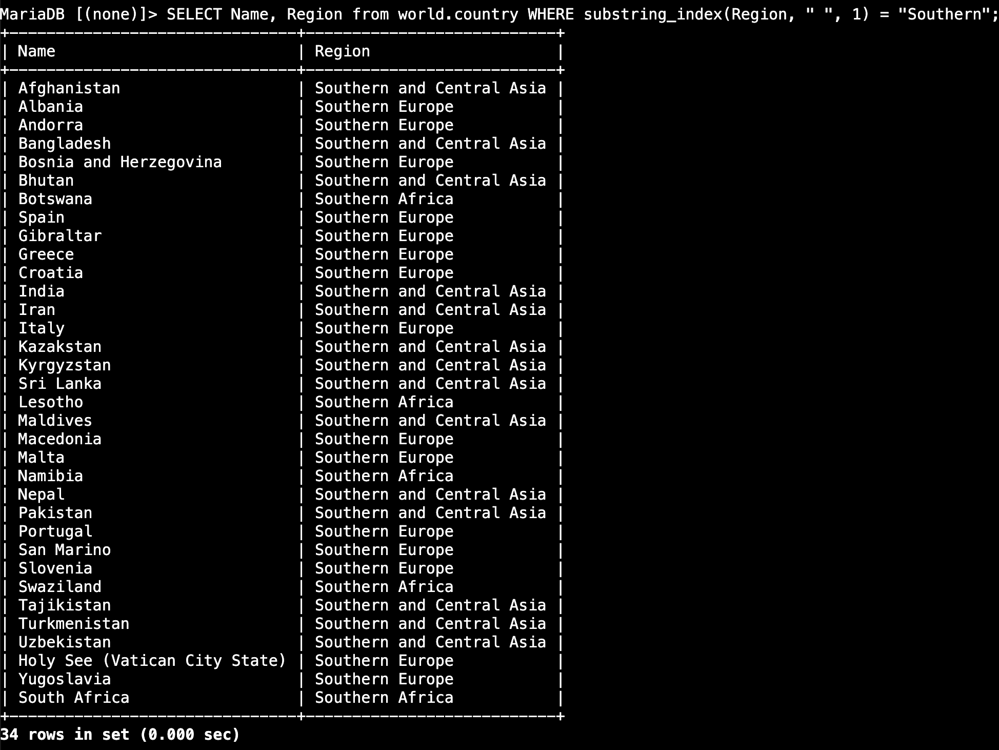

### 3.5. Filtrar regiones con LENGTH() y TRIM()

La guía utiliza `TRIM()` para quitar espacios iniciales y finales, y combina su resultado con `LENGTH()` en el filtro:

```sql
SELECT Region
FROM world.country
WHERE LENGTH(TRIM(Region)) < 10;
```

**Resultado observado:** aparecen valores repetidos de `Caribbean`, `Polynesia` y `Melanesia`.

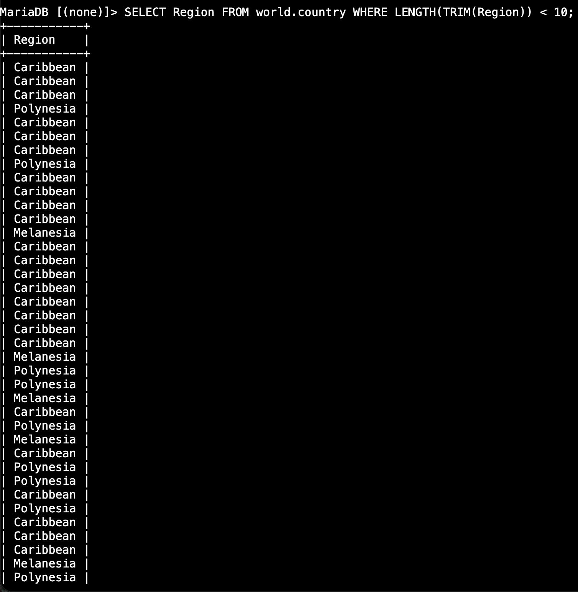

La consulta devolvió **39 filas**.

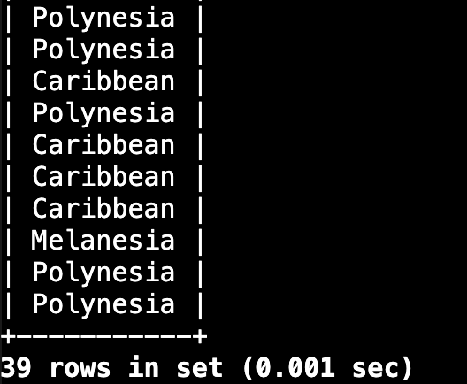

### 3.6. Eliminar duplicados con DISTINCT

Se aplicó `DISTINCT` al filtro anterior:

```sql
SELECT DISTINCT(Region)
FROM world.country
WHERE LENGTH(TRIM(Region)) < 10;
```

**Resultado observado:** se devolvieron **3 filas**, correspondientes a `Caribbean`, `Polynesia` y `Melanesia`.

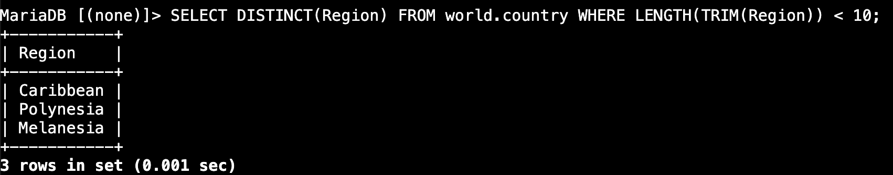

## 4. Desafío: dividir Micronesia/Caribbean en dos columnas

El desafío solicitó filtrar la región y dividirla en dos columnas llamadas **Region Name 1** y **Region Name 2**. La consulta proporcionada y ejecutada fue:

```sql
SELECT Name,
       substring_index(Region, "/", 1) AS "Region Name 1",
       substring_index(Region, "/", -1) AS "Region Name 2"
FROM world.country
WHERE Region = "Micronesia/Caribbean";
```

**Resultado observado:** se devolvió una fila:

| Name | Region Name 1 | Region Name 2 |
|---|---|---|
| United States Minor Outlying Islands | Micronesia | Caribbean |

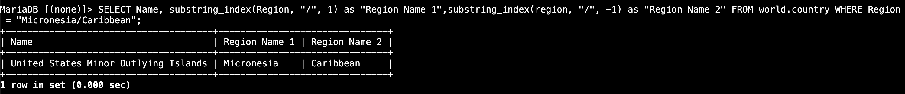

## 5. Validación de los objetivos

| Objetivo | Evidencia observada |
|---|---|
| Resumir datos con funciones agregadas | Resultados de SUM, AVG, MAX, MIN y COUNT |
| Dividir cadenas | Primer segmento de Region y separación mediante `/` en el desafío |
| Utilizar LENGTH y TRIM | Filtro que devuelve 39 filas |
| Filtrar duplicados | Tres regiones únicas con DISTINCT |
| Usar funciones en SELECT y WHERE | Consultas documentadas en los pasos 3 y 4 |

## 6. Cierre del laboratorio

**Instrucción recibida:** seleccionar **Finalizar laboratorio** y luego **Sí**. La guía indica que debe aparecer el mensaje **El laboratorio de AWS finalizó correctamente**.

**Estado de la evidencia:** no se recibió una captura ni confirmación de esta acción; el cierre queda pendiente de verificar.

## Fuentes del registro

- Fragmento 1: situación, objetivos, arquitectura, duración, restricciones e inicio del laboratorio.
- Fragmento 2: conexión a Command Host, consultas, desafío e instrucciones de cierre.
- Once capturas de ejecución proporcionadas por Felipe Kessi Bustos.
- Diagramas inicial y final proporcionados con la guía.
- Según la guía, los datos de muestra proceden de Statistics Finland, estadísticas regionales generales, descargados el 4 de febrero de 2022.

---

**ReCoders® 2026 · Autor: Felipe Kessi Bustos**
