<p align="center"></p>

# 274 - Introducción a Amazon Aurora

**ReCoders® 2026**  
**Autor:** Felipe Kessi Bustos  
**Fecha:** 5 de noviembre de 2026  
**Región:** `us-west-2`  
**Duración estimada de la guía:** 40 minutos

## Objetivos

- Crear una instancia de Aurora.
- Conectarse a una instancia de Amazon EC2.
- Configurar la instancia EC2 para conectarse a Aurora.
- Consultar la instancia de Aurora.

## Procedimiento realizado

Documentación basada en las instrucciones y las 29 capturas entregadas. Las evidencias se presentan junto al paso correspondiente, en orden cronológico.

### 1. Abrir Aurora y RDS

Se accedió al panel de Aurora y RDS en la región **US West (Oregon), us-west-2**. El panel inicial mostraba cero clústeres y cero instancias de base de datos.

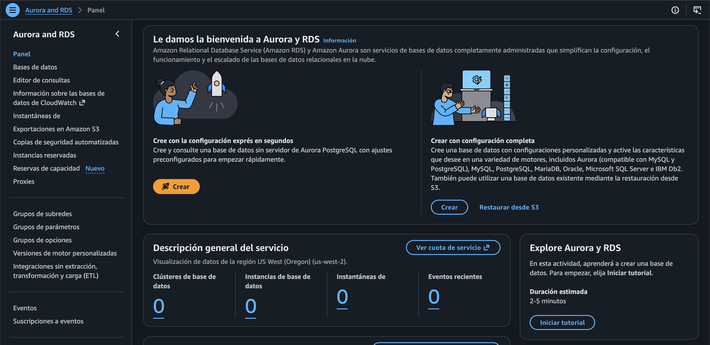

*Evidencia: captura del 5 de noviembre de 2026, 3:28:53 a. m.*

### 2. Seleccionar el motor y el método de creación

Se seleccionó **Aurora (MySQL Compatible)** y el método **Configuración completa**.

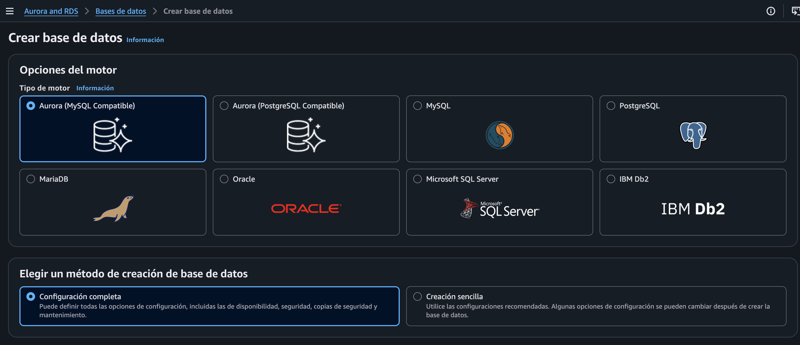

*Evidencia: captura del 5 de noviembre de 2026, 3:34:11 a. m.*

### 3. Configurar la plantilla y la capacidad

Se eligió **Desarrollo y pruebas**, escalabilidad **Aprovisionada**, **Clases ampliables (incluye clases t)** e instancia **db.t3.medium**, con 2 vCPU y 4 GiB de RAM.

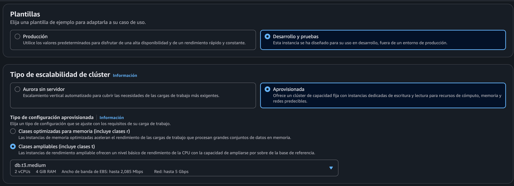

*Evidencia: captura del 5 de noviembre de 2026, 3:34:20 a. m.*

### 4. Definir el clúster y el usuario maestro

Se configuró **Aurora MySQL 3.10.3**, compatible con **MySQL 8.0.42**. El identificador del clúster fue `aurora` y el usuario maestro, `admin`. El soporte extendido de RDS quedó desmarcado.

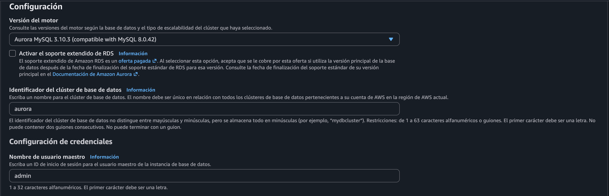

*Evidencia: captura del 5 de noviembre de 2026, 3:34:32 a. m.*

### 5. Configurar la administración de credenciales

Se seleccionó **Autoadministrado** y se ingresó y confirmó la contraseña maestra. La generación automática de contraseña quedó desmarcada. La contraseña usada en la conexión posterior difiere de la indicada en la guía.

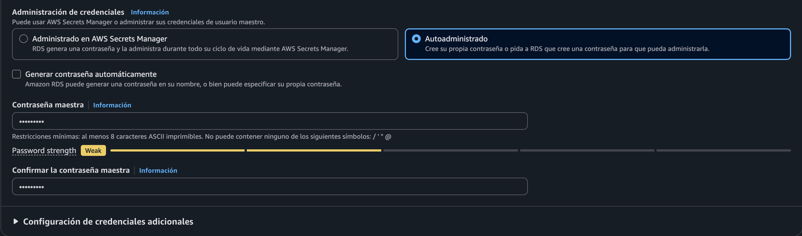

*Evidencia: captura del 5 de noviembre de 2026, 3:34:39 a. m.*

### 6. Configurar almacenamiento y disponibilidad

Se seleccionó **Aurora Estándar** y **No crear una réplica de Aurora**.

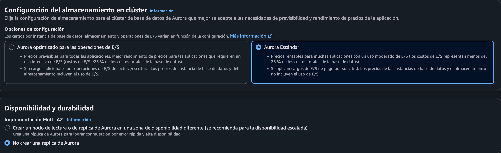

*Evidencia: captura del 5 de noviembre de 2026, 3:34:48 a. m.*

### 7. Configurar la red

Se mantuvo **No se conecte a un recurso informático EC2** durante la creación. Se eligió **IPv4**, la VPC **LabVPC** y el grupo de subredes **dbsubnetgroup**, con dos subredes en dos zonas de disponibilidad.

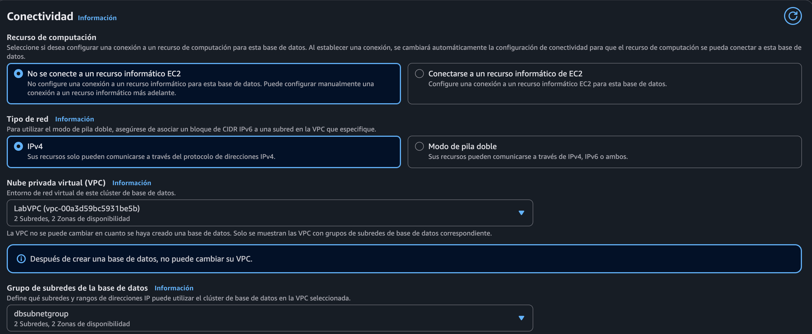

*Evidencia: captura del 5 de noviembre de 2026, 3:35:00 a. m.*

### 8. Configurar el acceso a la base de datos

Se seleccionó **No** en acceso público y **Elegir existente** para el grupo de seguridad de VPC. El grupo seleccionado fue **DBSecurityGroup**.

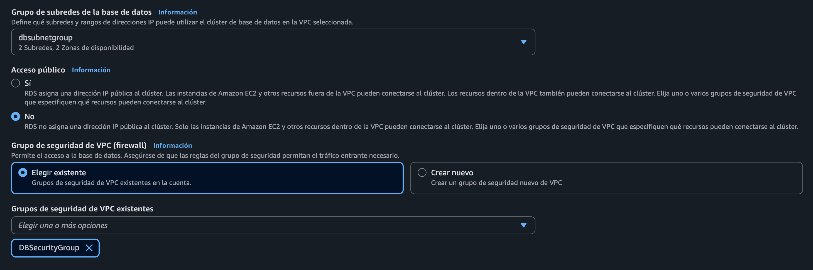

*Evidencia: captura del 5 de noviembre de 2026, 3:35:33 a. m.*

### 9. Revisar la zona, el proxy y el certificado

La zona de disponibilidad quedó **Sin preferencia**. No se habilitó un proxy de RDS y se mantuvo el certificado predeterminado **rds-ca-rsa2048-g1**.

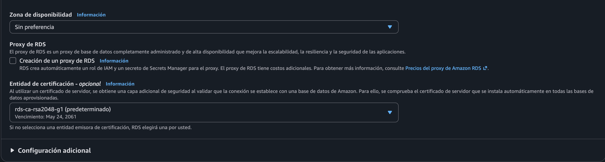

*Evidencia: captura del 5 de noviembre de 2026, 3:35:39 a. m.*

### 10. Revisar reservas, reenvío de escritura y etiquetas

Se mantuvo **Sin reserva de capacidad**, el reenvío de escritura local desactivado y el recurso sin etiquetas.

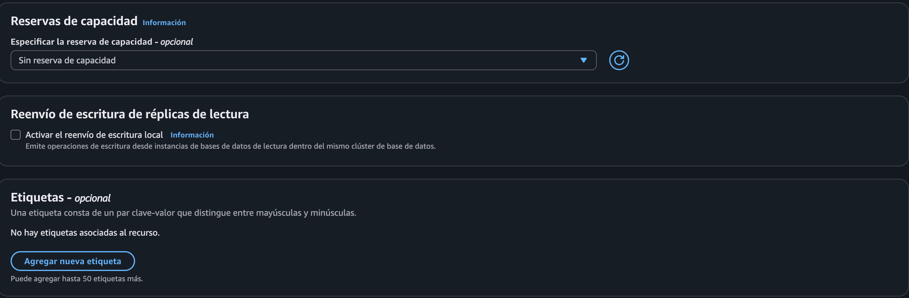

*Evidencia: captura del 5 de noviembre de 2026, 3:36:56 a. m.*

### 11. Revisar roles de IAM

No se agregaron roles de IAM al clúster.

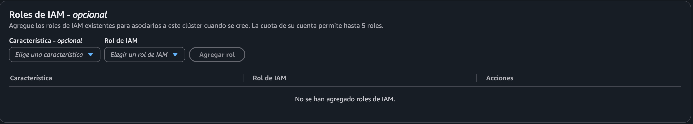

*Evidencia: captura del 5 de noviembre de 2026, 3:37:03 a. m.*

### 12. Revisar la supervisión

Se seleccionó **Database Insights: estándar**, con recopilación de métricas detalladas habilitada y retención de **7 días**. La clave de KMS mostrada fue `aws/rds`.

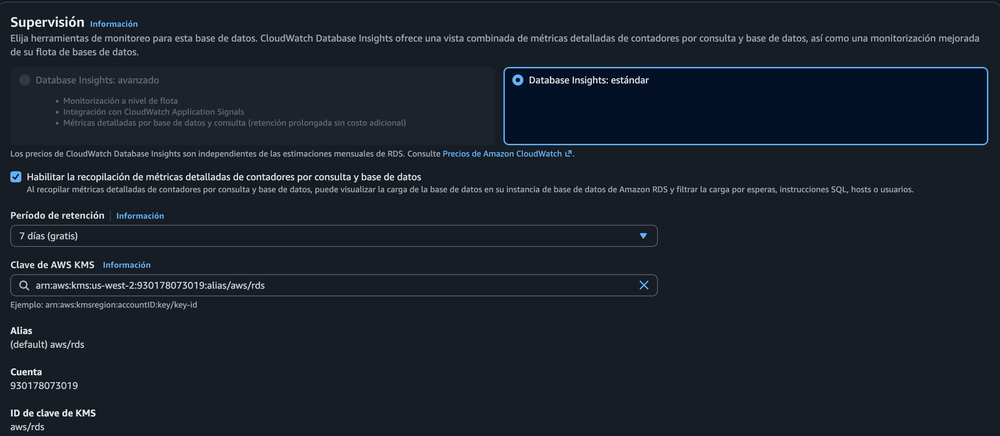

*Evidencia: captura del 5 de noviembre de 2026, 3:37:14 a. m.*

### 13. Desactivar la monitorización mejorada

La monitorización mejorada quedó desactivada. No se seleccionaron exportaciones de registros a CloudWatch Logs.

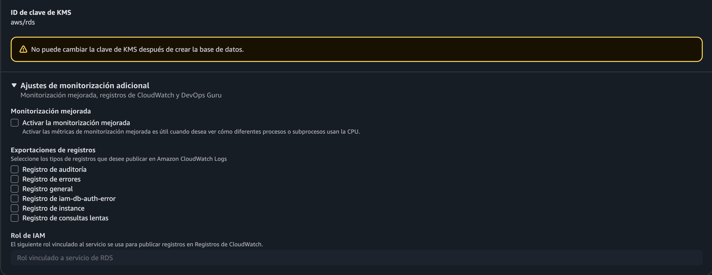

*Evidencia: captura del 5 de noviembre de 2026, 3:37:23 a. m.*

### 14. Configurar la base inicial y las copias de seguridad

En **Configuración adicional**, se ingresó `world` como nombre de base de datos inicial. Se mantuvieron los grupos de parámetros `default.aurora-mysql8.0`, la prioridad de conmutación por error sin preferencia, la retención de copias de seguridad de **7 días** y el período de copia sin preferencia.

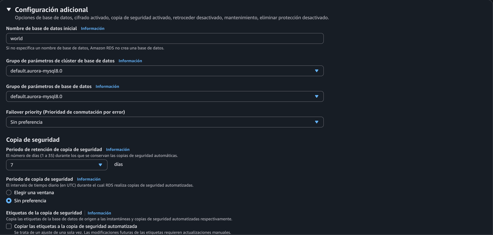

*Evidencia: captura del 5 de noviembre de 2026, 3:43:03 a. m.*

### 15. Revisar las etiquetas de copias y el cifrado

Se mantuvo activada la copia de etiquetas en las instantáneas y desactivada la copia de etiquetas a la copia de seguridad automatizada. El cifrado quedó configurado con una **clave de KMS administrada por AWS (SSE-KMS)**, alias `aws/rds`. Aunque la guía indicaba desactivar el cifrado, la captura muestra esta configuración habilitada.

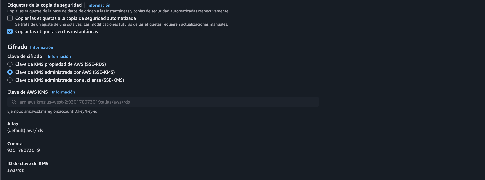

*Evidencia: captura del 5 de noviembre de 2026, 3:43:17 a. m.*

### 16. Revisar Backtrack y mantenimiento

Backtrack, la actualización automática de versiones secundarias y la protección contra eliminación quedaron desactivados. El período de mantenimiento quedó **Sin preferencia**.

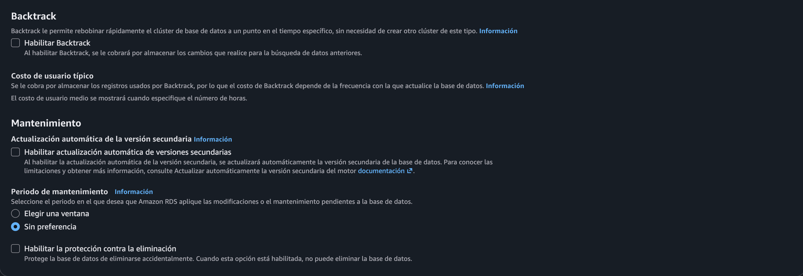

*Evidencia: captura del 5 de noviembre de 2026, 3:43:24 a. m.*

### 17. Crear la base de datos

Se llegó al final del formulario y se seleccionó **Crear base de datos**.

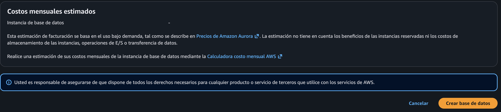

*Evidencia: captura del 5 de noviembre de 2026, 3:43:32 a. m.*

### 18. Verificar el inicio de la creación

La consola mostró el clúster `aurora` y la instancia `aurora-instance-1` en estado **Creando**.

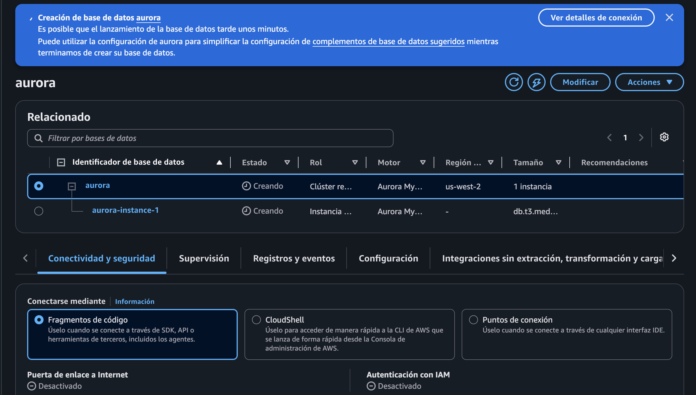

*Evidencia: captura del 5 de noviembre de 2026, 3:43:53 a. m.*

### 19. Verificar la creación del clúster

La consola notificó que la base de datos `aurora` se había creado correctamente. El clúster aparecía disponible y la instancia aún figuraba en creación, en `us-west-2a`.

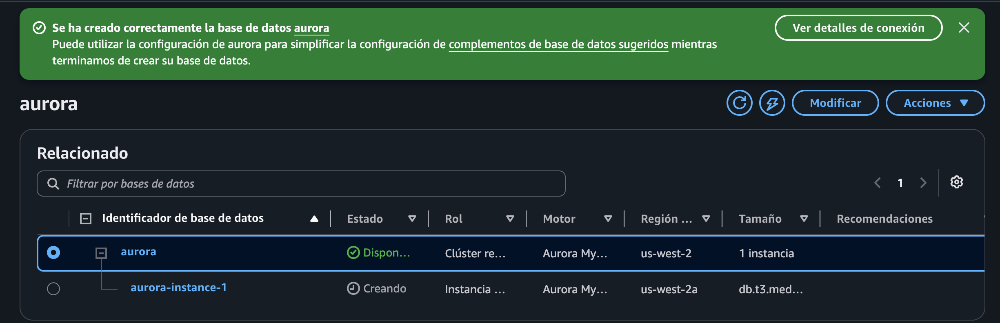

*Evidencia: captura del 5 de noviembre de 2026, 3:46:25 a. m.*

### 20. Identificar Command Host

En **EC2 > Instancias**, se identificó **Command Host**, de tipo `t3.medium`, en ejecución en `us-west-2a`, con **3/3 comprobaciones** correctas. La guía indica conectarse mediante **Session Manager**. Las capturas posteriores muestran comandos ejecutados en la terminal.

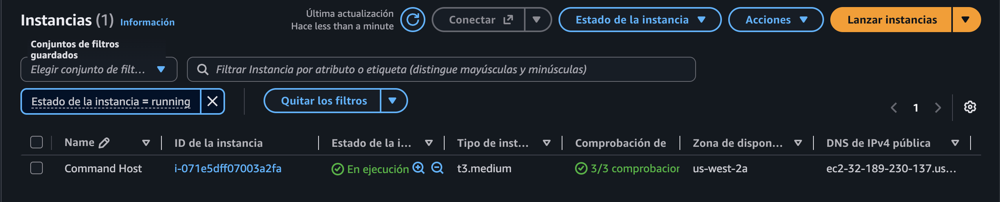

*Evidencia: captura del 5 de noviembre de 2026, 3:47:23 a. m.*

### 21. Instalar el cliente MariaDB

En la terminal de la instancia EC2 se ejecutó:

```bash
sudo yum install mariadb -y
```

La instalación del paquete `mariadb.x86_64 1:5.5.68-1.amzn2.0.4` finalizó con el mensaje `Complete!`.

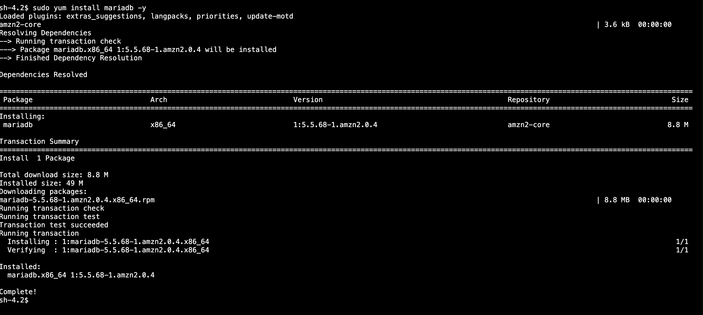

*Evidencia: captura del 5 de noviembre de 2026, 3:47:55 a. m.*

### 22. Confirmar la disponibilidad de Aurora

Se regresó a **Aurora y RDS > Bases de datos**. Tanto `aurora` como `aurora-instance-1` aparecían disponibles. La instancia era `db.t3.medium`, en `us-west-2a`.

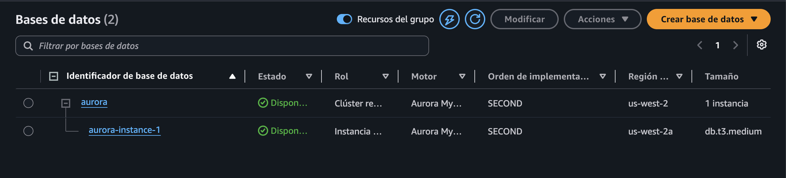

*Evidencia: captura del 5 de noviembre de 2026, 3:49:01 a. m.*

### 23. Revisar las opciones de conexión

Se abrió `aurora-instance-1` y la pestaña **Conectividad y seguridad**. Se seleccionó **Fragmentos de código**, lenguaje **MySQL (macOS)** y **Punto de conexión de la instancia**. La conexión posterior utilizó el punto de conexión de la instancia, en lugar del punto de conexión de clúster descrito en la guía.

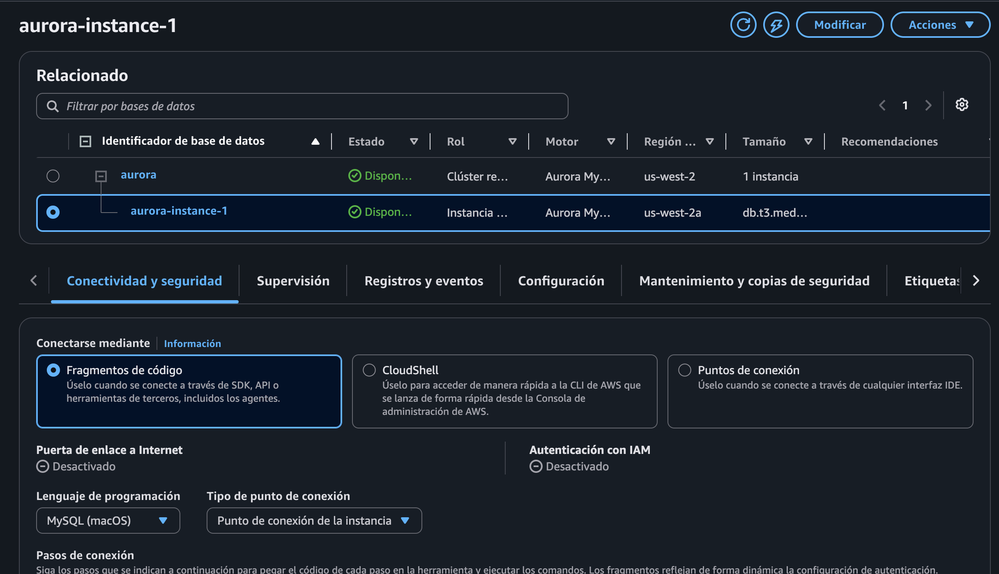

*Evidencia: captura del 5 de noviembre de 2026, 3:49:48 a. m.*

### 24. Conectarse a Aurora desde EC2

Se ejecutó el cliente MySQL con el usuario `admin`, la contraseña configurada y el punto de conexión de `aurora-instance-1`.

```bash
mysql -u admin --password='<contraseña configurada>' -h aurora-instance-1.ctk4ppx0hzjw.us-west-2.rds.amazonaws.com
```

El monitor MariaDB confirmó la conexión, con identificador **56**, servidor **8.0.42** y el prompt `MySQL [(none)]>`. En el comando documentado, la contraseña se representa mediante un marcador.

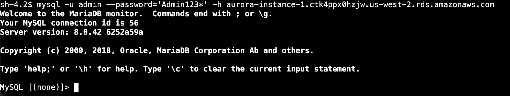

*Evidencia: captura del 5 de noviembre de 2026, 3:52:47 a. m.*

### 25. Listar las bases de datos

Se ejecutó:

```sql
SHOW DATABASES;
```

Se obtuvieron cinco bases: `information_schema`, `mysql`, `performance_schema`, `sys` y `world`.

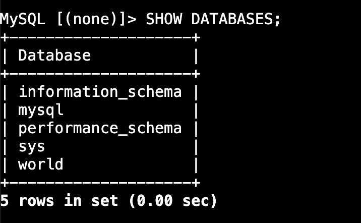

*Evidencia: captura del 5 de noviembre de 2026, 3:53:07 a. m.*

### 26. Seleccionar la base world

Se ejecutó:

```sql
USE world;
```

El resultado fue `Database changed` y el prompt cambió a `MySQL [world]>`.

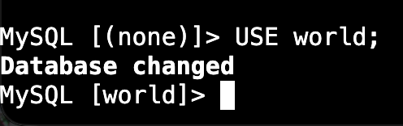

*Evidencia: captura del 5 de noviembre de 2026, 3:53:24 a. m.*

### 27. Crear la tabla country

Se creó la tabla `country` en la base `world` con la siguiente instrucción:

```sql
CREATE TABLE `country` (
`Code` CHAR(3) NOT NULL DEFAULT '',
`Name` CHAR(52) NOT NULL DEFAULT '',
`Continent` enum('Asia','Europe','North America','Africa','Oceania','Antarctica','South America') NOT NULL DEFAULT 'Asia',
`Region` CHAR(26) NOT NULL DEFAULT '',
`SurfaceArea` FLOAT(10,2) NOT NULL DEFAULT '0.00',
`IndepYear` SMALLINT(6) DEFAULT NULL,
`Population` INT(11) NOT NULL DEFAULT '0',
`LifeExpectancy` FLOAT(3,1) DEFAULT NULL,
`GNP` FLOAT(10,2) DEFAULT NULL,
`GNPOld` FLOAT(10,2) DEFAULT NULL,
`LocalName` CHAR(45) NOT NULL DEFAULT '',
`GovernmentForm` CHAR(45) NOT NULL DEFAULT '',
`Capital` INT(11) DEFAULT NULL,
`Code2` CHAR(2) NOT NULL DEFAULT '',
PRIMARY KEY (`Code`)
);
```

El resultado fue `Query OK, 0 rows affected, 7 warnings (0.03 sec)`.

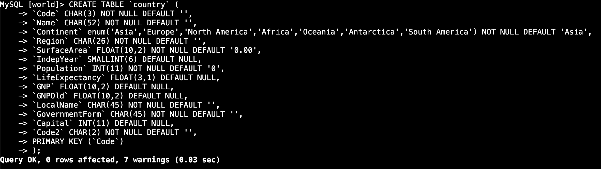

*Evidencia: captura del 5 de noviembre de 2026, 3:54:28 a. m.*

### 28. Insertar los registros de países

Se insertaron cinco registros: Gabón, Irlanda, Tailandia, Costa Rica y Australia.

```sql
INSERT INTO `country` VALUES ('GAB','Gabon','Africa','Central Africa',267668.00,1960,1226000,50.1,5493.00,5279.00,'Le Gabon','Republic',902,'GA');

INSERT INTO `country` VALUES ('IRL','Ireland','Europe','British Islands',70273.00,1921,3775100,76.8,75921.00,73132.00,'Ireland/Éire','Republic',1447,'IE');

INSERT INTO `country` VALUES ('THA','Thailand','Asia','Southeast Asia',513115.00,1350,61399000,68.6,116416.00,153907.00,'Prathet Thai','Constitutional Monarchy',3320,'TH');

INSERT INTO `country` VALUES ('CRI','Costa Rica','North America','Central America',51100.00,1821,4023000,75.8,10226.00,9757.00,'Costa Rica','Republic',584,'CR');

INSERT INTO `country` VALUES ('AUS','Australia','Oceania','Australia and New Zealand',7741220.00,1901,18886000,79.8,351182.00,392911.00,'Australia','Constitutional Monarchy, Federation',135,'AU');
```

Cada inserción devolvió `Query OK, 1 row affected`.

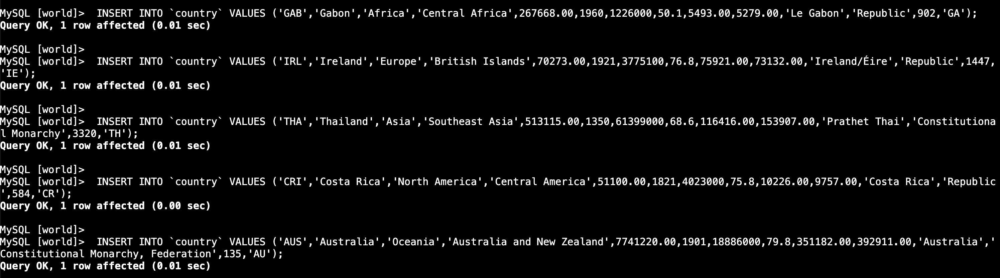

*Evidencia: captura del 5 de noviembre de 2026, 3:54:40 a. m.*

### 29. Consultar los registros

Se ejecutó:

```sql
SELECT * FROM country WHERE GNP > 35000 and Population > 10000000;
```

La consulta devolvió **2 registros**, correspondientes a **Australia** y **Tailandia**, con el mensaje `2 rows in set (0.00 sec)`.

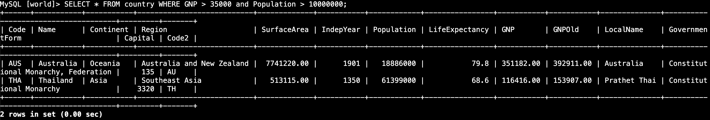

*Evidencia: captura del 5 de noviembre de 2026, 3:55:23 a. m.*

## Resultados verificados

| Comprobación | Resultado observado |
|---|---|
| Creación de Aurora | Clúster `aurora` e instancia `aurora-instance-1` disponibles |
| Cliente MariaDB en EC2 | Instalación completada |
| Conexión a Aurora | Acceso al monitor MariaDB confirmado |
| Base de datos `world` | Presente y seleccionada |
| Tabla `country` | Creada con siete advertencias |
| Inserciones | Cinco registros insertados correctamente |
| Consulta con filtros de GNP y población | Dos resultados: Australia y Tailandia |

## Finalización del laboratorio

La guía indica seleccionar **Finalizar laboratorio** y confirmar con **Sí**. No se recibió una captura de esa acción ni del mensaje de finalización, por lo que su ejecución no queda verificada en esta documentación.

---

**Felipe Kessi Bustos · ReCoders® 2026**
