

# 275 - Introducción a DynamoDB

**ReCoders® 2026**  
**Autor:** Felipe Kessi Bustos  
**Región:** us-west-2 — Estados Unidos (Oregón)  
**Fecha de las evidencias:** 5 de noviembre de 2026

## Objetivos

- Crear una tabla de Amazon DynamoDB.
- Ingresar datos en una tabla de Amazon DynamoDB.
- Consultar una tabla de Amazon DynamoDB.
- Eliminar una tabla de Amazon DynamoDB.

## 1. Crear la tabla Music

1. Se accedió al panel de Amazon DynamoDB y a la opción **Crear tabla**.

*Evidencia 01. Panel inicial de Amazon DynamoDB.*

2. Se configuró el nombre `Music`, la clave de partición `Artist` y la clave de ordenación `Song`. Ambas claves se definieron como **Cadena**.

*Evidencia 02. Nombre y claves de la tabla Music.*

3. Se mantuvo la configuración predeterminada mostrada: clase Estándar de DynamoDB, capacidad bajo demanda, sin índices secundarios, clave de cifrado propiedad de AWS y protección contra eliminaciones desactivada.

*Evidencia 03. Configuración predeterminada de la tabla.*

4. No se agregaron etiquetas y se utilizó **Crear tabla**.

*Evidencia 04. Sección de etiquetas y botón Crear tabla.*

5. Se verificó el mensaje de creación correcta y el estado **Activo** de `Music`.

*Evidencia 05. Tabla Music creada y activa.*

## 2. Ingresar y completar los datos

1. En la tabla `Music`, se creó un elemento con `Artist = Pink Floyd` y `Song = Money`.

*Evidencia 06. Creación del elemento Pink Floyd / Money.*

*Evidencia 07. Elemento Pink Floyd / Money en la tabla.*

2. Se registró una confirmación de guardado correcto.

*Evidencia 08. Confirmación de elemento guardado.*

3. Se editó el elemento de Pink Floyd y se agregó `Album`, de tipo Cadena, con el valor `The Dark Side of the Moon`.

*Evidencia 09. Edición del álbum de Pink Floyd.*

*Evidencia 10. Álbum visible en el elemento guardado.*

4. Se completó el atributo numérico `Year` con `1973`, visible en la tabla.

*Evidencia 11. Elemento Pink Floyd con Year igual a 1973.*

5. Se incorporaron también los elementos de John Lennon y Psy. La vista de la tabla muestra los tres registros y atributos diferentes entre ellos.

| Artist | Song | Album | Otros atributos registrados |
| --- | --- | --- | --- |
| Pink Floyd | Money | The Dark Side of the Moon | `Year`: 1973 |
| John Lennon | Imagine | Imagine | `Year`: 1971; `genre`: Soft rock |
| Psy | Gangnam Style | Psy 6 (Six Rules), Part 1 | `Year`: inicialmente 2011; `LengthSeconds`: 219 |

En las evidencias, el nombre del atributo `genre` aparece en minúsculas.

*Evidencia 12. Vista de los tres elementos de Music.*

## 3. Modificar el elemento de Psy

1. Se abrió el elemento `Psy / Gangnam Style`. La captura del formulario muestra `Year = 2011`, junto con el álbum y `LengthSeconds = 219`.

*Evidencia 13. Elemento de Psy antes de actualizar el año.*

2. Se cambió `Year` de `2011` a `2012` y se guardó. La consola confirmó el guardado; el valor actualizado se verifica en el resultado de la consulta del siguiente paso.

*Evidencia 14. Confirmación de guardado de los cambios.*

## 4. Consultar la tabla

1. En **Analizar, consultar o buscar elementos**, se seleccionó **Consulta** sobre `Music`, con todos los atributos. Se ingresó `Artist = Psy` y la condición de igualdad `Song = Gangnam Style`, y se ejecutó la consulta.

*Evidencia 15. Consulta por Artist y Song.*

2. La consulta devolvió un elemento: `Psy / Gangnam Style`, con `LengthSeconds = 219` y `Year = 2012`. La consola informó un elemento escaneado, eficiencia del 100 % y 0.5 RCU consumidas.

*Evidencia 16. Resultado de la consulta y año actualizado a 2012.*

3. Se seleccionó **Examen** (análisis de la tabla) y se aplicó el filtro `Year`, condición **Igual que**, tipo **Número**, valor `1971`. Al ejecutar, se devolvió `John Lennon / Imagine`, con álbum `Imagine`, `genre = Soft rock` y `Year = 1971`. La consola informó tres elementos escaneados, un elemento devuelto, eficiencia del 33.33 % y 2 RCU consumidas.

*Evidencia 17. Análisis con filtro Year igual a 1971 y resultado.*

## 5. Solicitar la eliminación de la tabla

1. En **Tablas**, se seleccionó `Music`, que figuraba activa, y se utilizó **Eliminar**.

*Evidencia 18. Tabla Music seleccionada para eliminar.*

2. Se abrió el diálogo de eliminación permanente de `Music` en Estados Unidos (Oregón). La opción de eliminar las alarmas de CloudWatch estaba marcada y la copia de seguridad bajo demanda estaba desmarcada. El diálogo solicitó escribir `confirmar` para habilitar la eliminación.

*Evidencia 19. Diálogo de confirmación de eliminación de Music.*

3. Tras confirmar la operación, la consola mostró que la solicitud de eliminación de la tabla `Music` se había enviado correctamente.

*Evidencia 20. Solicitud de eliminación enviada correctamente.*

La evidencia final acredita el envío correcto de la solicitud de eliminación. No se recibió una captura posterior de la lista de tablas que mostrara la ausencia de `Music`.

---

**Felipe Kessi Bustos · ReCoders® 2026**
 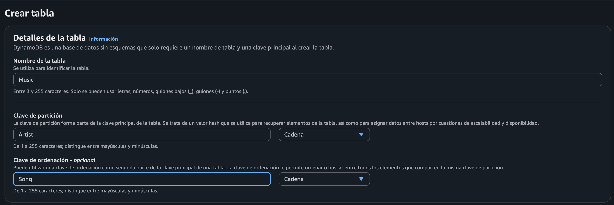 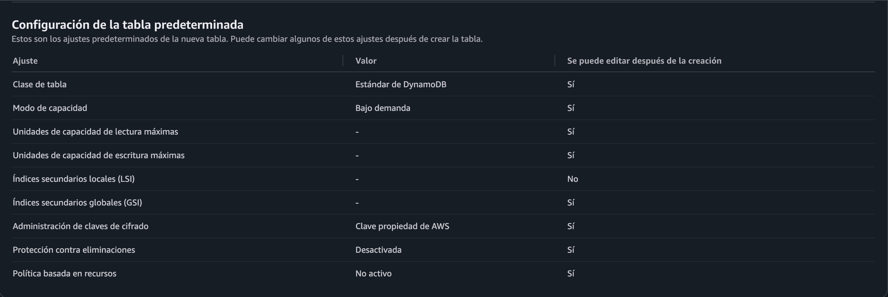 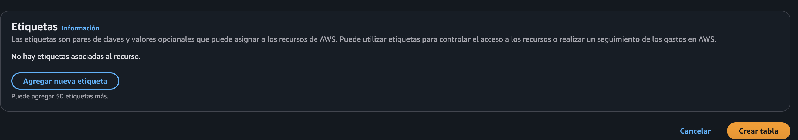 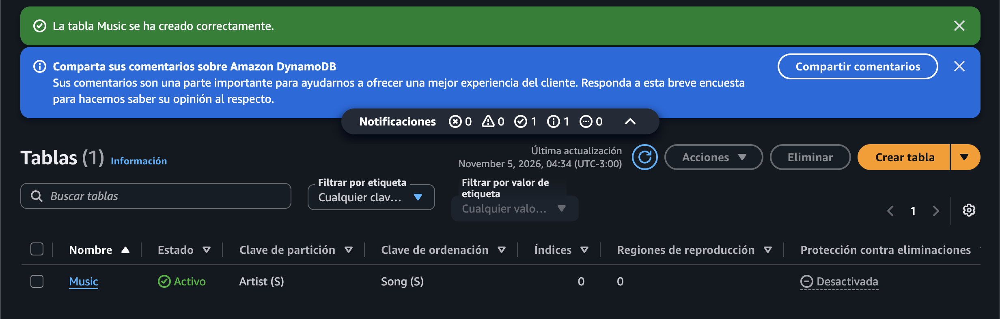 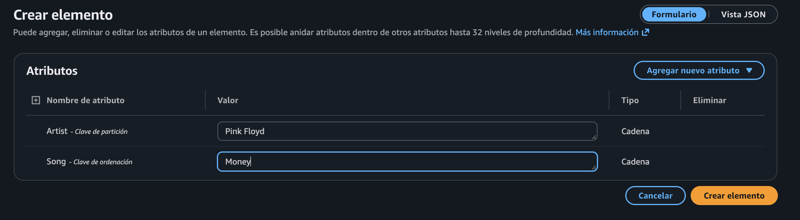 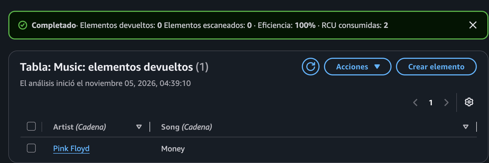  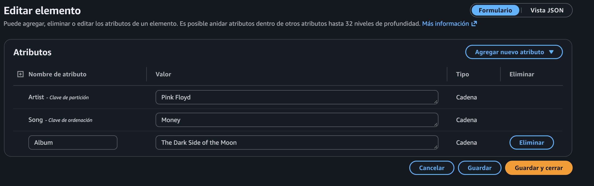 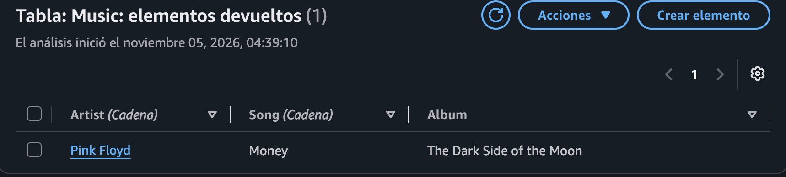 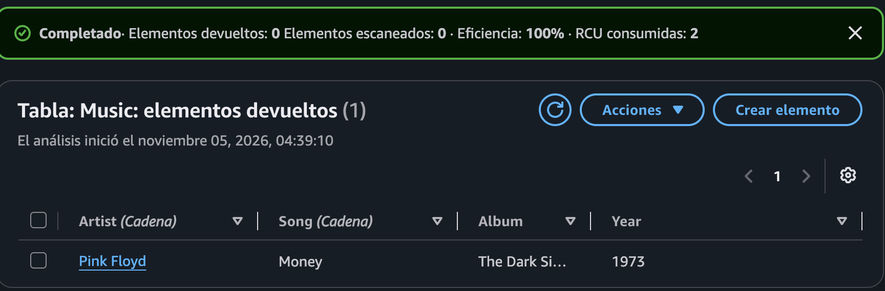 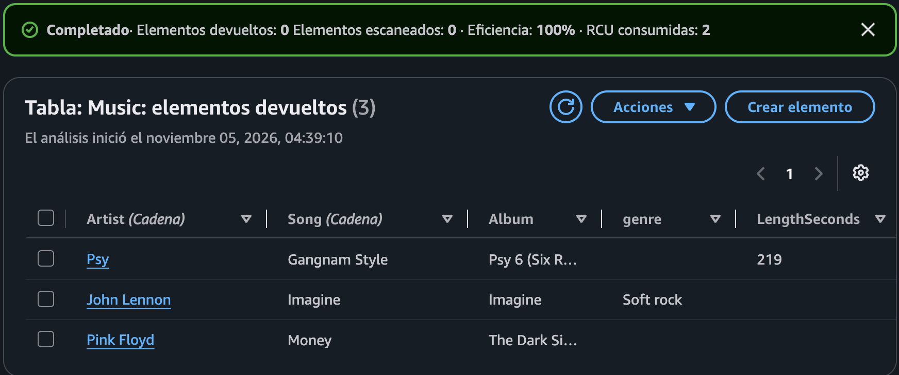 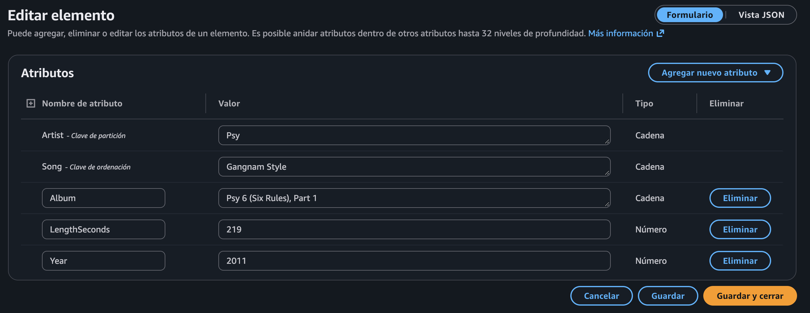 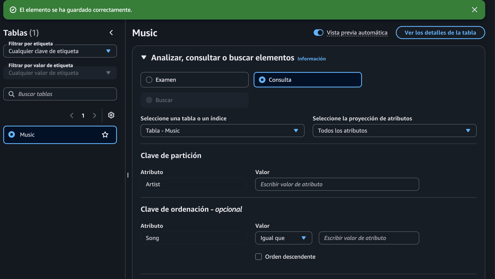 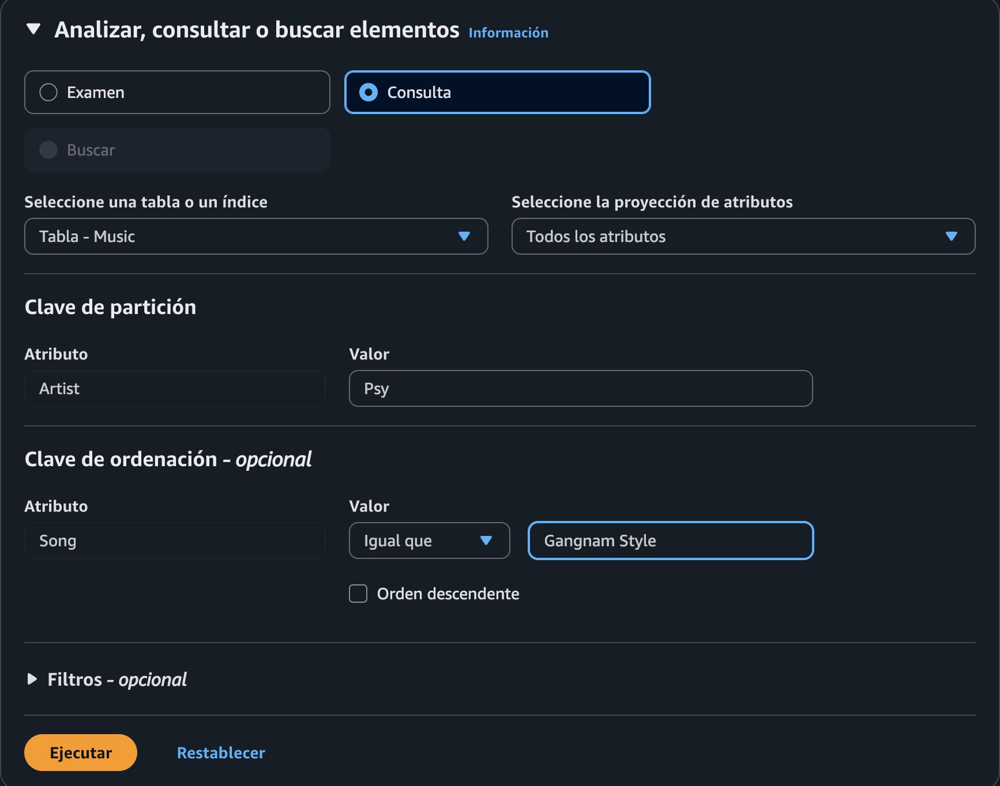 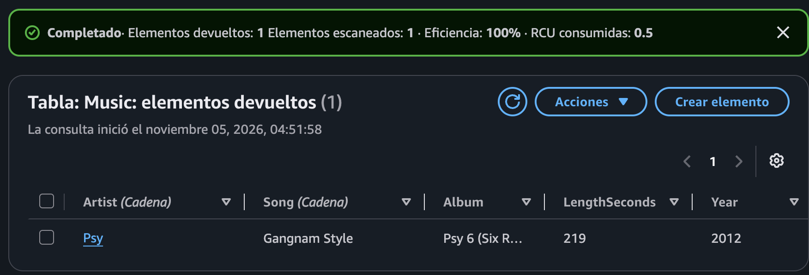 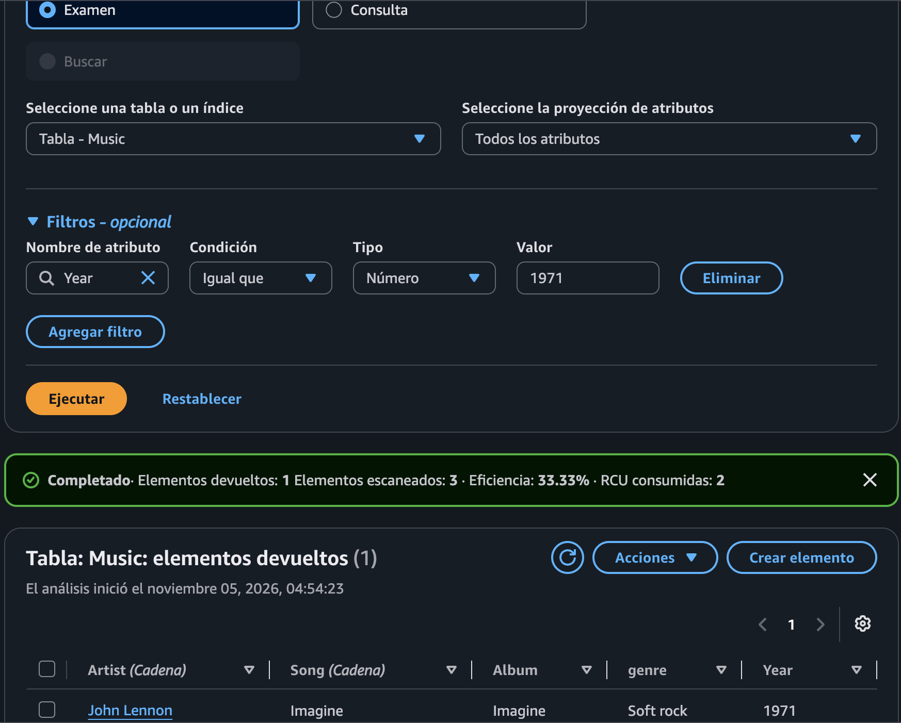 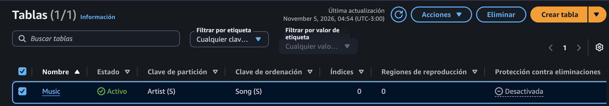 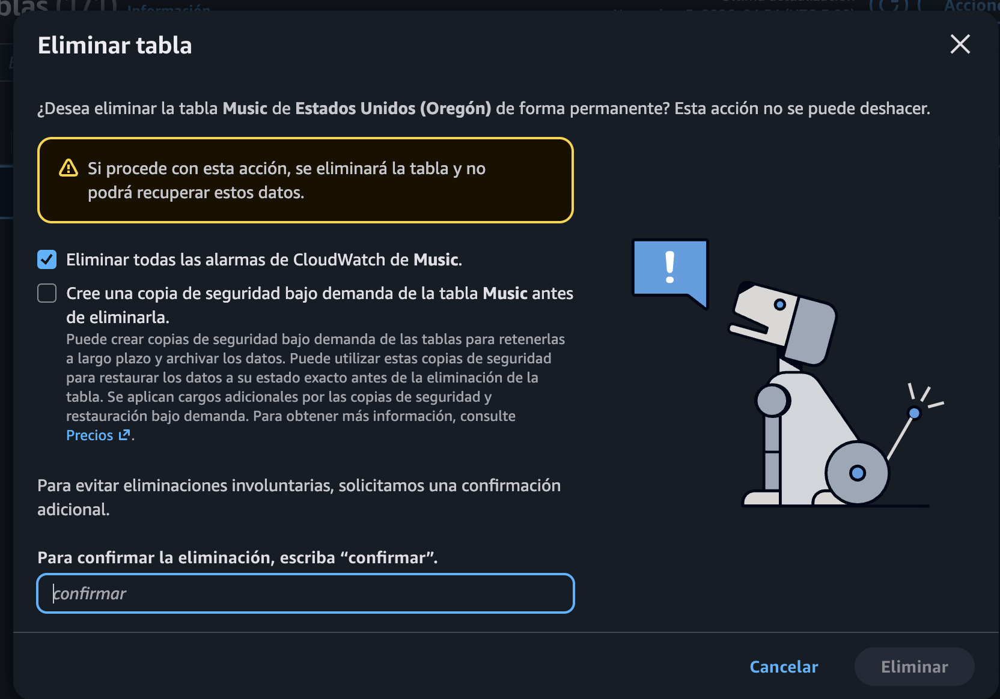  